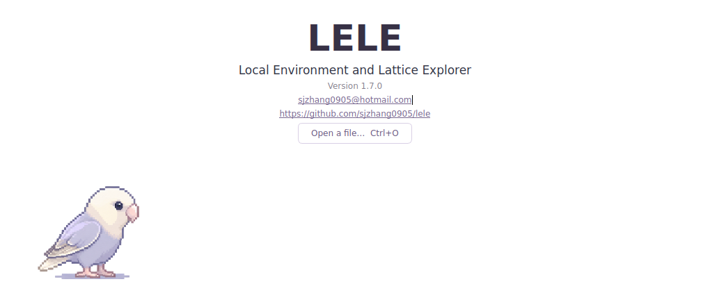
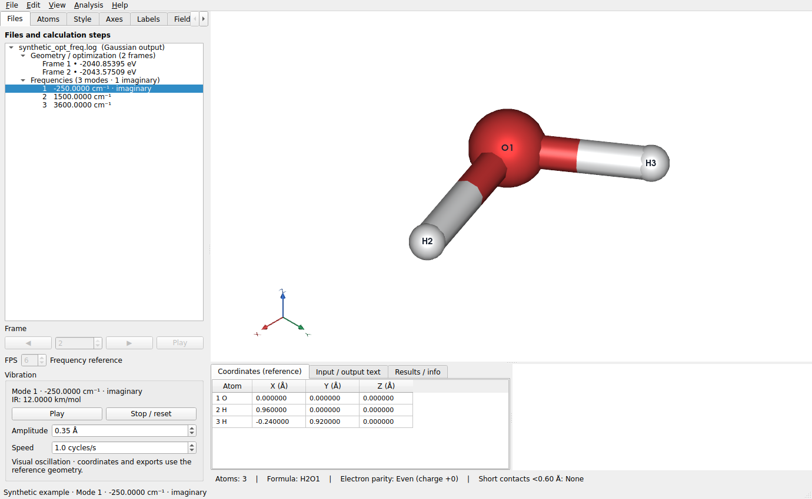

# LELE

**Local Environment and Lattice Explorer**

Version **3.5.5** also compacts lower-tab numeric inputs, including Boundary
ranges and high-precision isovalues, keeping them left-aligned as the panel grows.
See the [layout correction notes](docs/LAYOUT_v3.5.5_CN.md).

Version **3.5.4** fixes cell-sized CUBE isosurfaces missing from Boundary copies,
including mapped surface colors. Source fields remain unchanged. See the
[Boundary fix notes](docs/BOUNDARY_v3.5.4_CN.md).

Version **3.5.3** starts the sidebar at its existing minimum width and compacts
settings dropdowns and horizontal sliders. Expanded dropdowns still show the full
option text. See the [layout notes](docs/LAYOUT_v3.5.3_CN.md).

Version **3.5.2** recognizes renamed CHGCAR files by their structure and grid
content, and accelerates VASP scalar-field loading. See the
[fix and performance report](docs/CHGCAR_v3.5.2_CN.md).

Version **3.5.1** accelerates application startup, large CUBE grids and long AIMD
trajectories while retaining every frame and the existing numeric precision.
See the [performance and validation report](docs/PERFORMANCE_v3.5.1_CN.md).

Version **3.5.0** adds independent display styles for selected atoms, source-order
collapsed element groups with coordinate-row navigation, and NMR shielding tables
and referenced spectra. Axes / Labels / Field / Boundary move to the bottom left;
Coordinates / Input-output / Results move right. Crystal and Dipole are in View.
See the [Chinese guide](docs/FEATURES_v3.5.0_CN.md) and
[validation](docs/VALIDATION_v3.5.0.md). The v3.4 ESP/isosurface features remain included.

Version **3.4.0** adds cross-dataset isosurface overlays and scalar color mapping
(e.g. imported ESP on an electron-density surface), with color scales, project
persistence and PNG/GIF export. It also fixes all three independent v3.3.0
acceptance findings. See the [Chinese usage guide](docs/FEATURES_v3.4.0_CN.md)
and [validation](docs/VALIDATION_v3.4.0.md).

Version **3.1.0** gives **Atoms** a separate **Occupancy %** column and lists
each mixed-site element in its own group. Mn 0.5 / Sn 0.5 appears as a Mn row
at 50% and a Sn row at 50%, sharing the same site coordinates; ordinary sites
show 100%. The former bracketed composition text is removed from atom names.
See the [usage and validation](docs/VALIDATION_v3.1.0.md).

Version **3.0.4** makes edited mixed sites explicit in Atoms and the coordinate
table, includes minority elements in the colour selector, and asks whether to
use the highest-occupancy element when exporting to POSCAR, XYZ or GJF.
The conversion affects only the export copy; CIF retains the full occupancies.
See the [usage and validation](docs/VALIDATION_v3.0.4.md).

Version **3.0.3** adds a right-click **Element / occupancy** editor for one
atomic site, including multiple elements and an implicit vacancy fraction.
Mixed/partial sites retain their occupancies in CIF and saved projects;
POSCAR, XYZ and GJF exports require an explicitly ordered structure.
See the [usage and validation](docs/VALIDATION_v3.0.3.md).

Version **3.0.2** adds selected-atom label/index buttons in **Atoms**, VESTA
element colours and inclusive images of atoms on cell faces, edges and corners.
New structures start with their own enabled one-cell Boundary. SIESTA ionic
energies are matched by move and available in the energy curve/results view.
See the [usage and validation](docs/VALIDATION_v3.0.2.md).

Version **3.0.1** keeps OUTCAR Step labels stable, opens multi-frame files at
their last available structure, and enables Boundary display by default.
See the [fix validation](docs/VALIDATION_v3.0.1.md).

Version **3.0.0** defaults PNG saving to **4× resolution with Smooth edges**.
See the [release validation](docs/VALIDATION_v3.0.0.md).

Version **2.13.6** fixes both corner-axis acceptance findings: complete XYZ/abc
letters in the live canvas and consistent axes in high-resolution smooth PNGs.
See the [fix validation](docs/VALIDATION_v2.13.6.md).

Version **2.13.5** sets default Ball and stick bond thickness to 7, enlarges
Default-palette H display radii by 15%, and adds another 5% white to the palette.
Save PNG now offers resolution and edge-smoothing controls, defaulting to 3×
output with smoother geometry and annotations. See the [guide and validation](docs/VALIDATION_v2.13.5.md).

Version **2.13.4** renames the default atom palette to **Default**, mixes 10%
white into its element colors, and reduces the initial atom size to 50% and
bond thickness to 9. See the [validation](docs/VALIDATION_v2.13.4.md).

Version **2.13.3** keeps the footer and canvas height stable when selection
measurements appear or disappear, and uses a pure white (#FFFFFF) default
background. See the [validation](docs/VALIDATION_v2.13.3.md).

Version **2.13.2** fixes the full-acceptance PQR and CUBE findings. PQR reads
whitespace fields (optional chain IDs) and fixed-column records consistently;
CUBE shares one Bohr/Angstrom header normalization path for atoms and grids,
including negative grid counts. See the [fix details](docs/FIX_PQR_CUBE_v2.13.2_CN.md)
and [validation](docs/VALIDATION_v2.13.2.md).

Version **2.13.1** fixes all five delta-acceptance findings: skew-cell CIF face
coordinates, precise occupancy round trips, atom identity after additions,
duplicate POSCAR species blocks, and original mixed-site CIF component row order.
See the [fix details](docs/FIX_DELTA_v2.13.1_CN.md) and [validation](docs/VALIDATION_v2.13.1.md).

Version **2.13.0** uses the supplied **Sibyl.tcl** palette and **Glossy** lighting
by default, simplifies the welcome page, and automatically shows periodic **abc**
or molecular **XYZ** axes. Every structure export preserves the current atom
order, with added atoms appended in addition order, including the legacy
converter. See the [guide](docs/FEATURES_v2.13.0_CN.md) and [validation](docs/VALIDATION_v2.13.0.md).

Version **2.12.1** fixes all seven v2.12.0 acceptance findings: symmetry-equivalent
CIF occupancies, POSCAR selective-dynamics flags and atom order, cross-frame atom
identity, unchanged and small vacuum spacing, automatic footer alignment and
explicit-identity Chemcraft CIF input. See the [fix details](docs/FIX_A1_B4_v2.12.1_CN.md)
and [validation](docs/VALIDATION_v2.12.1.md).

Version **2.12.0** displays fractional CIF occupancies as colored site sectors,
adds right-click atom reindex/swap and fixed-coordinate slab-vacuum editing,
aligns the summary footer with the coordinate pane, and uses a green dashed
selection silhouette. See the [guide](docs/FEATURES_v2.12.0_CN.md) and [validation](docs/VALIDATION_v2.12.0.md).

Version **2.11.0** reorients periodic structures with a proper rotation of both
coordinates and lattice. Use **Edit → Reorient complete structure / crystal…**
to set origin/X/Z together or paste the analyzer script's row-vector matrix.
Nearest-image centering, volume grids, image bonds, undo and projects follow
the same transform. See the [guide](docs/FEATURES_v2.11.0_CN.md) and [validation](docs/VALIDATION_v2.11.0.md).

Version **2.10.1** fixes the independent acceptance findings: QE optimization
convergence now requires explicit success; CP2K cell and coordinate repetitions
are independent; `ANGLES` and explicit angle units preserve oblique cells.
See the [fix details](docs/FIX_A1_A3_v2.10.1_CN.md) and [validation](docs/VALIDATION_v2.10.1.md).

Version **2.10.0** extends QE PW input/vc-relax results, PHONON frequencies and normalized
matdyn modes, with explicit reference association and q-phase-aware periodic animation.
See the [QE guide](docs/FEATURES_v2.10.0_CN.md) and [validation](docs/VALIDATION_v2.10.0.md).

Version 2.9.0 uses Chemcraft's GaussView-style compatibility palette, Chemcraft
ordinary pair-distance limits, and selectable VESTA space-filling radii (Atomic
at 100% by default). See [sources and compatibility limits](docs/display_reference_data.md).
See the [2.9.0 guide](docs/FEATURES_v2.9.0_CN.md) and [validation](docs/VALIDATION_v2.9.0.md).

Version 2.8.0 imports CP2K/Molden `.mol` normal modes, including frozen-atom zero
vectors, animation, arrows and GIF export. **View → Atom legend…** now opens a
separate legend-only canvas with its own PNG export; the main-canvas overlay is removed.
See the [2.8.0 guide](docs/FEATURES_v2.8.0_CN.md) and [validation](docs/VALIDATION_v2.8.0.md).

Version **2.7.0** audits long multistep imports across supported output formats,
adds delayed progress to data processing/exports/projects, marks converged optimization
frames, and adds **View → Atom legend** (also in PNG/GIF). The welcome page now lists
both contact emails. See the [2.7.0 guide](docs/FEATURES_v2.7.0_CN.md) and
[validation](docs/VALIDATION_v2.7.0.md), including CP2K vibrational output file organization.

Version **2.6.0** adds editable distance/angle/dihedral values, effective bond-cutoff
controls (0.10–5.00), a lower compact footer and faster ORCA optimization loading.
Scientific outputs load in a cancellable background worker; long loads show the
current phase, its percentage and elapsed time. See the
[2.6.0 guide](docs/FEATURES_v2.6.0_CN.md) and
[validation](docs/VALIDATION_v2.6.0.md).

Version **2.5.0** removes the application frame-count cap and speeds up long
trajectories. Native CP2K/plain XYZ and XDATCAR readers stream coordinate blocks;
output analyses share decoded text within one load. The Files tree expands long
sequences on demand, and large scientific files parse in the background with
cancellation. All frames and energy records remain available. See the
[long-file guide](docs/FEATURES_v2.5.0_CN.md) and
[validation and benchmarks](docs/VALIDATION_v2.5.0.md).

Version **2.4.0** adds independent CP2K input/restart, stdout and XYZ trajectory
readers. View inline structures, printed FORCE_EVAL energies, optimization
criteria, final orbital tables separated by k point/spin, and TDDFPT spectra/CSV.
No companion files are required or searched. See the
[CP2K guide](docs/FEATURES_v2.4.0_CP2K_CN.md) and
[validation record](docs/VALIDATION_v2.4.0.md).

Version **2.3.1** uses only VASP **E0** (OSZICAR E0= / OUTCAR σ→0) in
results, curves and CSV. Missing E0 stays unavailable. See the
[energy-policy and validation notes](docs/VASP_E0_v2.3.1_CN.md).

Version **2.3.0** adds element-pair bond/coordination rules, quantitative
polyhedron analysis with trajectory curves/CSV, and portable **.lele projects**.
Use **Crystal → Pair rules**, **Analysis → Coordination / polyhedron analysis…**,
and **File → Save/Open project…**. Projects restore loaded structures/results,
edited bonds, atom appearance, per-file cameras, HKL cuts and display settings.
See the [2.3.0 guide](docs/FEATURES_v2.3.0_CN.md) and
[validation record](docs/VALIDATION_v2.3.0.md).

Version **2.2.0** adds Miller **(hkl) display cuts** and a **Polyhedral** style.
Use **Crystal → HKL planes** for signed offsets in d/Å, one-sided cuts, slabs,
multiple-plane intersections and normal views. Use **Crystal → Polyhedra** to
choose centers, ligands, distance rules, translucent faces and edges. Periodic
coordination shells are completed across cell boundaries. Source structures
and manually edited ordinary bonds retain their existing behavior.
See the [2.2.0 guide](docs/FEATURES_v2.2.0_CN.md) and
[validation record](docs/VALIDATION_v2.2.0.md).

Version **2.1.0** adds independent VASP OUTCAR, XDATCAR and OSZICAR readers.
Open optimization/MD structures, energy-only results or geometry-only
trajectories without companion files. VASP normal modes retain imaginary
frequencies, their own reference structure and mass-corrected animation.
View ionic E0 energies and export them to CSV (E0-only policy since 2.3.1).
See the [2.1.0 guide](docs/FEATURES_v2.1.0_CN.md) and
[validation record](docs/VALIDATION_v2.1.0.md).

Version **2.0.3** adds **Ctrl+H** to draw/remove a dashed hydrogen bond between
two selected atoms, independently of ordinary **Ctrl+B** bonds, with undo.
Each open file now retains its camera, colours and complete display settings
when switching files, including frequency and energy-only tree entries.
See the [2.0.3 guide](docs/FEATURES_v2.0.3_CN.md) and
[validation record](docs/VALIDATION_v2.0.3.md).

Version **2.0.2** fixes periodic-image searches for non-reduced skew cells,
translates aligned cell outlines together with atoms (including Boundary), and
removes an obsolete version from the Windows startup error. Geometry edits now
preserve existing bonds. Use **Ctrl+B** for explicit bond changes or
**Edit → Rebuild bonds from distances** to request a fresh distance-based graph.
See the [2.0.2 guide](docs/FEATURES_v2.0.2_CN.md) and
[validation record](docs/VALIDATION_v2.0.2.md).

Version **2.0.1** simplifies the footer, adds clickable short-contact counts
with atom-pair/distance and periodic-image details, and shows periodic cell
volume in Results / info. See the [2.0.1 guide](docs/FEATURES_v2.0.1_CN.md).

Version **2.0.0** adds selection-driven normal-mode analysis, multi-parameter
geometry curves with frame navigation, and reversible trajectory display
alignment, including aligned GIF export. Energy-only xTB records now appear
individually in the Files tree; selecting one shows its energy without inventing
a structure. Use **Find vibrations…**, **Geometry curves…** and **Align trajectory
for display** in Files or Analysis. See the [2.0.0 guide](docs/FEATURES_v2.0.0_CN.md).

Version 1.11.1 loads geometry and calculation results independently. Energy-only
xTB files show results and curves without a 3D view or placeholder frame;
geometry-only files retain navigation with energy/curve controls unavailable.
Companion files are optional. See the [1.11.1 guide](docs/FEATURES_v1.11.1_CN.md).

Version 1.11.0 added xTB/g-xTB geometry optimization, verified trajectory
companions, energy curves/CSV and on-demand HOMO/LUMO. Printed frontier labels
take precedence for fractional occupations; alpha/beta results remain separate.
See the [1.11.0 guide](docs/FEATURES_v1.11.0_CN.md).

Version 1.10.0 added ORCA NEB/NEB-TS path snapshots and image histories,
stage-specific optimization and Hessian results, GOAT ensemble populations and
aligned RMSD, and complex SOC couplings, mixed states and corrected absorption.
Use the **NEB / GOAT / SOC…** button in Files or the Analysis menu.
See the [1.10.0 guide](docs/FEATURES_v1.10.0_CN.md) for companion files and scope.

The 1.9.0 on-demand HOMO/LUMO button, selection measurements beside Short
contacts, and common ORCA 4/5/6 summaries, orbitals, spectra, dipoles and
printed orbital contributions remain available.

LELE is a desktop workbench for visualizing and editing molecular and periodic
structures, inspecting calculation outputs, and exploring atomic environments.
Version **2.6.0** retains the restored 1.4/1.5 feature set on top of the real periodic
supercell feature from 1.6.0: improved GIF quality, file-relative save paths,
camera-facing axis letters, molecular/periodic energy display units, Gaussian/ORCA
IR/Raman/UV-Vis spectra, typed dipole arrows and CSV exports, bond filtering,
cross-file atom copy/paste, rectangle selection and Boundary display ranges.
It retains Gaussian Opt+Freq results and precise scientific isovalue entry.
It includes an element-grouped Atoms sidebar with individual colour,
visibility, transparency and label controls, and a compact two-column lower
inspector. The welcome window appears first and automatically preloads the
scientific backend. The project uses the MIT License and retains the parrot
animation, X/Y/Z views, grouped menus and on-demand plane fitting.

The original 1.4/1.5 source files were unavailable; their features have been
reimplemented and verified in this version. See the
[restored feature guide](docs/RESTORED_FEATURES_v1.7.0_CN.md) and
[supercell guide](docs/SUPERCELL_CN.md).

In 1.7.1, **Ctrl+G** automatically builds an undoable real supercell when a
finite fragment crosses cell boundaries. Coordinates and atom IDs include every
new atom, and **Ctrl+I** inverts selection across the expanded structure.
**Ctrl+Z** restores the original frame and attached field. See the
[fragment-selection fix](docs/FIX_PERIODIC_FRAGMENT_v1.7.1_CN.md).

Version 1.7.2 fixes bottom-left axis letters, fixed-width arrows, editable
dipole scales and excited-state labels. **Ctrl+Shift+B** toggles transparent,
dashed box selection; **Esc** exits. Boundary now repeats complete unit cells:
0–2, 0–2, 0–1 shows four original-sized cells with all atoms and internal edges.
See the [display-controls guide](docs/DISPLAY_UPDATES_v1.7.2_CN.md).

[中文说明](README_CN.md) · [Changes](CHANGELOG.md) · [License](LICENSE) · [Development and releases](docs/GITHUB_PREPARATION_CN.md)

Repository: [sjzhang0905/lele](https://github.com/sjzhang0905/lele)

Contact: [sjzhang0905@hotmail.com](mailto:sjzhang0905@hotmail.com)

## Current features

- A white startup page with the application name, version, shortcut reference
  and 乐乐 walking across the canvas; poses change every 0.8 seconds.
  The contact email appears immediately below the version and can be copied
  or clicked to open an email application. A selectable GitHub link below the
  email opens the project repository in a browser.

- Structure import and conversion through the bundled ChemStructConverter
  backend and ASE, including XYZ, Gaussian inputs, CIF and POSCAR.
- Native VTK rendering with nine appearance presets, editable element colours,
  saved custom styles, atom labels, unit cells and XYZ/abc axes.
- An element-grouped Atoms sidebar with individual or batch visibility,
  colour, transparency and label/index/custom-text controls, including undo.
- A compact editable coordinate table in the left half of a resizable lower
  inspector, with a blank right half reserved for future content.
- Atom selection, fragment selection, inversion, deletion and undo.
- Coordinate editing, distances, angles, dihedrals and fragment transforms.
- Preserve connectivity while moving/editing atoms; undo restores both geometry
  and bonds. Copy/paste and supercell construction retain the source graph.
- Ctrl+H toggles a manually drawn dashed hydrogen bond between two atoms;
  manual links remain separate from covalent fragment connectivity.
- Per-file camera and display settings persist while switching open files
  within the current session, including view angle, zoom, pan and projection.
- On-demand least-squares planes from three or more selected atoms, with optional
  periodic images and rigid alignment of the structure and cell to XY.
- Frame navigation and playback for supported trajectories, including SIESTA
  output/ANI histories, and energy curves when corresponding energies exist.
- xTB/g-xTB optimization stdout and Xmol trajectories, source total energies,
  clickable energy curves/CSV, and printed HOMO/LUMO including fractional and
  separate alpha/beta tables. Unmatched energy-only cycles remain visible.
- ORCA NEB/NEB-TS stages, path snapshots, fixed-image histories and Hessian
  provenance, with geometry matching and sequence-specific playback/GIF export.
- GOAT conformer energies, printed/recalculated populations, temperature controls,
  same-order aligned RMSD, conformer selection and CSV export.
- SOC complex components and heatmaps, mixed-state compositions and printed
  SOC-corrected absorption, kept separate from spin-free excitation results.
- Gaussian geometry/optimization and frequency groups in the same Files tree,
  including imaginary modes, IR intensities and vibration animation controls.
- Total atom count, cell composition/formula, charge-aware electron parity, geometric hydrogen-bond
  candidates and short-contact diagnostics.
- Signed CUBE isosurfaces, PNG screenshots and structure export.
- GIF export for trajectories or the selected vibration mode, including frame
  range, FPS, resolution, amplitude and cycle duration controls.

Trajectory and energy availability depend on the input format and reader.
Initial distance-based bonds and hydrogen-bond candidates are geometric display aids.
After a geometry edit, bonds remain fixed until an explicit bond command.
Edits affect the active frame; use structure export to save edited coordinates.

See the [Atoms sidebar and lower-panel guide](docs/ATOM_CONTROLS_CN.md) for the
per-atom controls, frame scope and a UI preview. Display overrides are session
settings and are not written to exported XYZ/POSCAR/CIF files.

## Welcome canvas

Starting without files shows the welcome page and an empty Files tree. Use
**Open a file**, **Ctrl+O**, or drop files into the window. A successfully
loaded file switches to the 3D view and data inspector; a failed or cancelled
open leaves the welcome page visible. Command-line file arguments open
automatically after the window appears and preloading finishes.

The welcome window and its settings load without NumPy, SciPy, ASE or VTK.
Immediately after the welcome header is painted, a background thread preloads
the core scientific libraries and readers automatically. The full ASE format
registry, SciPy spatial analysis and image-export dependencies load on demand.
The GUI thread then prepares
the hidden 3D canvas and the status bar shows Ready. The welcome animation and
menus remain active during imports. Files chosen while loading are queued and
open when ready; display settings carry over. Rebuild the Windows executable
with `build_windows.bat` to apply this startup optimization.

The supplied artwork is kept in `lele/assets/lele_walk.png`. The first four
poses form the gait: **standing → left leg → standing → right leg**, repeated.
The trailing standing pose is omitted to avoid a double standing frame at
the cycle boundary. Poses are mirrored at display time so the bird faces right.
Each pose lasts **800 ms**;
the pose and horizontal position change together in a single jump. Between
frames the bird stays completely still. A **25.6-second** left-to-right pass
contains eight complete four-frame gaits and repeats while the page is visible.
The overhead name badge has been removed;
the caption “Meet 乐乐 · LELE's little explorer” remains below the animation.
The animation stops when the page is hidden.
The shortcut columns reflow and the page scrolls on smaller windows.



## Planned extensions

The following are planned and are **not integrated in this release**:

- Surface, carbon-material and heterostructure builders from the author's tools.
- Expanded transformation-matrix and structure-processing utilities.
- Automated AIMD analysis, scientific plotting and SVG figure export.

## Run on Windows

Use **64-bit CPython 3.12** (recommended) or **3.11**.

1. Clone this repository, or extract its complete source archive.
2. Double-click `start_windows.bat` to create `.venv`, install dependencies and
   launch LELE.
3. Confirm that the title displays
   `LELE 2.6.0 - Local Environment and Lattice Explorer`.

To build an executable, run `build_windows.bat` after the first successful
launch. The result is `dist/LELE/LELE.exe`. Distribute the complete `dist/LELE`
directory, including `_internal`, `LICENSE` and `SOURCE_NOTICE.md`.

Both `build_windows.bat` and the Windows GitHub Actions build embed
`lele/assets/lele.ico` into the executable. The icon uses the first standing
pose, facing right on a transparent background, with sizes from 16 to 256 px.
The application window uses the same icon. Rebuild the executable to apply
the change; replacing source files does not alter an already-built EXE.

## Install from source

From the project directory, in a Python 3.11/3.12 environment:

```bash
python -m pip install -e ".[test]"
python -m lele
```

Installation also provides the `lele` GUI entry point. Open files by passing
their paths, for example `python -m lele examples/water.xyz`.

## Quick example

Open `examples/selection_plane_demo.POSCAR` and select the first four Cu atoms.
In the left **Edit** tab, click **Fit selected plane**, then **Align fitted
plane to XY**. Merely selecting atoms does not calculate or show a plane.
Changes to selection, fitted coordinates, cell or periodic-image option clear
the previous fit; click the fit button again to regenerate it. Use **Ctrl+I**
to select the remaining O atom, **Delete** to remove it, and **Ctrl+Z** to restore it.

## Gaussian optimization and frequencies

Open a Gaussian `.log` or `.out` containing optimization and frequency results.
The **Files** tree shows **Geometry / optimization** and **Frequencies** groups.
Select a frequency to start its vibration animation; negative frequencies are
marked **imaginary**. Use **Pause**, **Stop / reset**, **Amplitude** (maximum
atom displacement in Å) and **Speed** (visual cycles/s) below the tree. Up/Down
also selects modes. **Analysis → Vibrational frequencies** opens the first mode.

Each frequency calculation uses its own printed reference geometry/orientation,
including multiple Link1 jobs. The coordinate table and structure export use
that reference; select an optimization frame to edit coordinates. Animation
does not alter geometry history. Modes with missing or incomplete Cartesian
displacements remain listed with animation disabled.

Try `examples/synthetic_opt_freq.log`, which contains clearly labelled artificial
test data. See the [Gaussian vibration guide](docs/GAUSSIAN_VIBRATIONS_CN.md).



## Save animation GIF

Choose **File → Export animation GIF…**. Export **Geometry / optimization
trajectory**, or select a frequency first and export **Current vibration**.
The dialog provides output width, FPS and looping. Trajectories also offer
first/last frames, stride and forward/backward playback; vibration export
offers amplitude and the duration of one full cycle.

GIFs contain the 3D view using the current camera, colours and labels. The
height follows the canvas aspect ratio. Export preserves source coordinates,
the live view and playback state; cancellation leaves existing files intact.
See the [GIF export guide](docs/GIF_EXPORT_CN.md).

## Exact isovalue entry

Under **Field → |Isovalue|**, select the number and type a decimal such as
`0.01234567` or scientific notation such as `1.25e-5`. Press **Enter**, click
**Apply**, or leave the field to update. Intermediate keystrokes do not rebuild
the surface. Up to 12 decimal places and values from `1e-12` to `10000` are
supported; arrows retain their `0.005` step.

## Menus and views

| Menu | Commands |
|---|---|
| File | Open, export structure, save PNG, export animation GIF |
| Edit | Undo, fragment selection, invert/clear selection, delete atoms, toggle bonds, fit/align plane |
| View | Fit to window, isometry, X/Y/Z axis views, orthographic/perspective projection |
| Analysis | Calculation overview, HOMO/LUMO, energy/convergence curves, frequencies, spectra, NEB/NEB-TS, GOAT, SOC, Hessian history |
| Help | Help and shortcuts |

The X/Y/Z views look from the positive axis toward the structure. They change
only the camera. Projection choices keep the current viewing direction, and
existing keyboard shortcuts remain available without opening a menu.

The bottom summary keeps the total atom count before the composition/formula,
then shows **Electron parity: Odd/Even** without a total electron number.
The net charge comes from the active frame or the **Net charge** input in
the Edit tab. Unknown charge is explicitly treated as neutral.

## Tests and Windows builds

```bash
python -m pytest tests -q
```

Linux off-screen test runs use `QT_QPA_PLATFORM=offscreen` and
`VTK_DEFAULT_OPENGL_WINDOW=vtkEGLRenderWindow` with a compatible VTK build.

GitHub Actions definitions are included for Linux tests and a manually
triggered Windows build. The Windows workflow uploads `LELE-windows-x64` as a
workflow artifact; it does not publish a release. Test runs triggered by a push
or pull request are listed in the repository’s Actions tab. The Windows build
is started separately using Windows executable → Run workflow.

See `docs/VALIDATION_v1.11.1.md` for the current local checks and their limits.

## Appearance settings

LELE uses the Qt application configuration directory under the stable
application name `LELE`. On first use, valid saved styles from known
ChemViewStudio/legacy launcher directories are copied into LELE's directory.
Existing LELE settings take priority and the original files are retained.

## Project history and notices

Earlier release notes and validation records are kept in `docs/history` under
their original project name. The bundled conversion backend retains its
ChemStructConverter name and attribution.

LELE's original source code, documentation, assets and author-distributed
binaries use the **MIT License** from version 1.0.1. See [LICENSE](LICENSE).
Third-party components retain their own licences and copyright notices;
see [SOURCE_NOTICE.md](SOURCE_NOTICE.md).

The earlier binary-only licence is archived under `docs/history` as historical
text and does not apply to version 1.0.1 or later.
