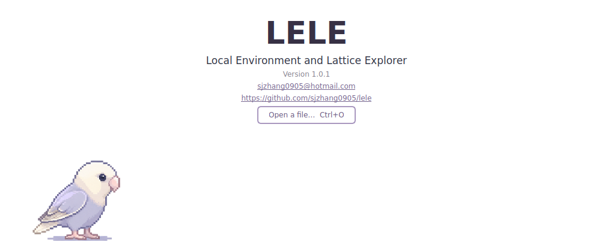

# LELE

**Local Environment and Lattice Explorer — 局域环境与晶格探索工具**

当前版本：**1.0.1**。项目采用 **MIT 协议**。欢迎页版本号下显示可复制、可点击的联系邮箱 `sjzhang0905@hotmail.com` 及仓库地址；采用四帧步态循环，底部保留电子奇偶性但不显示电子总数，Windows EXE 与窗口使用站立鹦鹉图标。顶部分类菜单、X/Y/Z 视角和手动拟合平面继续保留。Python 包名为 `lele`，Windows 程序名为 `LELE.exe`。

## 当前功能

- 启动时显示纯白欢迎页：LELE、英文全称和版本号，横向走动的“乐乐”，以及快捷键说明。

- 分子、晶体、计算输入和输出的结构读取与格式转换，沿用 ChemStructConverter 后端及 ASE。
- 九种显示风格、自定义元素颜色、预设保存、标签、晶胞和 XYZ/abc 坐标轴。
- 多选、片段选择、反选、删除、撤销和坐标编辑；距离、键角和二面角测量。
- 选中三个及以上非共线原子后，点击 `Fit selected plane` 才拟合并显示平面；支持周期镜像和将完整结构、晶胞及附带网格刚性对齐到 XY。
- 支持的轨迹文件逐帧浏览和播放，包括 SIESTA 输出/ANI 历史；有相应能量数据时绘制能量曲线。
- 原子总数、晶胞组成/分子式、考虑净电荷的电子奇偶性、几何氢键候选、短距离检查、CUBE 正负等值面和 PNG 截图。

轨迹帧数、能量等内容取决于文件本身及读取器。结构编辑只作用于当前帧；保存修改后的坐标请使用 `Export structure`。

## 欢迎页与乐乐

未指定文件启动时，左侧 Files 列表保持为空，中央显示完整的白色欢迎页。点击 `Open a file`、按 `Ctrl+O` 或把文件拖入窗口即可开始；成功读取后自动显示三维画布和坐标表，取消打开或读取失败时保留欢迎页。通过命令行指定结构文件时直接进入结构视图。

欢迎页从上到下分为三部分：

1. **LELE / Local Environment and Lattice Explorer / Version 1.0.1**，版本号正下方显示 **sjzhang0905@hotmail.com**。邮箱可选择复制，点击可打开系统邮件客户端；邮箱下方显示可点击、可复制的仓库地址 **https://github.com/sjzhang0905/lele**。
2. **鹦鹉“乐乐”**：从原始帧图中使用前四帧，以“**站立→左腿→站立→右腿**”重复，不再使用末尾多余的站立帧。每 **0.8 秒**姿态与横向位置同步瞬间切换，帧间保持不动；四帧步态周期为 **3.2 秒**，每 **25.6 秒**完成八个完整步态周期、横穿画布并重新从左侧开始。
3. **目前已支持的快捷键**，按文件编辑、原子与片段、鼠标与导航分组。

鹦鹉头顶不再显示“乐乐”名牌。画布下方保留 `Meet 乐乐 · LELE's little explorer`。中文采用系统字体回退。

小窗口自动减少快捷键列数，并允许纵向滚动；欢迎页隐藏后停止动画。原始帧图随源码、wheel 和 Windows 打包一起包含，无需额外下载或安装 GIF 组件。



## 后续规划

表面、碳材料和异质结构构建，更多旋转矩阵工具，以及 AIMD 自动分析、科学绘图和 SVG 出图属于后续开发内容，**本版尚未集成**。

## Windows 启动与打包

1. 使用 64 位 Python 3.12，或 3.11，解压完整源码目录。
2. 双击 `start_windows.bat`，自动建立环境、安装依赖并启动。
3. 窗口标题应为 `LELE 1.0.1 - Local Environment and Lattice Explorer`。
4. 首次成功启动后，可运行 `build_windows.bat`。新程序位于 `dist\LELE\LELE.exe`，分发时保留整个 `dist\LELE` 文件夹及其 `_internal`、`LICENSE` 和 `SOURCE_NOTICE.md` 内容。

从已配置好的开发环境也可执行：

```text
python -m pip install -e ".[test]"
python -m lele
python -m pytest tests -q
```

`build_windows.bat` 与 GitHub Actions 的 Windows 构建均已指定 `lele/assets/lele.ico`。
图标取自欢迎动画的第一帧站立姿势，与动画一样朝右，透明背景，包含 16、24、32、48、64、128、256 像素版本；程序窗口使用相同图标。
**需要重新运行 `build_windows.bat` 才会生成带新图标的 EXE**；源码更新不会改写之前已经打包好的 EXE。本次源码包内已包含所需图标，无需另外转换或设置路径。

## 常用操作

| 操作 | 方式 |
|---|---|
| 打开结构 | Ctrl+O，或拖入文件 |
| 原子多选 | 三维画布逐个单击，或在坐标表选择多行 |
| 反选 | Ctrl+I |
| 删除选中原子 | Delete；输入框内仍用于删除文字 |
| 撤销结构编辑 | Ctrl+Z |
| 选中相连片段 | Ctrl+G |
| 切换选中原子之间的成键 | Ctrl+B |
| 拟合最佳平面 | 选择至少三个非共线原子，点击左侧 Edit 页或 Edit 菜单的 `Fit selected plane` |
| 沿 X/Y/Z 观察 | View → X / Y / Z，从相应正轴方向朝结构观察 |
| 导出结构 | Ctrl+Shift+S |
| 保存截图 | Ctrl+S，当前为 PNG |

## 菜单与底部统计

| 菜单 | 功能 |
|---|---|
| File | 打开文件、导出结构、保存 PNG |
| Edit | 撤销、选择片段、反选/清空选区、删除原子、切换成键、拟合平面及对齐到 XY |
| View | 适配窗口、等轴测、X/Y/Z 视角、Projection 正交/透视投影 |
| Analysis | 能量曲线 |
| Help | 帮助与快捷键 |

顶部不再为每个命令单独占用工具栏按钮，原有快捷键保持可用。X/Y/Z 仅改变观察方向，不修改原子坐标或晶胞；切换投影会保留当前观察方向。

底部统计示例：`Atoms: 5 | Cell composition: Cu4O1 | Electron parity: Even (assumed charge 0) | Short contacts <0.60 Å: None`。`Atoms` 是当前帧的原子总数，与选中数量无关；非周期结构显示 `Formula`。电子奇偶性显示为 `Odd`（奇数）或 `Even`（偶数），不显示电子总数。默认使用文件中的净电荷；未知电荷时明确标注 `assumed charge 0`。可在左侧 Edit 页修改 `Net charge` 来调整奇偶性判断。

只选中原子不会生成最佳平面。改变选区、参与拟合的坐标、晶胞或周期镜像选项后，旧平面会清除；再次点击 `Fit selected plane` 才重新生成。`Show fitted plane` 仅控制已经生成的平面是否可见，不会自动启动拟合。随后点击 `Align fitted plane to XY` 可将完整结构、晶胞和网格一同旋转，支持 Ctrl+Z 撤销。

本次检查结果与环境限制见 [v1.0.1 验证记录](docs/VALIDATION_v1.0.1.md)。

## 配置与版本历史

LELE 使用独立、固定的 Qt 应用配置目录。首次运行时会尝试从原 ChemViewStudio 或旧启动入口目录复制有效的显示预设；已有 LELE 配置优先，旧文件保留。

历史说明和旧验收结果已归档到 `docs/history`。转换后端继续使用 ChemStructConverter 的原名称。

## GitHub 准备

源码仓库为 [sjzhang0905/lele](https://github.com/sjzhang0905/lele)。本目录包含标准 Python 项目元数据、Git 忽略规则、换行规则，以及 GitHub Actions 测试和 Windows 打包定义。详细操作见 [开发与发布说明](docs/GITHUB_PREPARATION_CN.md)，实际工作流状态请在仓库的 Actions 页面查看。

## 许可

从 **1.0.1** 起，LELE 原创源码、文档、素材和作者分发的可执行程序采用 **MIT 协议**，见 [LICENSE](LICENSE)。第三方组件和依赖保留各自许可及版权声明，见 `SOURCE_NOTICE.md`。

旧的 binary-only 协议已归档至 `docs/history/BINARY_ONLY_LICENSE_pre_v1.0.1.txt`，仅供历史参考，不适用于 1.0.1 及以后版本。
