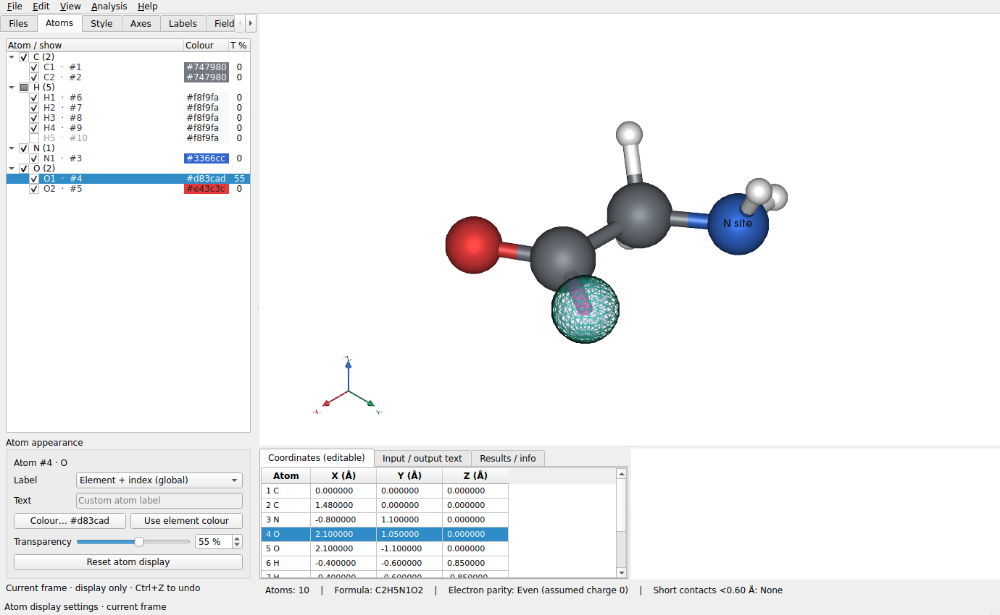

# 单原子显示与底部左右分栏

本功能随 LELE 1.1.0 提供，包含“先显示窗口、随后自动预加载”的启动方式。

## Atoms 标签页

在左侧选择 **Atoms**，原子按元素分组展开。行中的 `O1 · #4` 表示该元素列表中的第一个 O，
它对应原始坐标表的第 4 个原子。树的排列不改变结构中的原子顺序。

| 操作 | 控件 |
|---|---|
| 显示/隐藏单个原子 | 原子行左侧复选框 |
| 显示/隐藏某元素的全部原子 | 元素分组左侧复选框 |
| 单原子颜色 | 选中原子后点 `Colour…`，或双击颜色列 |
| 恢复全局颜色 | `Use element colour`，跟随 Style 中的元素颜色/调色方案 |
| 单原子透明度 | `Transparency` 滑块或百分比输入框；0% 不透明，100% 完全透明 |
| 单原子标签/编号 | `Label`：跟随全局、关闭、元素、全局编号、元素+编号、VESTA 编号 |
| 自定义标签 | `Custom text` 后在 `Text` 输入内容，按 Enter 或移出输入框应用 |
| 批量修改 | Ctrl/Shift 多选，或选中元素分组，再设置属性 |
| 恢复选中原子的默认显示 | `Reset atom display` |
| 撤销 | Ctrl+Z，整组修改作为一次操作撤销 |

多个原子的属性不同时，编辑区显示 `Mixed` 或空值；选取一个新值会统一应用到选中原子。
v1.8.0 起，颜色、透明度、显隐、标签和重置会同步到同文件原子序列一致的其他帧，包括匹配的振动参考构型；坐标、成键不传播。Ctrl+Z 撤销整次显示修改。
Atoms、坐标表与三维画布的选区同步。即使原子隐藏，也能从列表中选中并恢复显示。

透明度修改会立即应用到该原子的相连键及 Boundary 副本。
v1.8.0 起，整条键的不透明度为两端较低不透明度的平方，因此键比原子更快变透明；任一端完全透明或隐藏时，该键不显示。
比如原子设置 50% 透明、另一端不透明，相连键为 75% 透明。

单原子颜色优先于全局元素颜色和原子调色方案；未设置单原子颜色的原子继续跟随 Style。
选择 `Use global label setting` 时跟随 Labels 页；单独指定标签模式后，可在全局标签关闭时只显示指定原子的标签。
`VESTA (POSCAR groups)` 沿用原有 POSCAR 元素块编号规则。

隐藏或完全透明的原子不再绘制球体、标签、选择高亮或相连的键，也不参与画布点击拾取。
半透明原子的球体、标签和高亮使用对应的不透明度，相连键采用两端较小不透明度的平方。
周期性复制的原子沿用原原子的设置。隐藏不会删除原子，也不会改变原子总数、分子式、坐标或用于分析的成键图。

这些显示属性作用于当前帧，切换帧/文件不会串用；返回原帧时保留。删除原子后会重新对应幸存原子的设置，撤销可还原。
它们保存在当前会话的结构对象中，不写入 XYZ/POSCAR/CIF 等结构导出文件。

## 底部区域

底部划分为左右两栏，默认宽度相同，拖动中央分隔线可调整比例。

- 左半：原有 `Coordinates (editable)`、`Input / output text`、`Results / info` 标签页。
- 坐标表：紧凑字体、行高及单元格留白，隐藏重复的纵向行号；四列保持可手动调整宽度，
  末列不再自动拉伸占据整行。双击编辑、选择联动和 Delete/Ctrl+Z 等行为保留。
- 右半：空白预留区，供后续内容使用。
- 原子总数、组成和电子奇偶性等摘要仍横跨底部。

## 验证

148 项测试及 64 个子测试通过。新增覆盖同元素不同显示、全局标签关闭时的单原子标签、
颜色优先级、透明度、隐藏后的键/氢键/标签/高亮/拾取、周期复制、删除重排、撤销、
元素分组、选区联动，以及底部等宽分栏和坐标编辑属性。启动线程和原有功能测试均通过。
界面截图以真实 Qt 控件和 VTK 离屏渲染生成，检查了布局、文字、表格密度与空白预留区。

Windows 需用本次源码重新运行 `build_windows.bat`；当前环境未直接生成或测试 Windows EXE。
