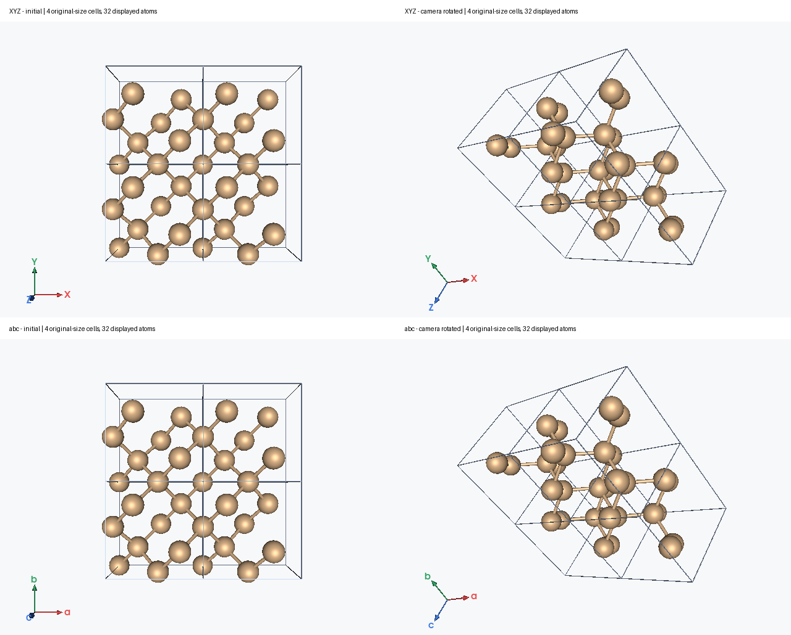

# LELE v1.7.2：八项显示与交互更新

日期：2026-10-28

| 项目 | 当前行为 |
|---|---|
| 左下角坐标轴文字 | XYZ、abc 字母始终正对镜头；连续旋转不需要额外刷新，字母保持在箭头端点，标记大小稳定。原点模式继续保持正对视角。 |
| 激发态 State 列 | `Singlet-?Sym` 显示为 `Singlet`，`Triplet-?Sym` 显示为 `Triplet`；真实对称性如 `Singlet-A1` 保留。 |
| Dipole Scale | 可直接键入小数，按 Enter 或移出输入框应用；上下箭头仍可用。输入过程中重绘不会重置数字，支持 6 位小数，单位 Å/D。 |
| 箭头粗细 | 增加坐标轴长度或偶极 Scale 时，仅增加箭头长度，杆和箭头头部的横向粗细固定。相机缩放仍会正常缩放三维画面。 |
| 框选外观 | 蓝色虚线边框、无填充，框内可继续看见分子；不依赖 Windows 的默认矩形填充样式。 |
| 框选快捷键 | Ctrl+Shift+B 开启/关闭框选，Esc 退出；Ctrl/Shift 拖框追加选区。菜单、Atoms 按钮和欢迎页同步显示快捷键。 |
| 原子与键透明度 | 普通键、周期键和 Boundary 副本随端点原子的透明度更新。整条连接采用较低的端点不透明度；隐藏或全透明端点同时隐藏其键。该逻辑原已存在，本版核验了真实控件操作、撤销及显示副本。 |
| Boundary | 完整复制原尺寸晶胞及其全部原子，以单胞边框区分；源结构和源晶胞不变。 |

## State 中的未知对称性

Gaussian 的 `?Sym` 表示未确定/未提供的对称性，不应据此猜测 A、A1 等标签。
界面清理这个占位符；导出的原始跃迁 CSV 仍保留文件中的状态描述，便于追溯。
激发能、强度、态编号和跃迁偶极数值不受影响。

## Boundary 的完整晶胞复制

1. 打开带有效周期晶胞的结构，在左侧选择 **Boundary**。
2. 勾选 **Enable boundary display**。
3. 设置 a/b/c 方向的整数晶胞范围。Start 包含，End 不包含。
4. 点击 **Apply**。下方显示晶胞数、显示原子数和源原子数。

| a 范围 | b 范围 | c 范围 | 结果 |
|---|---|---|---|
| 0–1 | 0–1 | 0–1 | 1 个原尺寸晶胞 |
| 0–2 | 0–2 | 0–1 | 4 个原尺寸晶胞，即 2×2×1 |
| −1–2 | 0–1 | 0–1 | 原胞、左侧和右侧各一胞，共 3 胞 |

每个副本包含全部源原子，共享边框只画一次，内部边界保留；边框长度始终等于原晶格矢量长度。
适用于斜晶胞。沿非周期晶格方向也可复制显示，但不据此增加物理周期性或推断跨该方向的键。
源原子在周期方向先包裹到单胞内，再按完整晶格矢量平移显示；非周期方向不裁掉原子。

Boundary 的副本仍对应源原子编号。修改源原子的颜色、显隐、透明度会同步全部副本；
拾取某个副本选择的是它对应的源原子，坐标表和结构导出仍采用源结构。
非周期帧暂停 Boundary 显示并禁用面板，保留全局范围和启用设置；回到周期帧后恢复显示。
Boundary 不重复 CUBE 体数据。最多显示 50,000 个原子。

需要独立编辑每个新增原子或导出更大的计算晶胞时，使用 **Edit → Build supercell…**。
v1.7.1 的 Ctrl+G 真实自动扩胞和 Ctrl+I 反选功能继续保留。

## 实际渲染示例

下图使用人工 Si 晶胞：每胞 8 个原子，Boundary 为 2×2×1，共显示 4 胞、32 个原子。
右侧仅改变相机，不重建角落标记；XYZ/abc 的字母仍正向并位于箭头端点。

源码与测试结果见 [v1.7.2 验证记录](VALIDATION_v1.7.2.md)。
Windows 使用者需要重新构建 EXE；源码包不会自动更新旧 EXE。
