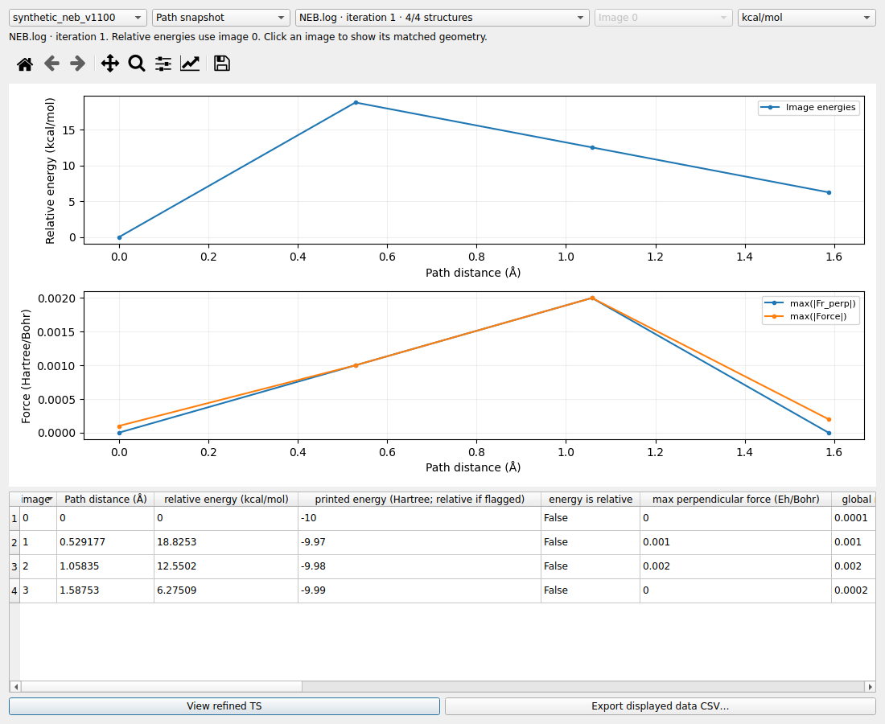
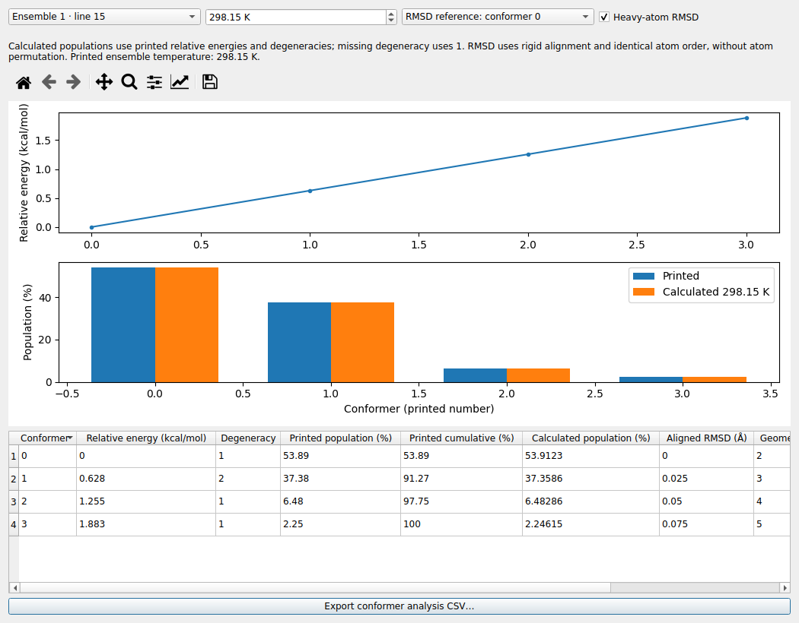
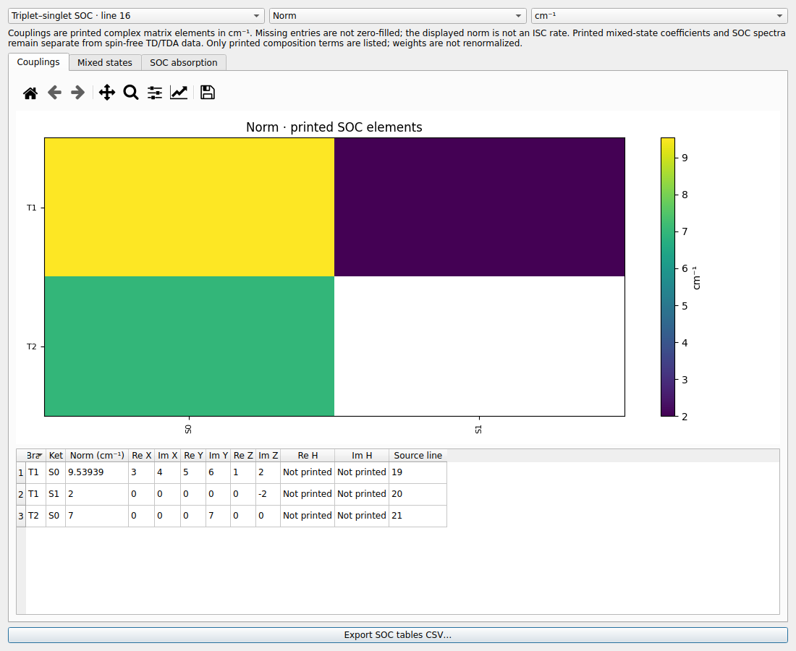

# LELE v1.10.0：NEB-TS、GOAT 与 SOC

本版增加 ORCA 反应路径、构象集合和自旋轨道耦合结果浏览。原有 Gaussian/ORCA
轨道、频率、光谱、偶极及测量功能继续保留，HOMO/LUMO 仍由按钮打开。

## 入口

加载输出后，点击 Files 页 **NEB / GOAT / SOC…**，或打开 Analysis 菜单。
只对当前文件中实际读到的数据启用相应命令。

| 命令 | 内容 |
|---|---|
| NEB / NEB-TS paths… | 路径快照、固定 image 历史、主输出 NEB 收敛 |
| GOAT conformer ensemble… | 能量、布居、温度、RMSD、构象结构 |
| Spin–orbit coupling (SOC)… | 耦合矩阵元、混合态组成、SOC 吸收 |
| Hessian history… | 阶段/周期、计算或更新类型、Hessian 文件及对应模式 |
| Calculation overview… / Energy / convergence curves… | 各优化阶段的状态和独立曲线 |

表格可点击表头排序。可用窗口中的 Export 按钮保存 CSV；图形工具栏可以缩放和保存图像。

## NEB / NEB-TS

### 阶段与结构分组

Files 树分别列出反应物预优化、产物预优化、NEB 路径和 TS 精修；Hessian/振动结果
保留自己的阶段和优化周期。计算总览同样显示各阶段的状态。
某个端点达到最大优化步数时仍显示未收敛，后续 NEB 收敛或程序正常结束不会覆盖它。

普通优化能量/收敛窗口增加阶段选择，曲线不会跨端点、NEB 和 TS 阶段连线。
首次 TS 周期只有能量而没有新 Cartesian 表时，使用输出明确打印的 SADDLE POINT 参考结构；
不会挪用末态优化的结构或能量。单独的 Hessian 作业也不会根据相似文件名接到 NEB 上。

### 配套文件

建议打开主 `.out/.log`，并将下列同一计算的配套文件放在其旁边：

| 文件 | 用途 |
|---|---|
| `NAME.NEB.log` | 各次 NEB 迭代中每个 image 的能量与力 |
| `NAME.interp` / `NAME.interp.final` | 打印的 image 点与 ORCA 插值路径，保留相对能量属性 |
| `NAME_MEP_ALL_trj.xyz` | 每次快照中全部 image 的结构 |
| `NAME_MEP_trj.xyz` | 单个路径快照的结构 |

NAME 优先取主输出中打印的输入 NAME，否则采用已知文件后缀之前的名称。
可以直接打开上述结果文件，但 `.NEB.log/.interp` 浏览结构需要旁边有相应 XYZ；
缺少 image 数量信息的 ALL XYZ 只作为尚未分配 image/迭代的记录浏览。

结构对应不只按记录顺序推测：LELE 核对原子顺序和整条路径的能量向量，确认后才将
路径点连接到 XYZ。窗口显示该快照有多少个结构，例如 `16/16 structures` 或 `1/16 structures`。
能量不一致、结构不完整或缺少配套文件时保留能量结果，相关点不能跳到其他快照的结构。

### 三种视图

1. **Path snapshot**：固定一次迭代，查看所有 image 的相对能量和可用的逐 image 力。
   能量以该快照的 image 0 为零点，可切换 kcal/mol、eV、Hartree；距离由 Bohr 转为 Å。
   `.interp` 的连续插值与离散 image 点分别绘制。
2. **Image history**：固定一个 image，查看其随 NEB 迭代变化的能量和垂直力。
   能量相对同次迭代的 image 0；该视图使用 `.NEB.log` 的快照序列。
3. **NEB convergence**：主输出打印的最高/CI 能垒，以及普通 image 垂直力和 CI 全局力的
   maximum/RMS。该汇总保留为独立来源，不据迭代号推断坐标。

点击具有匹配坐标的曲线点或表格行，即跳到主画布中的相应结构。
Files 树也提供 **Paths by snapshot** 与 **History by image**。
主窗口的前后帧、帧号、Play 和轨迹 GIF 导出均跟随当前序列。
选择一条路径时播放 image；选择单个 image 历史时播放它随迭代的变化。
**View refined TS** 单独打开 NEB 后的 TS 精修结果，避免混入 image 历史。

### 这批样本的来源差别

提供的 `.NEB.log` 与 MEP XYZ 一致，包含 20 个快照（迭代 0–19），每个 16 个 image，
共 320 个结构；`.interp` 和主输出则到迭代 20，且并非所有能量都一致。
本版分别保留这些来源。迭代 20 的不匹配路径显示能量，不以迭代 19 结构替代。
主输出明确打印的最终 CI 结构可独立查看，不据此补齐其余 image。

### Hessian 与频率

Hessian history 区分解析/数值精确计算、模型或读入 Hessian，以及 BFGS/Bofill 更新。
更新默认隐藏，可勾选 Include BFGS/Bofill updates。表格给出阶段、周期、文件名及源行号；
可点击表头调整排列。选择具有对应模式的精确 Hessian 后，按钮可打开该次计算的振动模式。

数值 Hessian 的正负微位移计算不会进入优化轨迹，也不会覆盖母结构的能量、轨道或偶极。
优化 Hessian 模式与收敛后的 Final frequency verification 分别列出；普通频率入口优先打开
最终验证。优化器报告的 Hessian 负本征值数单列，不能等同于最终振动虚频数。
若原文件没有最终频率结果，不生成“已通过单虚频验证”的结论。

## GOAT 构象集合

打开 GOAT 输出及同目录的 `NAME.finalensemble.xyz`，也可直接打开该 XYZ。
输出中的 Final ensemble info 提供原构象编号、相对能量、简并度、布居与累计布居；
配套 XYZ 通过数量、顺序和能量核对后连接到结构。

GOAT 窗口提供：

- 相对能量曲线（kcal/mol）、原文件布居与当前温度下重算的布居柱状图。
- 温度输入（1–3000 K）；优先采用文件打印的集合温度，缺失时从 298.15 K 开始。
- 以所选构象为参考的刚性对齐 RMSD，可切换重原子或全原子，单位 Å。
- 可排序的构象表；点击行跳到对应结构。播放和 GIF 只遍历该集合。
- CSV 导出相对能量、简并度、两类布居、累计布居、RMSD、结构帧号和分析温度。

重算布居使用 `g × exp(−ΔE/RT)` 后归一化，g 来自打印的简并度，缺失时明确按 1。
重算基于打印的相对能量，可能因能量舍入与原始布居略有不同；它不是热化学自由能计算。
直接打开 XYZ 时不虚构原始布居或简并度。

RMSD 要求元素及原子顺序一致，只做刚性对齐，不进行等价原子置换或自动聚类。
缺少构象坐标时仍可查看能量/布居表，结构和 RMSD 留空；即使主输出没有 Cartesian 表，
也可从有效的 finalensemble XYZ 打开集合，或仅浏览能量结果。

## SOC 结果浏览

加载包含 SOC 表的 ORCA 输出，打开 Spin–orbit coupling (SOC)…。

| 标签页 | 显示内容 |
|---|---|
| Couplings | Bra/Ket、复数 X/Y/Z 分量或稀疏标量 H、模长、来源行；分量热图 |
| Mixed states | SOC 态能量、原始基态标签、权重及系数实部/虚部 |
| SOC absorption | 打印的 SOC 修正吸收线、振子强度、偶极强度及可用的复数跃迁偶极 |

耦合单位可在 cm⁻¹ 和 eV 间切换；热图可选总模长、各分量绝对值、实部或虚部。
缺失的矩阵元保持空白，不当作零。总模长不是系间窜越速率。
组成表只列出实际打印的项，权重不重新归一化；SOC 混合态及吸收结果独立于普通 TD/TDA 表，
不会把自旋自由的单重态、三重态和 SOC 态混排。

Export SOC tables CSV… 一次导出当前分析的耦合、混合态/组成和修正吸收，
用 record 字段区分记录类型；CSV 的耦合列明确使用 cm⁻¹，能量同时提供原始单位。

## 支持与验证范围

NEB/NEB-TS 已用提供的真实主输出、全部配套路径文件与独立 Hessian 作业核对。
当前以单个 NEB 工作流及相邻配套文件为主要组织方式，多套 NEB 在一个输出里连续运行
或重启文件拼接等特殊情况仍需逐例核对。

GOAT 依据 ORCA 官方 Final ensemble info / finalensemble XYZ 格式实现，并用随包合成样例
检验；当前没有真实 GOAT 输出作为实文件验收样本。
SOC 已核对公开的 ORCA 5 TDDFT SOC 输出，并支持合成稀疏标量表；不据此宣称覆盖所有
多组态/CASSCF 稠密 Hamiltonian 或全部 ORCA 版本的特殊打印格式。

所有 `synthetic_*_v1100` 示例均为格式测试数据，不是真实计算。
本次全量测试、样本来源与限制见 [验证记录](VALIDATION_v1.10.0.md)。

官方格式参考：[NEB](https://www.faccts.de/docs/orca/6.1/manual/contents/structurereactivity/neb.html)、
[TS 优化](https://www.faccts.de/docs/orca/6.1/manual/contents/structurereactivity/optimizations_TS.html)、
[GOAT](https://www.faccts.de/docs/orca/6.1/manual/contents/structurereactivity/goat.html)、
[SOC](https://www.faccts.de/docs/orca/6.1/tutorials/spec/SOC.html)。

源码版本为 1.10.0。Windows 需重新运行 `build_windows.bat` 生成本版 EXE；旧 EXE 不会自动更新。
