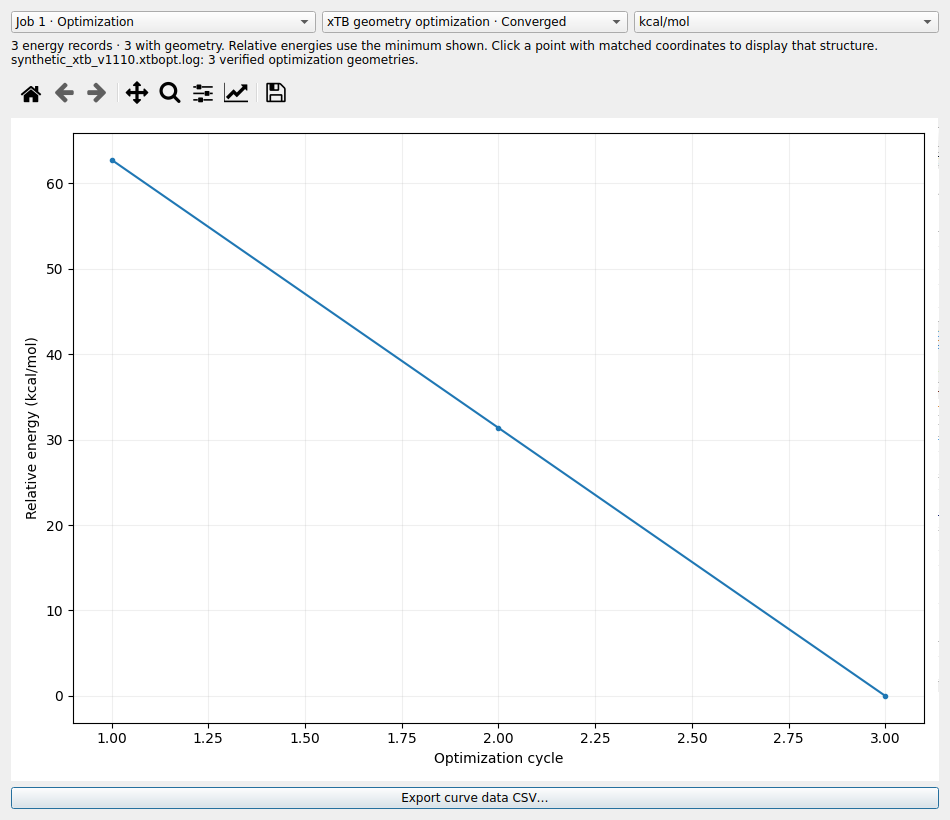
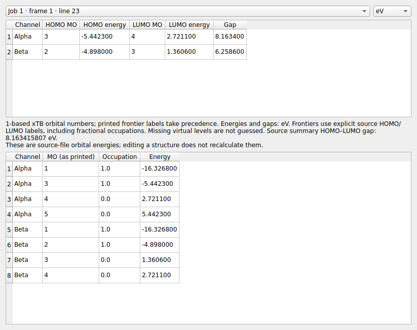

# LELE v1.11.0：xTB 优化、能量与 HOMO/LUMO

本版接入 xTB/g-xTB 的几何优化、总能量和前线轨道信息。读取文件无需安装或运行 xTB。
原有 Gaussian/ORCA、NEB/GOAT/SOC 与显示交互功能继续保留。

## 打开文件

使用 Ctrl+O、File → Open 或拖放文件。通过内容识别 xTB 输出，文件可以叫
`opt1.log`、`opt2.log` 或其他名称。

| 文件类型 | 可读内容 |
|---|---|
| 优化主输出 `.log/.out` | 优化周期、总能量、最终结构、收敛状态及打印的轨道表/能隙 |
| `xtbopt.log` 或带 xTB 注释的 Xmol/XYZ 轨迹 | 各记录的结构与注释行中的总能量 |
| `xtbopt.xyz` | 最终结构；若注释行打印 `energy:` 或 `SCF done`，同时读取其能量 |

主输出通常只打印最终结构。若要浏览完整优化过程，把相应轨迹放在主输出旁边。
可用名称为 `xtbopt.log`、`NAME.xtbopt.log` 或 `NAME_xtbopt.log`，其中 NAME 为主输出去除扩展名的名称。
例如同目录有两个计算时，可分别保留为 `opt1.xtbopt.log` 和 `opt2.xtbopt.log`。

LELE 核对周期数量、完整能量序列、元素顺序和最终坐标后才关联轨迹。
同目录存在不属于当前计算的 `xtbopt.log` 时不会直接使用；有多个不同但无法区分的匹配轨迹时
也不会任选一个。可直接打开轨迹文件单独检查。

## 优化结构与能量

匹配的优化结构进入 Files 树与坐标表，可逐帧切换、播放和导出轨迹 GIF。
主输出没有相应轨迹时，最终结构仍可显示，所有打印的优化周期能量仍可绘图。

Analysis → **Energy / maximum-RMS convergence curves…** 对 xTB 打开专用能量视图：

- 横轴为优化周期；单独打开轨迹时横轴为轨迹记录号。
- 能量默认以 kcal/mol 显示，可切换 eV 或 Hartree；曲线以当前显示数据的最低能量为零点。
- 点击有匹配坐标的能量点会跳到该结构；没有坐标的点保留能量并明确提示。
- Export curve data CSV… 导出全部周期/记录、可用结构帧号和绝对能量（Eh、eV、kcal/mol）。
  缺少结构的帧号留空，能量记录不会丢失。

总能量来自优化汇总或轨迹注释，不使用内部 SCC/SCF 迭代表中的中间电子能量。
对于明确打印的最终结构，主输出以最终单点能量作为该结构的能量；它可能与最后一次
优化能量/轨迹注释有很小的数值差别，原轨迹能量仍保留。

Calculation overview 显示方法、打印的电荷等元数据、优化状态、记录数与轨迹关联情况。
`Converged`、`Finished run` 和 `Normal termination` 分别来自优化收敛、运行结束与显式正常终止标记，
不会因为程序运行结束就认为几何优化收敛。
本次不把 `gnorm` 或 ANC 的范数当作 Cartesian maximum/RMS force 绘制。

## HOMO/LUMO

点击 Files 页 **HOMO / LUMO…**，或 Analysis → **HOMO / LUMO and orbital energies…**。
加载文件时不自动弹窗。默认选择最后一次轨道结果，以 eV 显示，可切换 Hartree。

- 显示原始轨道编号、HOMO/LUMO 能量、占据数与能隙，保留 xTB 的 1 起始编号。
- 优先使用原文 `(HOMO)` / `(LUMO)` 标记。分数占据时，LUMO 可能仍有非零占据，
  不以“占据大于零”重新定义前线轨道。
- 空白的未占据轨道占据数按 xTB 的零占据格式读取，省略号不展开成虚构的轨道。
- g-xTB 的 Alpha/Beta 通道分开显示。各通道打印的 HL-Gap 与程序总汇总的
  HOMO–LUMO gap 分别保留，总汇总值不覆盖另一个通道。
- 初始与最终轨道表分别选择；最终重复打印的同一张表合并。只有实际有参考结构的结果才标出帧号。

轨道能量保留 Energy/eV 列的打印值，通常只有四位小数；汇总能隙可能打印更多位数，
所以它与两列舍入后的能量直接相减可能略有差别。
单独的 `xtbopt.log` 没有轨道本征值，不从总能量估算 HOMO/LUMO；此时按钮不启用。
若输出仅有汇总能隙而没有轨道表，则显示该能隙，轨道编号和能量保持缺失。
修改结构只改变当前结构，不会重新计算轨道或能量。

## 提供的三份文件

| 文件 | 实测读取结果 |
|---|---|
| `xtbopt.log` | 329 原子，37 个带能量的优化结构；不含 HOMO/LUMO 本征值 |
| `opt1.log` | GFN2-xTB 6.7.0，37 个优化周期，与上述轨迹匹配；最终能量 −445.876152027688 Eh |
| `opt2.log` | g-xTB 6.7.1，123 原子，175 个优化周期；1 个最终结构，保留完整的 175 步能量曲线 |

`opt1.log` 最终 HOMO 为 416（−18.3417 eV），LUMO 为 417（−17.9534 eV），
汇总能隙 0.388346320974 eV。

`opt2.log` 的 Alpha 为 209 → 210，打印通道能隙 7.0657 eV；Beta 为 206 → 207，
打印通道能隙 6.1802 eV。源文件总汇总 gap 为 7.065672459737 eV，单独保留。
本次的 `xtbopt.log` 属于 `opt1.log`，不能用作 `opt2.log` 的优化轨迹；
补齐 `opt2.log` 对应的轨迹后，再打开主输出即可核对并显示其完整结构历史。

## 范围与示例

当前实文件验证覆盖 GFN2-xTB 6.7.0 和 g-xTB 6.7.1 的上述输出格式；
其他版本的相同格式可按此读取，特殊打印格式仍需样例核对。
本次范围限于优化、总能量与 HOMO/LUMO，未增加 xTB 的振动、MD、成键分析或结构搭建功能。
缺失的轨道、优化状态与坐标不会补造。

合成示例为 `examples/synthetic_xtb_v1110.out`、对应 `.xtbopt.log` 与
`synthetic_gxtb_v1110.out`，均标明不是实际计算。
详细回归与实文件核对见 [验证记录](VALIDATION_v1.11.0.md)。

格式参考：[xTB 几何优化](https://xtb-docs.readthedocs.io/en/latest/optimization.html)、
[xTB 轨道性质](https://xtb-docs.readthedocs.io/en/latest/properties.html)。

Windows 更新需重新运行 `build_windows.bat` 构建 1.11.0 的 EXE；已有 EXE 不会因源码更新而改变。
