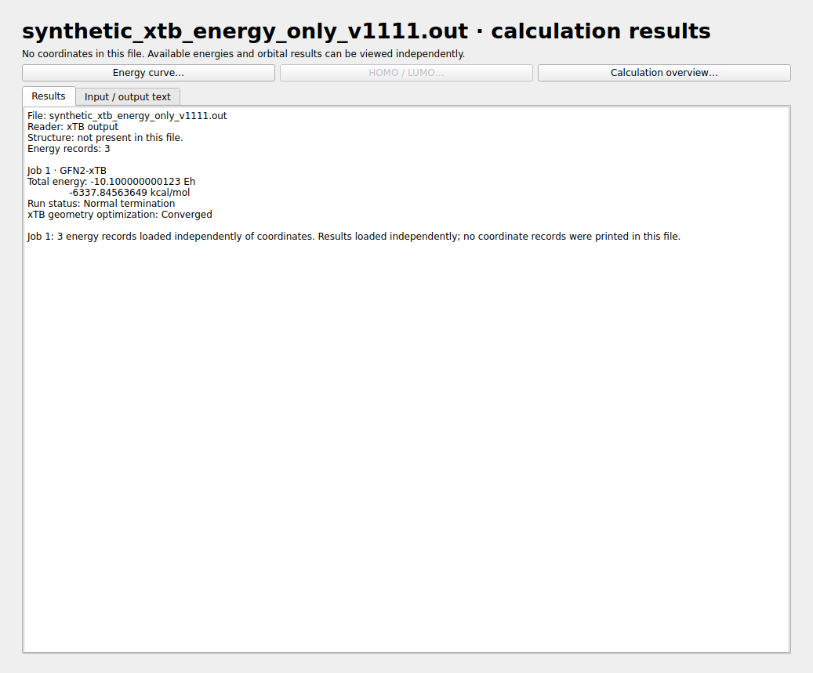

# LELE v1.11.1：结构与能量独立读取

输出文件不必配对。xTB 文件按其中实际存在的数据读取：

| 文件内容 | 界面行为 |
|---|---|
| 只有能量/轨道结果，没有坐标 | 显示结果页和已有能量曲线；不显示结构视图、坐标表或虚拟结构帧 |
| 只有结构，没有能量 | 显示结构与坐标，可逐帧浏览/播放；不显示能量数值，曲线入口禁用 |
| 结构和能量都有 | 分别显示已有数据；只有明确对应的能量点才与结构联动 |

HOMO/LUMO 同样以实际打印数据为准，不要求存在几何结构，仍然点击按钮后才打开。
没有轨道/能隙信息时按钮禁用。文件有轨道能量但没有结构总能量时，也不据此生成优化能量曲线。

## 纯能量文件

打开后中央显示结果页，列出能量记录数、打印的总能量和状态；可以打开能量曲线、
计算总览及有数据的 HOMO/LUMO。原始文件文本在另一个标签页查看。
Files 列表不增加虚拟 Frame 1，结构播放/GIF 不启用。

能量曲线保留全部周期，CSV 的结构帧号留空。点击这些点不会跳到其他文件的分子或空白坐标。

## 纯结构文件

例如 XYZ 中只有坐标与普通注释：正常读取并浏览结构，不推测能量，
也不借用附近其他文件的能量。多帧结构仍可播放、保存为 GIF 或导出坐标。
能量曲线菜单禁用，直接调用入口也不会打开空曲线窗口。

## 可选关联

同一文件中已有的结构与能量可以正常使用。
前版对明确匹配的 xTB 主输出/轨迹的核对仍可作为可选增强，文件可以单独打开，
不要求补齐另一类数据。缺少结构参考时，不根据邻近文件名补出结构。

例如原 `opt2.log` 自身含有最终坐标，所以可以显示那个最终结构和 175 步能量；
如果一个输出只有这些能量、没有任何坐标，就只显示能量结果。
只有坐标的 `xtbopt.log`/XYZ 则只提供结构功能。

检查结果见 [验证记录](VALIDATION_v1.11.1.md)。
Windows 需用本版源码重新运行 `build_windows.bat` 才能生成更新后的 EXE。
