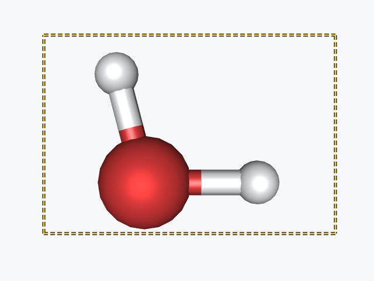
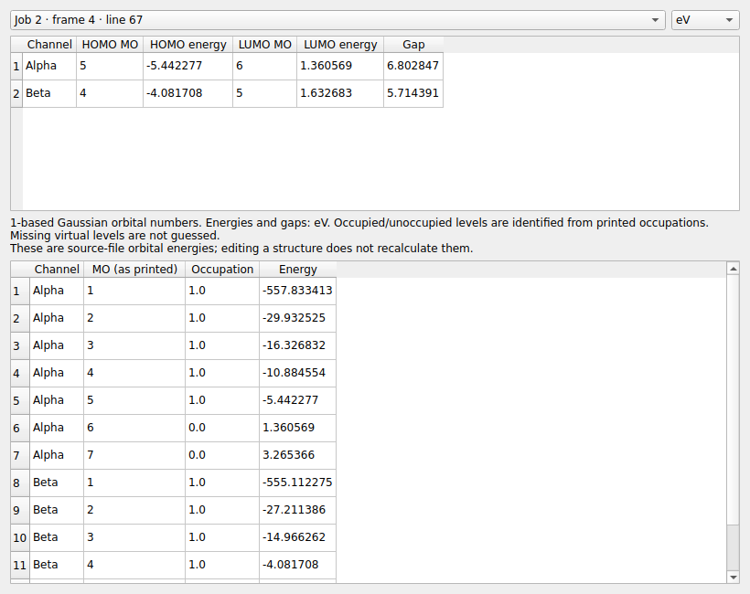
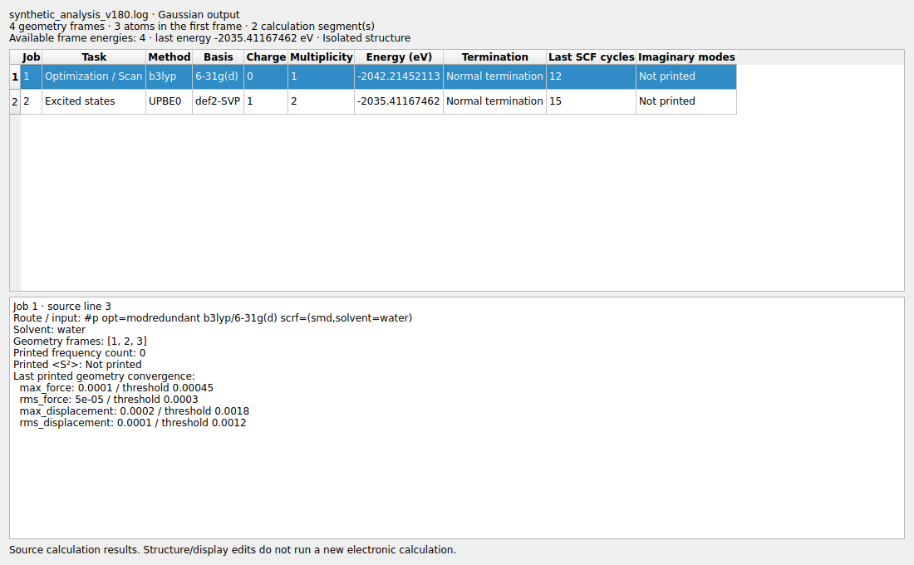
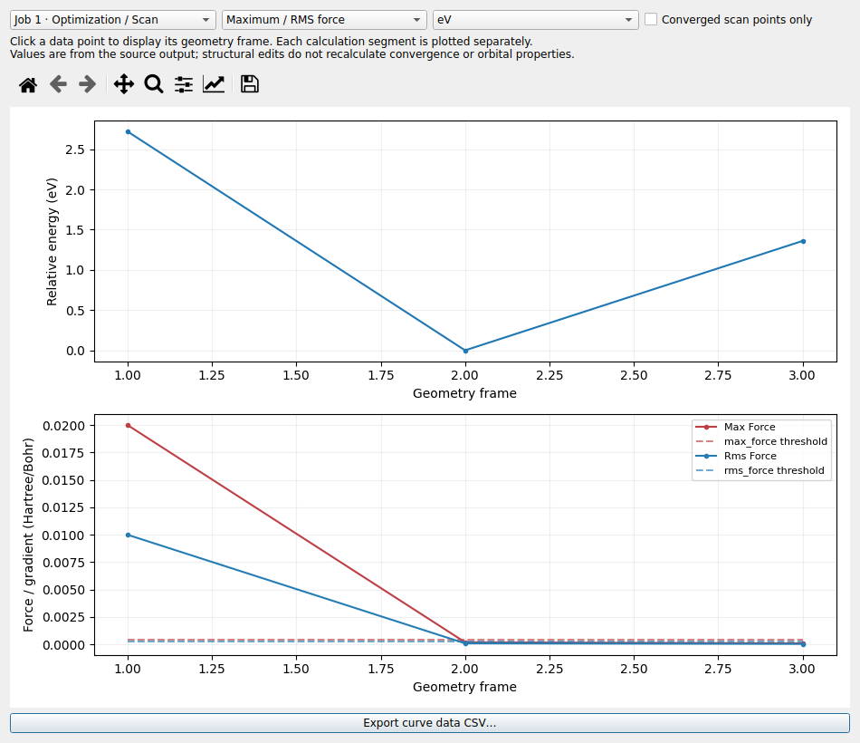
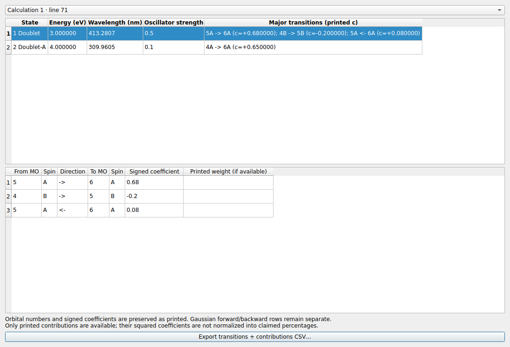

# LELE v1.8.0 使用说明

日期：2026-10-28

版本提示：v1.9.0 起 HOMO/LUMO 改为按需打开，当前操作见 [v1.9.0 说明](FEATURES_v1.9.0_CN.md)。

## 九项更新

| 项目 | 行为 |
|---|---|
| 框选累加 | 每次完成矩形选择，都添加到当前选区；无需按住 Ctrl/Shift。重复框住已有原子不产生额外撤销项。 |
| 选区撤销 | Ctrl+Z 撤销上一次框选添加，保留之前的选区；与结构编辑、显示修改按操作顺序共用撤销历史。 |
| 明显外框 | 高对比黄黑虚线直接绘制在 VTK 画布内，无内部填充；松开鼠标或取消时隐藏。 |
| 全选 | Ctrl+A 选中当前帧全部原子；输入框内仍按原生规则全选文字。 |
| 键的透明度 | 键比原子更快变透明：原子 50% 透明时，相连键约 75% 透明；隐藏/全透明端点同时隐藏其键。 |
| 跨帧显示同步 | 同文件原子顺序一致的帧共享颜色、透明度、显隐、标签及重置操作；坐标、成键不传播，其他文件不受影响。 |
| 轨道与总览 | 自动查找分子输出中的轨道表并弹出 HOMO/LUMO；Analysis 菜单提供轨道窗口和计算结果总览。 |
| 优化/扫描曲线 | 上图为相对能量，下图可切换最大/RMS 力或位移，并显示打印阈值；点击数据点跳转到对应结构帧。 |
| 激发态组成 | 显示主要轨道跃迁及全部打印系数，区分自旋通道与正/反向行，支持 CSV。 |

## 框选与撤销

Ctrl+Shift+B 切换框选模式，Esc 退出。第一次框选 A、第二次框选 B 后，选区为 A∪B；
第一次 Ctrl+Z 恢复 A，第二次恢复第一次框选之前的状态。空框和没有新增原子的框不增加撤销记录。
选区撤销不修改坐标、成键、能量或体数据。

## 同文件显示设置与透明度

逐原子的颜色、透明度、显隐、自定义文字及标签方式，会应用到该文件原子序列相同的其他帧，
也同步兼容的振动参考构型。原子数/顺序因删除、粘贴或真实扩胞而改变的帧不会强行按错误编号同步。
修改发生在当前工作会话，不自动覆盖原始输入文件。显示操作不修改任何帧的位置或手动成键。
一次 Ctrl+Z 可以恢复这次操作影响的所有帧；先撤销几何编辑、再撤销显示编辑也保持正确。

以不透明度 α 表示原子显示状态，键采用 `min(α₁, α₂)²`。
例如一个端点 50% 透明，另一个不透明，键的不透明度为 0.25，即 75% 透明。
该规则同时应用普通键、周期连接、几何氢键及 Boundary 副本。

## HOMO / LUMO

打开含可识别轨道表的孤立 Gaussian/ORCA 输出后，自动弹出窗口；
也可用 **Analysis → HOMO / LUMO and orbital energies…** 再次打开。

- 默认单位 eV，可切换 Hartree。
- 显示 HOMO、LUMO 的轨道编号、能量及能量差，下方列出已打印的轨道占据与能量。
- α/β 通道分开报告，保留开壳层信息，不用电荷或电子奇偶性猜测占据。
- Gaussian 编号从 1 起；ORCA 保留打印的从 0 起的编号，窗口中明确说明。
- 顶部可选不同计算段/轨道打印块，标出来源行和对应几何帧。
- 未打印空轨道时，LUMO/能隙显示 Not printed；负能量的空轨道仍按占据判断为空轨道。

能隙指轨道能量差，区别于 TD 激发能。窗口展示源文件数据，编辑结构不会重新计算轨道。

## 计算结果总览

**Analysis → Calculation overview…** 按计算段列出任务、方法、基组、电荷、多重度、
已识别能量、终止状态、最后一次打印的 SCF 循环数及虚频数。
下方显示原始 route/input、溶剂、对应帧、打印的 S² 和最后的收敛数值/阈值。

Gaussian/ORCA 提供本版的详细解析；其他结构/轨迹格式显示基本文件、结构和可用能量信息，
没有可靠元数据时明确标注缺失。未结束的输出不标为正常结束，不把未知电荷/多重度当作 0/1。
Gaussian 电荷和多重度跟随各计算段的几何，修复此前 A1；带电帧导出 GJF 使用相应值。

## 能量与最大/RMS 曲线

**Analysis → Energy / maximum-RMS convergence curves…**：

1. 选择计算段；不同段分别绘图。
2. 上图显示相对该段最低能量的能量，可选择 eV、Hartree 或 kcal/mol。
3. 下图选择最大/RMS 力（梯度）或最大/RMS 位移；有打印阈值时同时画虚线。
4. 扫描可切换只显示已收敛扫描点，或显示所有优化帧。
5. 点击任一数据点，主窗口跳到该几何帧；曲线窗口保持打开。
6. CSV 导出当前数据，包括绝对能量 eV、帧号、最大/RMS 数值及阈值；曲线可通过工具栏保存图片。

Gaussian 使用输出中的原子单位；ORCA 数值按其源表单位展示。
其他 ASE 轨迹如提供力，使用笛卡尔力分量的最大值/RMS（eV/Å），不猜测缺失阈值。
没有最大/RMS 数据时下图显示未打印提示，不生成零曲线。
本版扫描终点通过输出中的几何收敛标记识别；不把没有对应几何的计算段借用成其他段的数据。

## 激发态主要跃迁

**Analysis → Excited-state transitions…** 显示态能量、波长、振子强度及主要轨道组成；
选中一个态，下方列出全部已打印的组成。UV-Vis 结果表也增加主要跃迁列。

Gaussian 的 `5A -> 6A`、`5A <- 6A` 分开保存，系数正负号保留。
ORCA 常见 TD/TDA 输出中明确打印的权重与 `c=` 系数分别保存。
只展示输出中确实打印的组成，不将截断列表的系数平方强行归一化成完整百分比。

跃迁 CSV 新增主要组成摘要及完整 `contributions_json`，保存轨道、自旋、方向、系数及已有权重。
缺少振子强度时保持缺失，不用 0 代替；没有强度的数据仍可查看组成，不用于模拟吸收强度。

## 示例及验证

`examples/synthetic_analysis_v180.log` 和 `examples/synthetic_orca_analysis_v180.out` 全部是人工数据，
可用于试用弹窗、总览、曲线和跃迁表，不是真实电子结构计算结果。
验证记录见 [VALIDATION_v1.8.0.md](VALIDATION_v1.8.0.md)。
Windows 需要重新运行 `build_windows.bat`；旧 EXE 不会随源码自动更新。
