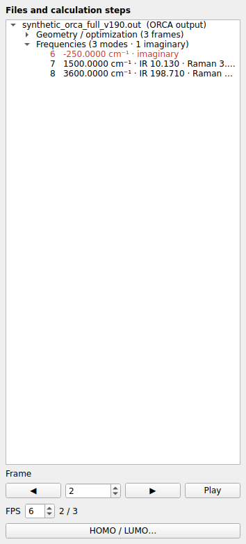
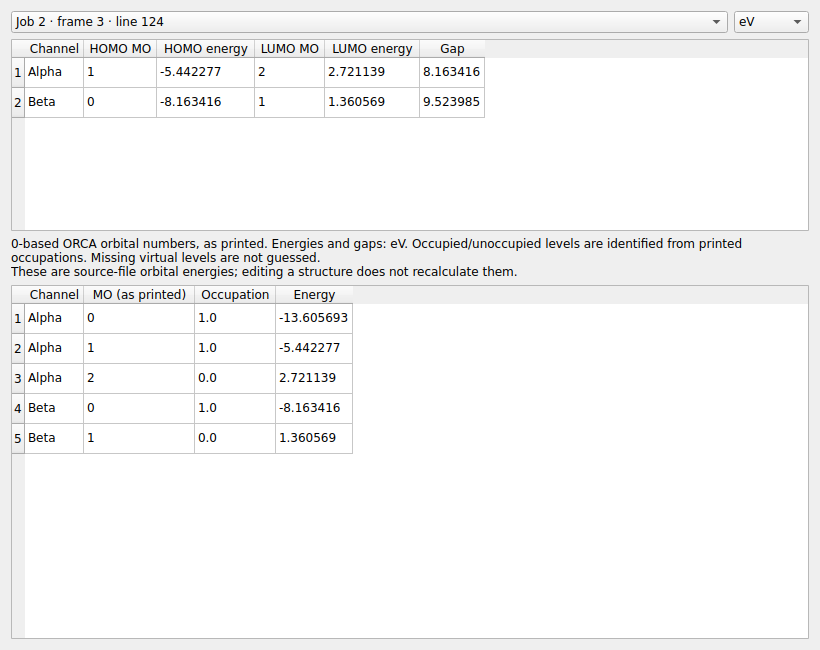
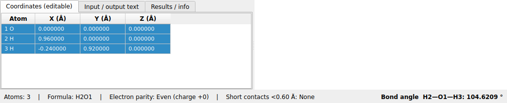
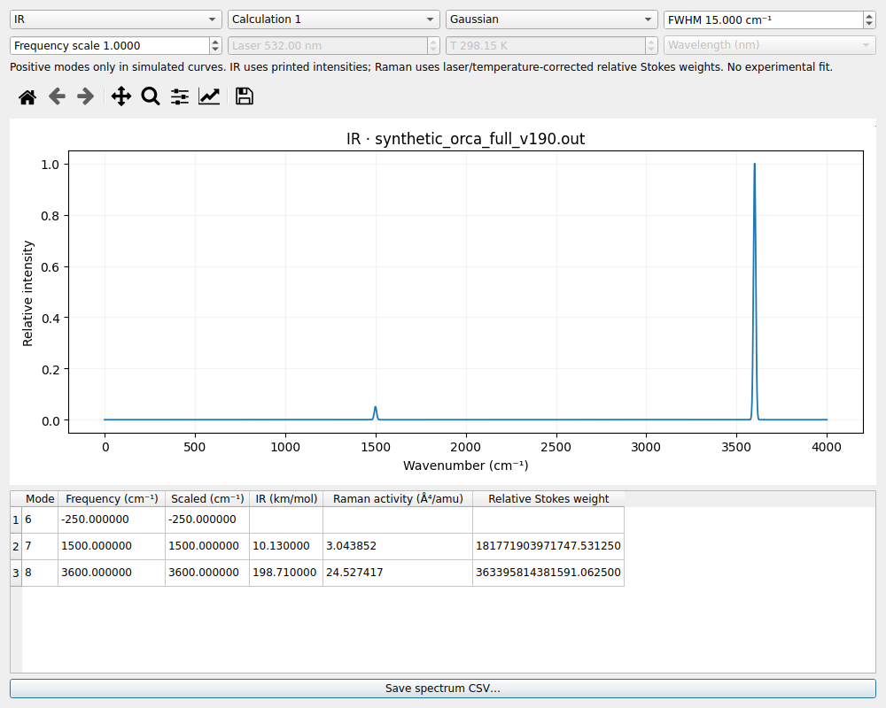
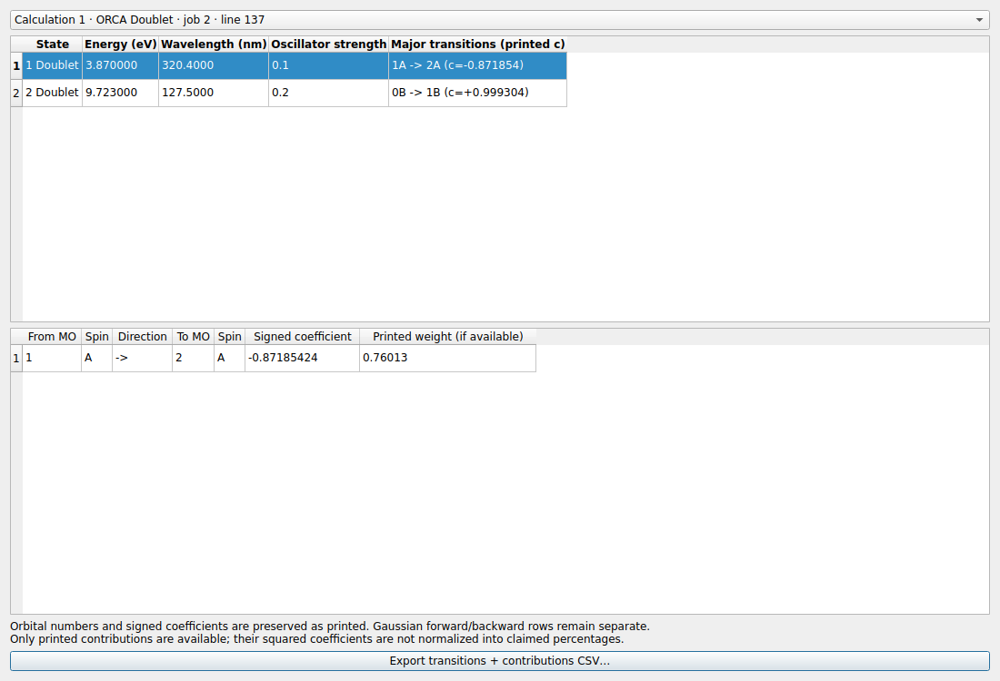
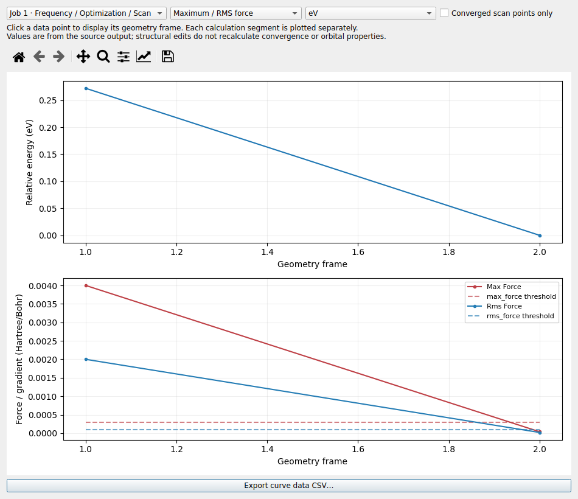

# LELE v1.9.0：按需查看轨道、底部测量与 ORCA 输出

日期：2026-10-28

## 1. HOMO / LUMO 按需打开

打开 Gaussian 或 ORCA 输出时仍会在后台读取轨道表，文件加载完成后不再自动弹出窗口。
点击左侧 **Files → HOMO / LUMO…** 按钮，或 **Analysis → HOMO / LUMO and orbital energies…** 打开。
Files 按钮仅在当前文件有可识别轨道表时启用；切换文件后随当前文件更新。

窗口默认 eV，保留轨道原始编号、占据数、Alpha/Beta 通道、来源计算段与几何帧。
未打印空轨道时不推算 LUMO。Gaussian 轨道编号从 1 起，ORCA 从 0 起。

## 2. Short contacts 右侧的选择测量

底部右侧显示与 Edit 页相同的测量值，保留原有侧栏显示：

| 选择数量 | 底部显示 | 定义 |
|---|---|---|
| 2 个原子 | Bond length，Å | 按选择顺序计算两点距离 |
| 3 个原子 | Bond angle，° | 第二个原子为角顶点 |
| 4 个原子 | Dihedral，° | 围绕第二到第三个原子的有向二面角 |

标签同时标出原子编号和选择顺序。取消选择、只选一个或选择超过四个时清空该项；
切帧、坐标编辑及撤销后立即更新。退化角度显示 undefined。
使用当前显示帧的坐标；振动模式下使用频率参考构型。周期结构沿用原有测量规则。

## 3. ORCA 支持范围

读取常见 ORCA 4/5/6 的孤立体系 `.out` / `.log` 输出。
结构选择、显示、成键调整、跨帧显示同步、PNG/GIF、结构导出等原有操作继续使用同一套界面。

| 功能 | 读取内容与入口 |
|---|---|
| 结构和轨迹 | Angstrom/Bohr 笛卡尔坐标、单点/优化/扫描历史及最终能量；Files 树和帧控件 |
| 电荷、多重度 | 按各个 JOB / COMPOUND JOB 读取；用于结构元数据及 GJF 导出 |
| 计算总览 | 输入关键词、方法、基组、溶剂、电荷/多重度、最终能量、终止状态、最后 SCF 循环、打印的 S²、频率/虚频数量 |
| 轨道信息 | Restricted 或 Alpha/Beta 的 OCC、E(Eh)、E(eV)；保留 ORCA 的零起始编号 |
| 优化/扫描曲线 | 能量、MAX/RMS gradient、MAX/RMS step 及收敛阈值；点击点跳到关联帧；CSV 导出 |
| 振动与虚频 | VIBRATIONAL FREQUENCIES、NORMAL MODES 的分块笛卡尔向量；Files → Frequencies 播放、暂停与 GIF |
| IR | 新版取 Int（km/mol）；旧版只有 T² 的表保留打印单位，用于相对谱，不标成 km/mol |
| Raman | Activity 与现有激光波长/温度设置生成相对 Stokes 谱 |
| UV-Vis | 经典 State 表及 ORCA 6 的 `0-1Ag → 1-3Bu` 等 Transition 表；使用打印的电偶极振子强度 |
| 永久/激发态偶极 | Total Dipole Moment，以及打印的 unrelaxed/relaxed state dipole 表；原子单位换算为 Debye |
| 跃迁偶极 | 电偶极、速度表及 CD 表中的磁偶极分量；电偶极箭头与现有 Dipole 页联动 |
| 跃迁组成 | 常见 TD/TDA 的轨道/自旋通道、正负系数、打印权重；CSV 保留完整行 |

曲线的梯度单位为 Hartree/Bohr，位移单位为 Bohr。
几何收敛标记用于筛选优化后的扫描终点；没有梯度/位移表的普通扫描只显示已打印能量。

ORCA 4/5 的单重态、三重态可能各自从 1 编号；ORCA 6 的 STATE 列表与 Transition 表
也可能采用不同编号。两类表按自旋组对应，原始 STATE 编号和原始表格标签均保留，
CSV 的 `source_label` 可追溯光谱表。明确打印 spin forbidden 的行按零电偶极振子强度处理；
其他缺失数据保持缺失，不生成偶极或跃迁系数。

## 数据与格式说明

- 接受普通 UTF-8、带 BOM 的 UTF-8，以及 Windows 重定向生成的 UTF-16 文本。
- 频率使用 ORCA 已打印的数值；输出写明已应用的缩放系数不会再次应用。界面 Frequency scale 默认为 1。
- NORMAL MODES 已是打印的笛卡尔位移，动画直接使用其相对运动，不再次按质量加权。
- 零频且没有运动的平移/转动列不列入振动树，真实模式保留原编号，通常从 6 起。
- 截断的位移列不拼接或补零；频率、已完成的其他模式及可用强度仍可显示。
- 每段计算独立关联几何；新计算段没有坐标时，不借用前段的参考构型。
- 显示的是已有输出结果；编辑结构不会重新计算能量、轨道、频率或光谱。

本版针对常见 HF/DFT、优化/扫描、谐振动和 TD/TDA 输出适配。
EOM/ADC/ROCIS 等程序如打印了标准光谱表，可以读取该表；其专用多组态组成、SOC 混合态及
从非零初态出发的 DOTRANS 表不在完整适配范围内。`.gbw`、`.cis`、`.hess` 二进制/辅助数据未作为读取入口。
没有在输出中打印的模式向量、强度或轨道不能从几何推算。

已使用 12 份公开真实输出核对 ORCA 4.2、5.0、6.0、6.1，并附带一个小型合成综合示例
`examples/synthetic_orca_full_v190.out`。如实际文件有未识别项，请提供完整 `.out` / `.log`
及 ORCA 版本，便于按相应任务的输出格式适配。

截图使用上述合成示例，来自 Linux Qt 离屏环境，未代表 Windows 实机验收。
Windows 使用本版源码重新运行 `build_windows.bat`，再分发完整 `dist\LELE` 文件夹。

## 格式参考

- [ORCA 6.1 振动光谱手册](https://www.faccts.de/docs/orca/6.1/manual/contents/spectroscopyproperties/vibrations.html)
- [ORCA 6.1 TD-DFT/TDA 手册](https://www.faccts.de/docs/orca/6.1/manual/contents/spectroscopyproperties/tddft.html)
- [ORCA 6.1 激发态计算](https://www.faccts.de/docs/orca/6.1/manual/contents/spectroscopyproperties/excitedstates.html)
- [公开输出样本 cclib-data](https://github.com/cclib/cclib-data/tree/master/ORCA)
- [公开输出样本 cclib](https://github.com/cclib/cclib/tree/master/data/ORCA)
