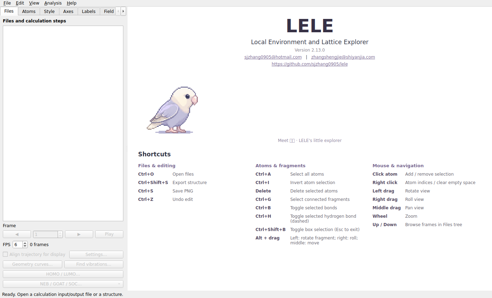
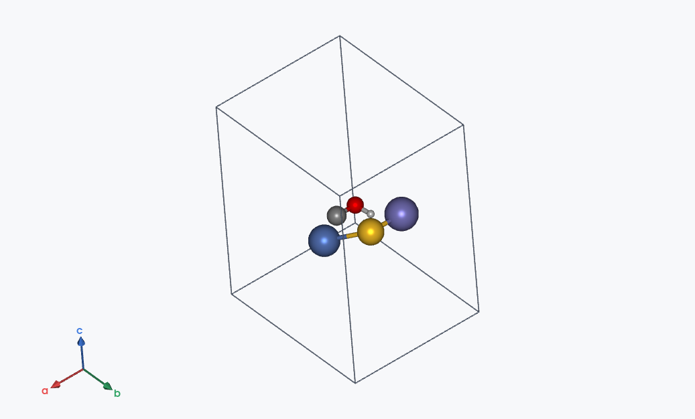

# LELE v2.13.0：显示默认值与导出顺序

2026-11-02。保留 v2.12.1 的七项验收修复。

1. **默认 Glossy**：新启动时 Lighting 为 Glossy，原子和键使用现有 Glossy 光照参数；Classic ball and stick 也采用该默认光泽。其他手动选择的材质及已保存项目的明确设置继续保留。
2. **移除欢迎页打开按钮**：删除 `Open a file… Ctrl+O` 按钮。文件菜单、Ctrl+O 和快捷键表继续可用。
3. **移除欢迎页拖放提示**：删除 `Drop a structure or calculation file anywhere in the window to begin.` 这一行，拖放打开功能仍可用。
4. **周期结构默认 abc**：Axes type 默认 `Automatic (periodic abc / molecular XYZ)`。有有效周期晶胞时，角落及原点坐标轴均使用真实 a、b、c 晶矢，保留斜晶胞夹角；角落轴只归一化长度。非周期结构或无有效晶胞时使用 XYZ。可手动切换到明确的 XYZ / abc，文件切换和项目保存保留选择。
5. **导出保留原子顺序**：XYZ、Gaussian GJF、CIF、POSCAR Direct、POSCAR Cartesian 均按当前坐标表顺序输出，已有原子不自动按元素排序。新原子按添加批次依次追加，每批内部保留加入时的顺序。手动设置 index / 交换 index 后，导出使用该明确调整后的顺序。旧转换接口也已取消 POSCAR 的元素排序。VASP 固定标记随原子保留；为维持顺序，POSCAR 可能出现重复的非连续元素块。
6. **Sibyl.tcl 配色**：Atom colours 默认 `Sibyl`，从用户提供文件中提取 H–Rg 共 111 种元素的 RGB 和 Element→ColorID 映射。原子、按元素着色的键及图例共用此配色；逐原子或逐元素的自定义颜色仍优先。原 GaussView style / Legacy LELE 等可在下拉框中选择。

配色示例（LELE 现有 8 位 RGB 渲染管线）：

| 元素 | RGB 十六进制 |
| --- | --- |
| H | `#CCCCCC` |
| C | `#8E8E8E` |
| N | `#1919E5` |
| O | `#E50000` |
| S | `#FFC628` |
| Fe | `#7F7AC6` |
| Co | `#5B6DFF` |
| Ni | `#5B7AC1` |

原始文件保存在 [Sibyl.tcl](reference_data/Sibyl.tcl)，SHA-256 为 `df1f31f3a4b765817410c62410ba7036b75d4f4e0077d5177d1d23fb710cfdb8`。`lele/sibyl_palette.py` 同时保留四位小数的源 RGB 数值和用于渲染的颜色值；D 使用 H 色。文件没有定义的元素沿用现有回退色。

只提取文件的颜色定义及元素映射，没有执行 TCL，也未引入其中的 VMD `CPK` 尺寸或 `Opaque` 材质。可以用 `python tools/extract_sibyl_palette.py docs/reference_data/Sibyl.tcl` 重新生成配色表。

复验结果见 [验证记录](VALIDATION_v2.13.0.md)。
