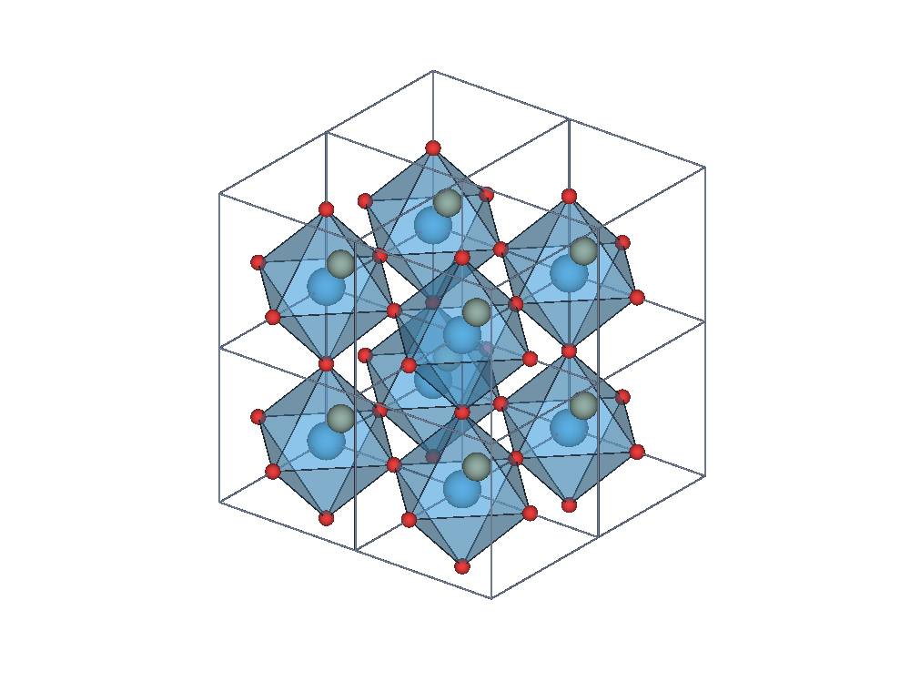
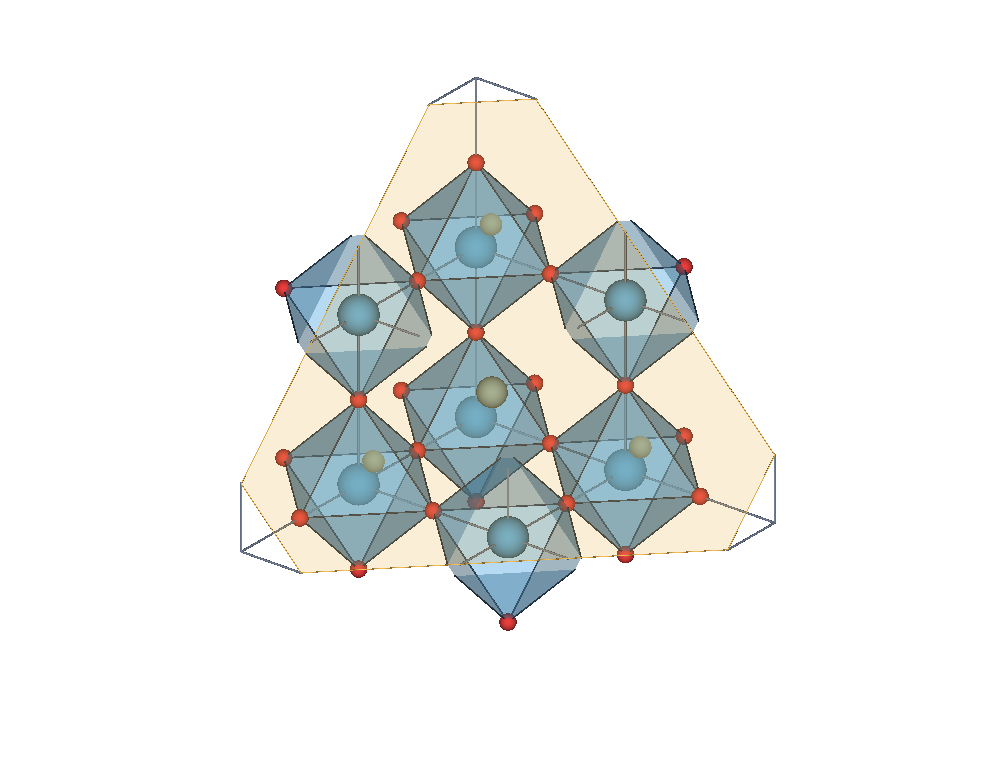

# LELE v2.2.0：Miller 晶面裁切与 Polyhedral 样式

本版在 v2.1.0 上新增 **Crystal** 面板，包含 **HKL planes** 与 **Polyhedra** 两页。
也可从 View 菜单进入对应页面。已有 VASP 支持、快捷键、轨迹与逐文件视图功能保留。

## 按 (hkl) 设置切面

1. 打开带有效晶胞的周期结构，进入 **Crystal → HKL planes**。
2. 点击 **New**，输入 h、k、l；允许负指数，三个指数不能同时为 0。
3. 设置 **Position** 和单位。`d` 表示该 (hkl) 的晶面间距倍数，`Å` 表示距晶胞
   原点的有符号垂直距离。可用 **Center plane in shown cells** 放到当前显示范围中央。
4. 在 **Keep region** 选择保留区域，点击 **Apply planes**。
5. 需要正对切面观察时，点击 **View normal to (hkl)**。

| Keep region | 显示方式 |
| --- | --- |
| Show only | 显示晶面，不裁切 |
| Keep below | 保留沿 (hkl) 法向投影不大于 Position 的部分 |
| Keep above | 保留沿 (hkl) 法向投影不小于 Position 的部分 |
| Slab | 保留以 Position 为中心、Slab thickness 为总厚度的薄层 |

薄层厚度使用与 Position 相同的单位。多个启用的切面取交集；最多六个裁切边界，
一个 Slab 占两个边界。**Enable this plane** 控制该项是否生效；
**Show plane surface / edges** 只控制晶面本身的可见性，关闭后仍可裁切。
**Clear all** 立即清除本文件的晶面和裁切。

例如，对于 4 Å 的立方晶胞：

- `(0 0 1)`、Position `0.5 d` 对应 z = 2 Å。
- `(1 1 1)`、Position `1 d` 通过 a、b、c 三个轴端点。
- 单胞中 `(1 1 1)` 的中间截面为 `1.5 d`，可直接点击 Center 获得。

一般晶胞的法向采用倒易晶格，不直接使用笛卡尔向量 (h,k,l)。设晶胞行向量矩阵为 A、
分数坐标为 f，则晶面满足 `h·f_x + k·f_y + l·f_z = Position`（Position 单位为 d 时）。
晶面间距为 `1 / |A⁻¹·(h,k,l)|`。保留原始指数，如 (200) 的间距是 (100) 的一半。

晶面在当前 Boundary 显示范围内绘制；若晶面不与该范围相交，可调整 Position、Boundary
或使用 Center。裁切会作用于原子球、普通键、配位多面体、晶胞线和已有等值面；坐标轴和
偶极参考箭头继续用作方向参考。原子标签和鼠标/框选按裁切后保留的原子中心位置处理。

这些操作是**显示裁切**。结构导出仍输出完整源结构，坐标表、原子编号和晶胞不被裁切删除。
PNG 和 GIF 会反映当前裁切结果；本版不额外计算或着色体数据的二维密度切片，也不构造
带真空层的表面计算模型。

## Polyhedral 配位多面体

入口有两种：

- **Style → Style → Polyhedral**，或选择 **Coordination polyhedra (VESTA inspired)** 预设。
- **Crystal → Polyhedra** 设置规则，再点击 **Apply Polyhedral style**。

| 设置 | 用途 |
| --- | --- |
| Center elements | 中心元素，如 `Ti`、`Co Fe Mn Ni Zn` |
| Ligand elements | 配位顶点元素，如 `O`、`O N` |
| Neighbors | Covalent radii 或 Distance range |
| Min./Max. distance | 配位距离范围，单位 Å，包含上下界，排除零距离 |
| Face opacity | 多面体面的透明度 |
| Show polyhedron edges | 显示真实棱线，可单独设颜色 |
| Show atoms | 在多面体中显示原子球 |
| Complete ligand atoms across cells | 补画构成边界多面体的跨胞顶点原子 |

元素可用空格、逗号或分号分隔；`*` 表示所有元素。`Auto` 默认寻找常见配位元素
O、N、F、Cl、S、Br、I，并将其他非 H 元素作为中心；没有这些元素时使用非 H 元素。
需要明确的某类多面体时，建议直接填写中心与配位元素。

**Covalent radii** 同时使用 Style 中的 Bond cutoff 和这里的最大距离；
**Distance range** 只使用这里设置的元素与距离范围。例如，示例中的 TiO₆ 可指定
Center `Ti`、Ligand `O`、Distance range、0–2.1 Å。

面由配位顶点的凸包生成。四面体、八面体等三维壳层显示为闭合多面体；三个或更多
共面顶点显示为平面多边形；共线或不足三个顶点时不生成面。面颜色沿用中心原子的
元素色或单原子覆盖色。棱线省略共面三角剖分的内部对角线。

周期近邻搜索使用完整周期映像，支持斜晶胞与同一原子的多个配位映像。Boundary 中每个
可见中心生成完整配位壳层，即使个别顶点位于当前整胞显示范围之外；补画的顶点原子
保留源原子编号，可用现有原子显示设置控制，不新增计算原子。

多面体的配位规则与普通键相互独立。Style 中的 Bonds 保持现有普通键显示，尊重 Ctrl+B、
手动去键以及编辑时冻结的连接；移动原子不会因为新样式而重新建立普通键。多面体的面
则随当前坐标和配位规则重新生成。面板计数是裁切前构建的多面体数量。

## 示例与状态保存

打开 [`../examples/SrTiO3_polyhedra.POSCAR`](../examples/SrTiO3_polyhedra.POSCAR)，
选择 Ti/O、0–2.1 Å；Boundary 设为 0–2 / 0–2 / 0–2，可得到 8 个完整 TiO₆ 八面体。
添加 (111)、Position 2.4 d、Keep below，即可查看晶面裁切。

预览：

晶面列表、多面体参数、配色、视角和 Boundary 随各个已打开文件分别保留。
这些是当前会话中的显示设置；关闭软件后重新打开文件按初始设置显示。
轨迹显示对齐时，晶面、裁切边界和多面体一起变换；原始结构坐标仍用于结构导出。

完整验证见 [VALIDATION_v2.2.0.md](VALIDATION_v2.2.0.md)。本次提供源码包，Windows EXE 需重新构建。

参照的 VESTA 官方界面约定：

- [Lattice planes](https://jp-minerals.org/vesta/en/doc/VESTAch9.html)
- [Cutoff planes and view directions](https://jp-minerals.org/vesta/en/doc/VESTAch10.html)
- [Creating bonds and polyhedra](https://jp-minerals.org/vesta/en/doc/VESTAch8.html)
