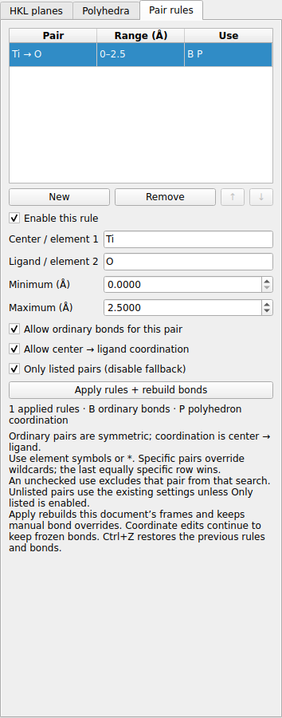
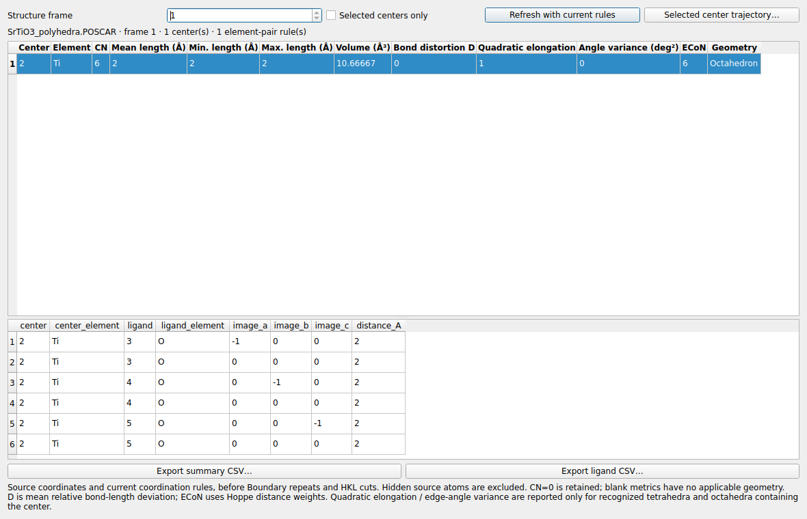
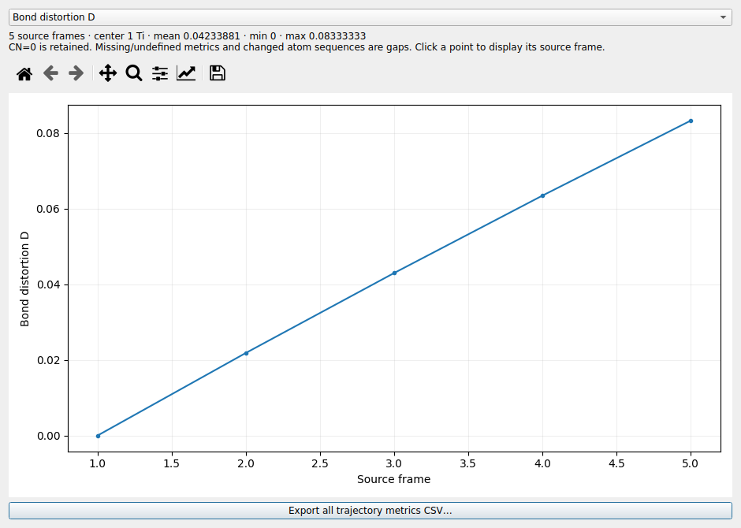

# LELE v2.3.0：元素对规则、多面体定量分析、项目保存

本版加入三个最高优先级功能，沿用 v2.2.0 的 HKL 裁切、Polyhedral 样式与独立 VASP 读取。

## 按元素对设置普通键与配位规则

打开结构，进入 **Crystal → Pair rules**，点击 **New**。填写元素符号和距离范围，
再点击 **Apply rules + rebuild bonds**。规则作用于当前文件的全部结构帧和
频率参考结构；手动加键、断键继续保留。**Ctrl+Z** 可恢复此前的规则与普通键。

| 字段 | 用法 |
| --- | --- |
| Center / element 1 | 第一种元素；配位搜索时作为中心，如 `Ti` |
| Ligand / element 2 | 第二种元素；配位搜索时作为顶点，如 `O` |
| Minimum / Maximum | 包含上下界的距离范围，单位 Å；排除零距离 |
| Allow ordinary bonds | 是否允许此元素对生成普通键 |
| Allow center → ligand coordination | 是否允许第一种元素配位第二种元素 |
| Enable this rule | 关闭后忽略整行，保留行内容 |
| Only listed pairs | 仅使用明确允许的规则，关闭未列元素对的默认搜索 |

普通键对称匹配，`Ti–O` 同时匹配 `O–Ti`；配位规则按中心 → 顶点方向匹配。
两种用途分别勾选；取消某个用途表示在该搜索中排除此元素对。
元素可填 `*`；明确元素越多的行优先，明确程度相同时最后一行优先，可用 ↑/↓ 调整。
每行使用 `0 ≤ Minimum < Maximum ≤ 20 Å`。

例如，只画 TiO₆ 多面体而不生成 Ti–O 普通键：第一元素 `Ti`、第二元素 `O`，范围
`0–2.2 Å`，勾选配位、取消普通键，再打开 Only listed。需要 O–H 普通键时另加 O/H 行。

未打开 Only listed 时，未列出的普通键继续使用原来的共价半径规则；未列配位对继续
使用 Polyhedra 页的元素、Neighbors 和距离设置。已匹配的配位行使用自身距离范围，
可为多个中心分别设置配位壳层。显式允许的普通键不被默认遮挡筛选去除。

应用规则是一次明确的重新推断。之后移动原子、编辑坐标仍按既有规则冻结普通键，
可用 Ctrl+B 修改连接，或 Edit → Rebuild bonds from distances 再次推断。
规则与各文件的显示设置分别保存；新打开的文件继承当前设置后独立管理。

## 多面体定量分析与轨迹

入口：**Analysis → Coordination / polyhedron analysis…**，或 Crystal → Polyhedra 页的
**Analyze coordination / polyhedra…**。选择源结构帧，可勾选 Selected centers only。
点选一个中心，界面列出对应配位顶点，并在主窗口选中中心和这些源原子。

| 指标 | 含义 |
| --- | --- |
| CN | 满足当前规则的配位顶点数量，跨胞周期像分别计数 |
| Mean / Min. / Max. length | 中心到配位顶点的距离，Å |
| Volume | 配位顶点三维凸包体积，ų；共面多边形为 0 |
| Bond distortion D | Baur 畸变指数：各键长相对平均键长的绝对偏差的平均值 |
| Quadratic elongation | 等体积理想多面体作参照的平均平方键长比 |
| Angle variance | 配位棱对应的中心键角偏离理想角度的方差，deg² |
| ECoN | 使用 Hoppe 距离权重的有效配位数 |

二次伸长率和角方差只对本版能识别、且中心位于凸包内的四面体/八面体计算；
八面体使用 12 个棱对应的角，不将三个对角的 180° 计入 90° 角方差。
其他壳层保留适用的距离、体积、D 和 ECoN，不适用的字段显示 `—`、导出为空。
CN=0 仍保留，ECoN=0，距离和体积无定义；不足三个或共线顶点也可查看配位距离。

计算使用**源结构坐标**和当前配位规则，在 Boundary 复制与 HKL 显示裁切之前统计。
隐藏的源原子会被排除。周期顶点列表同时列出源原子编号、a/b/c 周期像平移和实际距离，
因此一个源原子可有多条不同周期像记录。显示平移/旋转不改变这些统计量。

导出按钮分别保存全部中心的汇总 CSV 和配位顶点明细 CSV。点选一个中心后，点击
**Selected center trajectory…**，可切换上述指标，查看随源帧变化的曲线和均值/极值，
点击曲线点跳到对应结构，或导出全部指标 CSV。当前 NEB image 等限定序列沿用原有
导航范围；选择的参考帧确定元素顺序。元素顺序变化、中心被排除或指标无定义时断线，
配位消失的帧保留 CN=0。

分析窗口保留打开时的规则快照；**Refresh with current rules** 可取回该文件当前规则。
频率浏览中的分析仍由窗口的 Structure frame 选择源轨迹帧，振型预览位移不参与统计。

指标定义参照 [VESTA 官方手册第 11 章](https://jp-minerals.org/vesta/en/doc/VESTAch11.html)。
这里使用 LELE 自己选出的配位壳层；元素规则、截断范围不同会产生不同结果。

## 保存和恢复 .lele 项目

| 操作 | 入口 / 快捷键 |
| --- | --- |
| 打开项目 | File → Open project…，Ctrl+Alt+O |
| 保存项目 | File → Save project…，Ctrl+Alt+S |
| 另存项目 | File → Save project as… |

也可通过常规文件打开流程载入 `.lele`。项目保存当前会话中**全部已打开文件**，包含：

- 已加载的各结构帧、晶胞、能量及计算结果，包含无结构的独立结果；现有体数据也保留。
- 频率、位移、已解析光谱/偶极/轨道、NEB/GOAT/SOC 等科学数据。
- 编辑后的坐标、普通键冻结快照、手动普通键/虚线氢键、逐原子的颜色与显示设置。
- 每个文件的样式、配色、标签、Boundary、HKL 切面、元素对/多面体设置和摄像机。
- 当前文件/帧、选中原子、显示对齐、几何曲线参数、限定轨迹序列和当前纯能量记录。
- 已编辑的振型参考结构、当前模式、振幅/速度/箭头设置；恢复后暂停播放。

项目包含恢复所需的已解析数据，原输出文件移动或删除后仍可打开。Input / output text
保留原有最多 **180 KB** 文本预览；项目不打包完整原始输出文件或外部字体文件。
完整原始文本仍应单独保留。曲线等分析窗口可从恢复的数据重新打开，撤销历史不跨会话保存。

打开项目时，保存的文件会加入当前会话，已打开的工作保留。向已有会话加入项目后，
首次保存会询问新项目路径，用于保存合并的会话。在空会话中打开项目后可直接保存回原项目。
读取完成并验证成功后才加入界面；保存使用同目录临时文件完成后替换目标。

`.lele` 是版本化 ZIP，内部为 JSON 数据图及非对象 NPY 数组，不使用 Python pickle。
项目扩展名与结构导出格式分开；**Ctrl+S 继续用于 PNG**，已有快捷键保留。

## 可直接打开的示例

[`../examples/v230_coordination_project.lele`](../examples/v230_coordination_project.lele)
包含理想 SrTiO₃ 晶胞和一个合成 TiO₆ 畸变轨迹，附 Ti/O 元素规则、Polyhedral 显示、
Boundary、(111) 切面和保存视角。打开后可直接尝试分析、曲线和项目另存。
[`../examples/synthetic_TiO6_v230.xyz`](../examples/synthetic_TiO6_v230.xyz) 也可独立打开。

完整验证见 [VALIDATION_v2.3.0.md](VALIDATION_v2.3.0.md)。本次提供源码，Windows EXE 需运行
`build_windows.bat` 重新构建。
