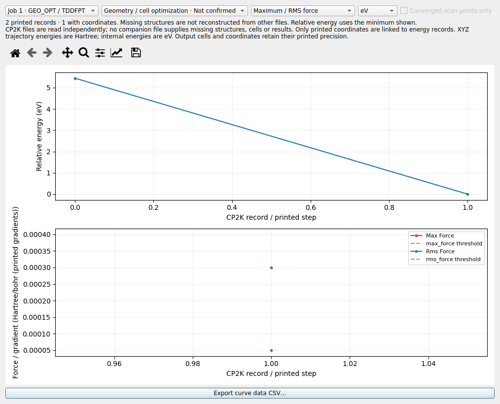
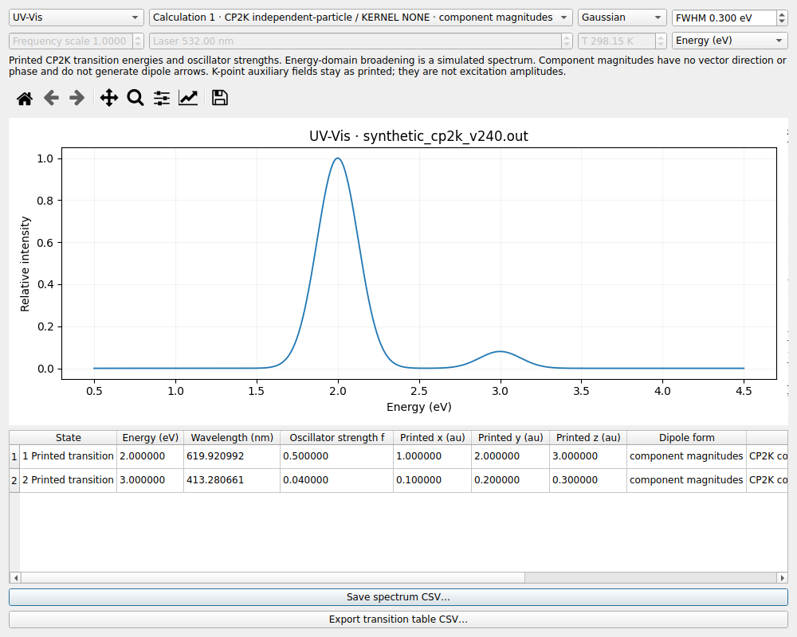

# LELE v2.4.0：CP2K 独立文件支持

输入、标准输出、轨迹与 restart 均可单独打开，不要求同时出现，不读取邻近文件补齐数据。
现有 VASP E0-only、Gaussian/ORCA/xTB、HKL、多面体、编辑和项目保存功能保留。

## 文件与可用数据

| 文件类型 | 本版读取 |
| --- | --- |
| CP2K 输入 `.inp` / 文本 `.restart` | 内嵌坐标、晶胞、周期方向、KIND 元素映射、电荷、多重度、项目/任务和可识别的方法/基组设置 |
| CP2K 标准输出，包括改名文件 | 打印的坐标、晶胞、FORCE_EVAL 能量、优化最大/RMS 梯度与位移及其阈值、SCF/完成状态 |
| 标准 CP2K XYZ 轨迹 | 多帧坐标，注释中的 `i=`、`time=`、`E=`；不从邻近文件推断晶胞 |
| 包含 MO 表的输出 | 每次 SCF 评估的最后一组已打印轨道表，按 k 点和自旋分别显示 |
| 包含最终 TDDFPT 表的输出 | 激发能、振子强度、已打印的跃迁分量/形式、可识别的跃迁振幅和辅助源字段 |

输入坐标支持 Angstrom、bohr、nm 和 `SCALED`；晶胞支持 A/B/C 或 ABC/角度，支持
PERIODIC 的部分周期方向。可读取简单 `@SET` 标量替换。外部坐标文件、`@INCLUDE` 不会
自动打开；条件预处理和坐标数学表达式不求值。无法完整识别内嵌坐标时只显示已有设置，
不会生成部分原子结构。这里的 restart 指文本输入式 restart，不读取二进制波函数文件。

## 结构与能量相互独立

- 输出的每条 FORCE_EVAL 能量都保留；缺少对应坐标时可在 Files 树中选择该能量记录。
- 不重复利用初始结构来冒充优化后续步的结构，也不按记录条数与其他文件自动配对。
- 只有结构时仍可浏览和导出；只有能量、轨道或跃迁时显示结果页，相关分析独立可用。
- 一份输出包含多个 CP2K 运行时，按运行分别保留结构、能量、轨道和光谱。
- 标准 XYZ 的坐标按 Angstrom、`E=` 按 Hartree 读取，内部能量转换为 eV。
  `time=` 存在时保留 fs 值，没有时间时不假定时间步长。

标准 XYZ 没有晶胞和周期信息时，LELE 只显示它实际包含的坐标和能量，Boundary/HKL
不可用；需要周期信息时可另外打开包含晶胞的输入、restart 或输出。它们仍是独立文档。
本版未自动关联外部轨迹、`.cell` 或 `.ener` 文件，也未实现 CP2K 全部输出格式和计算模块。

## 曲线、轨道与光谱

**Analysis → Energy / geometry convergence…** 显示所有 CP2K 结果记录，包含无结构的
能量和优化指标。可切换能量单位和最大/RMS 力或位移。点击有结构的点才切换三维结构；
无结构的点会保留当前视图。CSV 保留步号/记录号、可用的结构帧、Eh/eV 能量、指标、
阈值、源单位和行号。CP2K 优化梯度单位为 Hartree/bohr，位移单位为 bohr。

**HOMO / LUMO…** 按打印的占据数识别已显示窗口内的占据与非占据轨道。各 k 点和自旋
使用独立通道，不把不同 k 点的同号轨道混在一起；更早 SCF 迭代的表不会作为最终能级重复显示。
未打印的轨道不补齐，也不将单个 k 点的间隙声称为完整的全局带隙。

**Analysis → UV-Vis spectrum…** 可以查看 TDDFPT 跃迁并模拟展宽曲线，支持 eV/nm、
Gaussian/Lorentzian 展宽及 CSV。无结构结果页也有光谱和跃迁表导出按钮。

对于当前提供的 `cp2k.out_tddft`，输出明确标记 **KERNEL NONE / independent-particle**，
并注明跃迁偶极各分量为 **magnitudes**。这些数值显示为已打印分量，并在 Dipole form 中
标为 `component magnitudes`。没有符号、相位或方向，因此不画出跃迁偶极箭头。
`TDDFPT_KPOINT` 行作为辅助源字段完整保留；其中的权重不冒充激发组态系数。

常规 length/velocity/Berry 等打印形式也分别标记。只有明确的 length 形式矢量进入现有
电跃迁偶极箭头流程；其他形式不会被重新命名为 length。初始猜测、迭代残差等不充当
最终激发态表。光谱由源文件中的激发能和强度展宽，不执行新 TDDFT 计算。

## 提供文件的读取结果

| 文件 | 结构 | 能量/性质 |
| --- | --- | --- |
| cp2k.inp | 1 个 128 原子结构，带晶胞 | 输入设置，无计算能量 |
| Phenylhydrazine-1.restart | 1 个 128 原子结构，带晶胞 | restart 设置，不推断历史能量 |
| Phenylhydrazine-pos-1.xyz | 134 帧，每帧 128 原子 | 134 个注释能量；文件未提供晶胞 |
| cp2k.out | 1 个实际打印的初始结构 | 135 条能量与可用的优化收敛数据；134 条能量没有对应的打印坐标 |
| cp2k.out_tddft | 2 个运行，各有打印结构 | 2 条能量，2 组最终轨道快照，每组含 5 个 k 点；200 个跃迁 |

这五个文件都已在仅有自身文件的临时目录中分别验证；结果与它们放在一起时一致。
CP2K 输出中的晶胞和坐标受源文件打印精度限制，不从输入/restart 借用更高精度数据。

## 示例与项目保存

可打开 [v240_cp2k_project.lele](../examples/v240_cp2k_project.lele)，其中包含合成的输入、
输出、XYZ 三个独立文档；也可逐个打开 `examples/synthetic_cp2k_v240.*`。
这些是解析与界面示例，不是用户体系的计算结果。所有新增的 CP2K 结果和源字段可保存在 `.lele` 中。

参考：[CP2K COORD](https://manual.cp2k.org/trunk/CP2K_INPUT/FORCE_EVAL/SUBSYS/COORD.html)、
[轨迹输出](https://manual.cp2k.org/trunk/CP2K_INPUT/MOTION/PRINT/TRAJECTORY.html)、
[官方 TDDFT 说明](https://github.com/cp2k/cp2k/blob/master/docs/methods/properties/optical/tddft.md)。
验证详见 [VALIDATION_v2.4.0.md](VALIDATION_v2.4.0.md)。Windows EXE 需重新构建。
