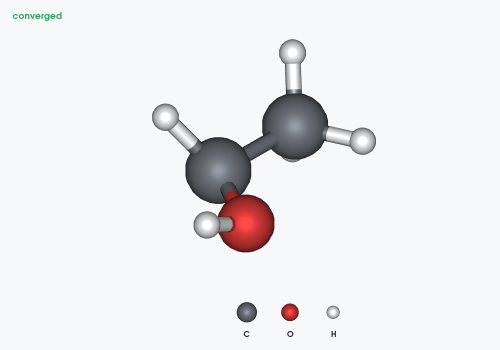

# LELE v2.7.0

## 多步输出文件检查与改进

保留所有完整帧，不设置程序帧数上限，不抽帧。仍受实际内存、原子数和数据量限制。

| 文件/程序 | 检查结果与改动 |
| --- | --- |
| ORCA | 保留 v2.6.0 的任务/几何索引、分块数值转换和后台读取。 |
| CP2K stdout | 修复每次遇到能量都重访全部既有光谱的问题。仅更新等待下一条能量的光谱；增加解析阶段和帧整理进度。 |
| Gaussian | 几何、轨道、偶极/激发态、振动均为有限次顺序扫描，同一次读取共用解码文本；补充各解析阶段进度。 |
| VASP OUTCAR/OSZICAR | 原有读取已经按离子记录组织；补充元数据、离子结构/能量/振动及帧整理进度。仍只使用 E0。 |
| Quantum ESPRESSO | 原 ASE 路径每帧重搜全局结构/能量索引，长优化存在平方级扫描。改用单次建立索引及二分定位，沿用 ASE 的坐标和单位解析。 |
| NWChem | 电子模块连续不打印几何时，原 ASE 路径会反复合并、重读越来越长的旧记录。现在仅保留关联该结构所需的最后几何、梯度、晶胞和能量行，避免不断重读历史。普通逐步几何仍逐块解析。 |
| xTB / g-xTB | 轨道快照改用源行号→优化步索引，不再逐快照遍历优化步；另修复轨道表把下一个带省略号的 CYCLE 标题吞掉的问题。 |
| SIESTA .out / .ANI | 坐标块解析后跳过已消费的原子行；补充循环取消检查、解析进度和 ANI 读取进度。 |
| 普通/CP2K XYZ、XDATCAR | 继续流式逐帧读取；增加字节进度，避免读取缓冲区提前到文件末尾时重复发送完成事件。 |
| 其他 ASE 格式，包括 vasprun.xml | 保留各格式原有语义，使用后台读取及活动进度；底层读取器没有内部回调时，取消只能在其返回/产出下一帧后生效。 |

完整数据一致性和速度记录见 [验证报告](VALIDATION_v2.7.0.md)。合成基准不是任意实际文件的速度保证。

## 加载之外的耗时操作

新增共用进度机制。通常超过约 **0.4 秒**才显示进度框，快速操作不闪窗。
可计数阶段显示阶段百分比；没有可靠总量时显示活动条和耗时。

覆盖项目保存/打开、结构导出、超胞生成、几何曲线计算、光谱展宽、振动参与度、
配位多面体和轨迹分析、偶极/跃迁/曲线等 CSV，以及大表格/结构视图更新。
PNG 捕获、编码和等值面计算接入 VTK 的进度回调；GIF 保留原有逐帧进度和取消。
偶极统计在切换数据文件时计算一次，避免每次重绘重新统计全部记录。

纯数据工作在后台线程运行；Qt 控件、绘图和 VTK 画布仍在主线程更新，通过阶段/行/VTK
回调刷新进度。单次不可分割的图形驱动调用仍可能暂时占用主线程。
数据计算期间暂停播放并阻止修改输入，完成后恢复。文件读取和可安全中止的分析支持取消；
写出及正在应用的界面更新不提供中途取消，避免半成品状态。

## 优化成功时的 converged

对于带有明确优化成功记录且能关联到结构的输出，最后相应优化帧会：

- 在画布左上角显示绿色 **converged**；
- 在 Files 中该帧名称后显示 **converged**；
- 在 Results info 中显示 `Geometry optimization: converged`。

目前标记来自 Gaussian、ORCA、VASP、xTB、CP2K 和 Quantum ESPRESSO 的已识别记录，
以及 NWChem 的 `Optimization converged` 所在几何块。多任务文件只标记所属的结构。
CP2K 沿用明确完成记录与四项已打印优化标准的核验，不把普通程序正常退出视为几何收敛。
只含坐标的 XYZ/XDATCAR/ANI 没有优化状态，不从邻近 log 推断。
SIESTA 当前读取路径没有已核验的优化状态记录时也不推断。

修改键长、角度、坐标、原子组成或生成新超胞时，清除不再适用的标记；撤销可恢复。
整体刚性坐标变换和改变显示样式不改变优化状态。该标记说明输出报告了优化收敛，
并不代表已通过频率分析证明为极小值。

## 原子图例

入口：**View → Atom legend**。

取当前画布可见结构中各元素的第一个可见原子作为样本，从左到右排列在画布底部，
每个球下方显示元素符号。采用对应原子的显示颜色/透明度，各样本之间没有键。
隐藏元素、晶面裁切、Boundary 和切换结构帧后重新确定出现的元素。
元素出现顺序沿用源结构原子顺序；同一元素有多种逐原子颜色时，图例采用首个可见样本。

图例是独立相机叠层，不加入原子列表、测量、成键或结构导出，不改变结构或主视角的缩放。
它随 PNG/GIF 一起输出，开启状态随各文件视图和 `.lele` 项目保存。



## 欢迎页

联系地址并列显示为：

`sjzhang0905@hotmail.com | zhangshengjie@shiyanjia.com`

两个地址均可点击，继续显示在版本号下方、源码链接上方。

## CP2K 频率计算的输出文件

确实不一定只有一个 log。CP2K 通常通过有限差分计算振动，副本并行会产生各副本的输出日志。
主日志、副本日志和振动可视化文件承担不同角色，不应把它们拼成一条普通几何优化轨迹。

| 文件 | 用途 |
| --- | --- |
| 主 `.out` / `.log` | 计算设置、整体运行和振动分析信息；具体内容受打印设置影响。 |
| 各 replica 日志 | 各位移点的电子计算、能量、力及诊断信息；名称/数量随版本和并行配置变化。 |
| `项目名-VIBRATIONS-1.mol` 等 | **Molden 振动文件**，通常包含参考坐标、`[FREQ]` 频率、`[FR-NORM-COORD]` 模式向量；不是 MDL MOL 结构文件。 |
| 可选 Hessian/重启等文件 | 取决于输入中的打印与重启设置，不一定全部生成。 |

若需明确写出振动可视化文件，可在原有振动分析设置中启用：

```text
&VIBRATIONAL_ANALYSIS
  &PRINT
    &PROGRAM_RUN_INFO ON
    &END PROGRAM_RUN_INFO
    &MOLDEN_VIB ON
    &END MOLDEN_VIB
  &END PRINT
&END VIBRATIONAL_ANALYSIS
```

官方示例的 `.mol` 文件使用原子单位的参考坐标、cm⁻¹ 的频率和模式位移。
实际读取须依据文件段名和单位。IR/Raman 强度还需要相应的偶极/极化率计算和打印设置。

**本版第 4 项为文件组织说明，尚未新增 CP2K Molden 振动文件的导入/动画解析。**
现有 CP2K stdout/输入/XYZ 仍按文件独立读取，不从其他副本日志补造结构或振动结果。

官方依据（核对日期 2026-10-30）：

- [CP2K 输入输出及多副本日志](https://manual.cp2k.org/trunk/getting-started/troubleshooting.html)
- [振动分析设置](https://manual.cp2k.org/trunk/CP2K_INPUT/VIBRATIONAL_ANALYSIS.html)
- [MOLDEN_VIB 打印](https://manual.cp2k.org/trunk/CP2K_INPUT/VIBRATIONAL_ANALYSIS/PRINT/MOLDEN_VIB.html)
- [CP2K 官方振动文件示例](https://github.com/cp2k/cp2k/blob/master/docs/methods/properties/optical/vibronicspec.md)

这是完整源码包。Windows 独立 EXE 需要从本版源码重新构建。
