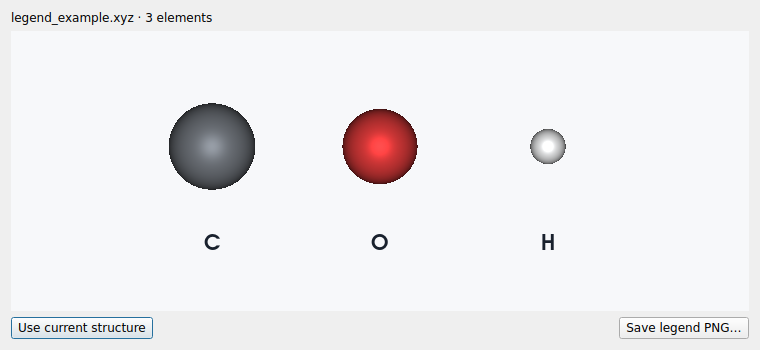
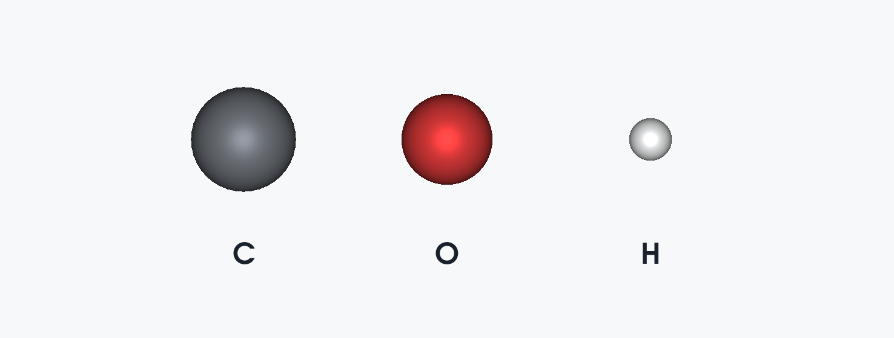

# LELE v2.8.0

## CP2K `.mol` 振动文件导入

直接使用 **File → Open…** 或拖入 `*-VIBRATIONS-*.mol`。
程序先检查 `[Molden Format]` 文件头，区分 CP2K/Molden 振动文件和普通 MDL `.mol` 结构文件。
`.molden`、`.mld` 扩展名以及具有相同文件头的其他扩展名也可识别。

在 Files 中展开 **Frequencies**，选择一个模式，可使用已有功能：

- 播放/暂停振动，调整可视化振幅和速度；
- 显示模式向量箭头，按选中原子筛选参与度；
- 保存当前图像、导出振动 GIF；
- 保存 `.lele` 项目后恢复结构、频率、模式向量和所选振动。

读取 `[FREQ]`、`[FR-COORD]`、`[FR-NORM-COORD]`；`[Atoms] AU/Angs` 可用于原子身份核对及参考结构回退。
频率单位为 cm⁻¹，负数保留为虚频。标准 Molden 的振动参考坐标、Cartesian 位移均为 Bohr，
导入时统一转换为 Å，不再次做质量加权。动画振幅仍表示最大原子的可视化位移 Å。

完整保留固定原子的零位移，不要求模式数等于整个结构的 3N 或 3N−6。
只有频率、缺少完整位移的模式仍列出，但禁用该模式的动画，不补造向量。
`[FR-COORD]` 是振动参考；若其与 `[Atoms]` 的坐标不同，使用前者并提示。

如果存在 `[INT]`，保留其第一列的 IR 数据和原始单位标签。CP2K 写出的该列是 a.u./amu，
不标成 km/mol；附加列保存在参考结构源信息中，不把未确认单位的数据转换成 Raman activity。
没有强度时不生成 IR/Raman 强度。可选 `[Cell] AU/Angs` 的晶胞矢量可以读取，但文件没有
给出周期方向时不猜测 PBC。不从邻近 log、输入、restart 借用能量、电荷、晶胞或优化状态。

### 本次提供的实际文件

`COF2_O2_a_freq-VIBRATIONS-1.mol`：124 个原子，6 个可动画模式。

| 模式 | 频率 / cm⁻¹ |
| --- | ---: |
| 1 | 239.777289 |
| 2 | 252.259862 |
| 3 | 312.216834 |
| 4 | 318.175319 |
| 5 | 324.214973 |
| 6 | 1548.774920 |

六个模式中仅第 123、124 号 O 原子具有非零位移；前 122 个原子在动画中保持不动。
该文件不含 `[INT]` 或 `[Cell]`，因此不显示并未提供的强度或周期性。
实际文件用于验收，未放入公开示例或本源码包。

## 原子图例改为独立窗口

入口仍为 **View → Atom legend…**，现在打开一个非模态窗口。
专用画布里仅有一排元素球与其下方的元素符号，没有原结构、键、坐标轴或收敛标记。

每种元素取主画布当前可见原子中的第一个样本，保持源结构中的出现顺序。
采用该样本的实际显示颜色、透明度及相对球半径；隐藏元素和晶面裁切后的不可见元素不列入。
同一元素有多种逐原子颜色时，使用第一个可见样本。

- **Use current structure**：按主窗口此时的结构、可见性和颜色重新生成图例。
- **Save legend PNG…**：只导出图例画布，默认保存到来源文件所在目录。

窗口保留打开/刷新时的图例快照，主窗口切换文件或视角不会修改已经打开的图例。
重新按 Use current structure 即可更新。固定正面显示保证所有样本始终从左到右排列，标签朝向读者。
图例不会加入原子列表、测量、成键或结构导出，也不会改变主结构视角。

主画布及其 PNG/GIF 已移除 v2.7.0 的图例叠层。旧 `.lele` 项目中的图例开关字段仍可读取，
但不会恢复旧叠层；需要图例时从 View 菜单打开窗口。

实现使用独立 VTK 场景生成球与文字，Qt 专用画布显示其图像；没有复用或嵌入主画布的相机/渲染层。
测试和实际文件验收记录见 [验证报告](VALIDATION_v2.8.0.md)。本包为源码，Windows 独立 EXE 需重新构建。

格式核对来源：

- [Molden 格式说明](https://www.theochem.ru.nl/molden/molden_format.html)
- [CP2K MOLDEN_VIB](https://manual.cp2k.org/trunk/CP2K_INPUT/VIBRATIONAL_ANALYSIS/PRINT/MOLDEN_VIB.html)
- [CP2K Molden 输出实现](https://doxygen.cp2k.org/dc/dff/molden__utils_8F_source.html)
