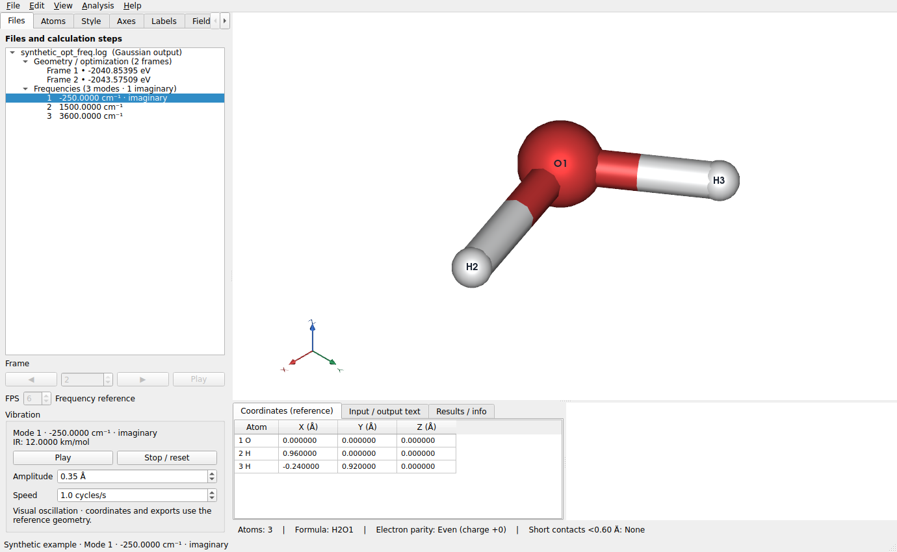
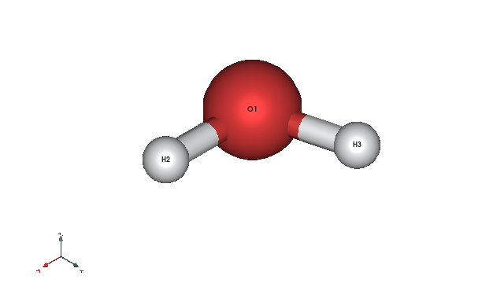

# Gaussian 优化、频率与振动动画

从 LELE 1.2.0 开始，同一 Gaussian 输出文件中的优化轨迹和谐振频率都可以查看。
打开 `.log` 或 `.out` 后，使用左侧 **Files** 页。

## 选择与播放

1. 展开文件。**Geometry / optimization** 中保留原有的结构帧及能量。
2. 展开 **Frequencies**。每行显示模式编号和波数，单位为 cm⁻¹；虚频保留负号并标注
   **imaginary**，未选中时以红色显示。分组标题显示总模式数和虚频数。
3. 点击任意模式立即开始动画；也可以在文件树中用上下键切换模式。
4. 树下的 **Vibration** 区显示当前频率及可用的 IR 强度，单位为 km/mol。
5. **Pause / Play** 暂停或继续；**Stop / reset** 停止并恢复参考构型。
6. **Amplitude** 设置振幅：所有原子中最大的单向位移，单位为 Å。默认 0.35 Å，
   范围 0.01–2.00 Å。所有原子位移使用同一个比例，保留文件中各原子的相对运动。
7. **Speed** 设置演示速度，默认每秒 1 个周期，范围 0.1–5.0 周期/秒。

**Analysis → Vibrational frequencies** 可直接进入当前文件的第一个模式。
选回任意结构帧会停止振动并恢复原来的帧浏览/播放控件；关闭窗口也会停止动画。

## 参考构型与坐标

Gaussian 输出中的 `Frequencies --`、IR 强度与下面 `Atom AN X Y Z` 表分别提供频率、
强度和相对笛卡尔位移向量。LELE 使用同一次频率计算打印的参考构型；常规情况下是
Standard orientation，在只有 Input orientation 时使用相应的输入坐标方向。
多个 Link1 频率任务各自分组、各自关联参考构型。

动画使用 `参考坐标 + 统一振幅比例 × 位移向量 × sin(相位)`。负频率也以往复运动展示，
方便观察过渡态模式。振幅和播放速度是可视化参数；物理频率仍按文件中读出的 cm⁻¹ 显示。
参见 Gaussian 官方的[振动分析说明](https://gaussian.com/vib/)。

动画不会改写优化帧或频率参考坐标。底部显示 **Coordinates (reference)**，坐标表、几何测量和
结构导出使用参考构型。原子选择、相机旋转、颜色、标签、显隐和透明度仍可使用；振动视图中的
原子显示调整作用于该视图，并可撤销。选回优化帧后可继续坐标编辑、删除原子和成键编辑。

振动预览固定参考构型的成键关系，避免位移放大后共价键反复消失、出现。
切换同组模式时保持相机方向和缩放。

## 缺失或截断的数据

- 读取文件中实际打印的模式，不补齐或推算没有输出的频率。
- 已有完整位移的模式可以播放；没有位移、位移表截断、原子序号/元素不匹配或全部位移为零
  的模式会保留在列表中，并提示动画不可用。
- 无法确认同次计算参考构型时，会在 Results / info 的 Reader note 中报告。
- 当前读取常规 `Atom AN X Y Z` 表；`HPModes` 的附加高精度表不会重复计入模式。
  只有附加表而缺少常规位移表时，不能播放相应模式。

## 保存单个振动模式为 GIF（1.3.0 起）

在 Files 中选择所需模式，再使用 **File → Export animation GIF…**，选择 **Current vibration**。
可调整输出宽度、FPS、振幅和一个周期的时长。保存的 GIF 包含该模式的完整周期，并可连续循环。
同一菜单也支持导出几何优化轨迹；见 [GIF 导出说明](GIF_EXPORT_CN.md)。

## 人工示例

源码中的 `examples/synthetic_opt_freq.log` 含两帧结构和三个模式，其中一个是负频率。
所有频率、强度与位移均为人工测试数据，文件开头已有说明。以下动画也使用该示例。

