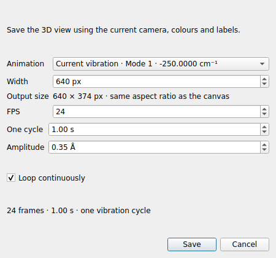
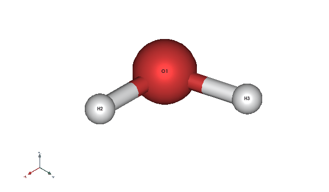
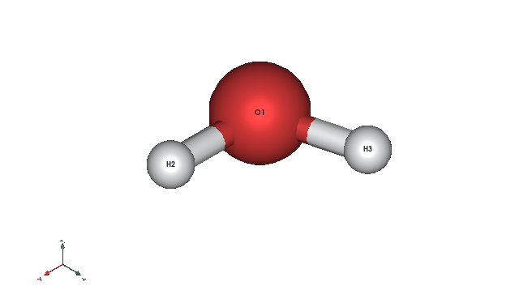

# GIF 动画导出

LELE 1.3.0 起可直接保存几何优化/普通轨迹，以及单个振动模式。

## 几何优化轨迹

1. 打开含多个结构帧的文件，例如 Gaussian 优化输出、XYZ 轨迹或 SIESTA 轨迹。
2. 在三维画布调整观察角度、缩放、配色和标签。
3. 选择 **File → Export animation GIF…**。
4. **Animation** 选择 **Geometry / optimization trajectory**。
5. 设置 **First frame / Last frame**（帧号从 1 开始），**Every N frames** 为抽帧间隔。
   例如第 2–6 帧、间隔 2，会导出第 2、4、6 帧；至少保留两帧。
6. **Forward then backward** 可往返播放：例如 `2 → 4 → 6 → 4`，循环时衔接到第 2 帧，
   首尾不会额外停留一帧。未勾选时按所选帧正向播放。
7. 设置宽度和 FPS，点击 Save 并选择 `.gif` 文件名。

## 单个振动模式

1. 在 Files 的 Frequencies 下先选择所需频率，包括虚频。
2. 使用相同的 **File → Export animation GIF…** 菜单。
3. **Animation** 默认选择 **Current vibration**，并显示当前模式编号和频率。
4. **Amplitude** 是所有原子中最大的单向位移，单位为 Å，初始值沿用振动控件。
5. **One cycle** 是完整往复周期的时长，初始值由当前演示速度换算。例如每秒 1 个周期对应 1 秒。
6. **FPS** 控制采样帧数。默认约 24 FPS；快速周期会提高最低帧率，以保留至少 8 帧。
   导出的是一个完整周期，采样末端不再添加与起点重复的姿态。

## 尺寸、循环与画面

- **Width** 设置输出宽度（像素）；高度按当前三维画布的宽高比自动计算，Output size 显示实际尺寸。
- **Loop continuously** 勾选时无限循环，取消勾选时播放一次。
- GIF 只包含三维画面，使用当前相机方向、缩放、投影、背景、颜色、标签、显隐和透明度。
  轨迹每帧沿用该帧自己的原子显示设置；振动模式沿用当前振动视图的设置及参考成键关系。
- 相机在整个导出期间保持固定，帧间不会自动改变缩放。
- GIF 使用 10 毫秒时间刻度，程序分配各帧时长，减少直接四舍五入每一帧造成的累计误差。
  实际总时长与帧数显示在对话框中。

## 进度与取消

导出期间显示当前帧数和进度，可以点击 Cancel。取消或出错会移除未完成的临时文件，
已有目标文件保持完整；成功完成后才替换目标文件。

导出使用独立的渲染画布，原始结构、振动参考坐标、主窗口视角和所选帧保持完整。
导出期间暂停主窗口播放，完成或取消后恢复先前的播放状态。关闭窗口会先取消导出再关闭画布。

程序逐帧渲染和编码，无需把完整高分辨率轨迹同时存入内存。Windows 打包前会安装声明的
依赖，包括 GIF 编码所需的 Pillow；无需安装录屏软件或 FFmpeg。

## 人工示例

以下均使用 `examples/synthetic_opt_freq.log` 的人工测试数据，通过本版导出功能生成：

