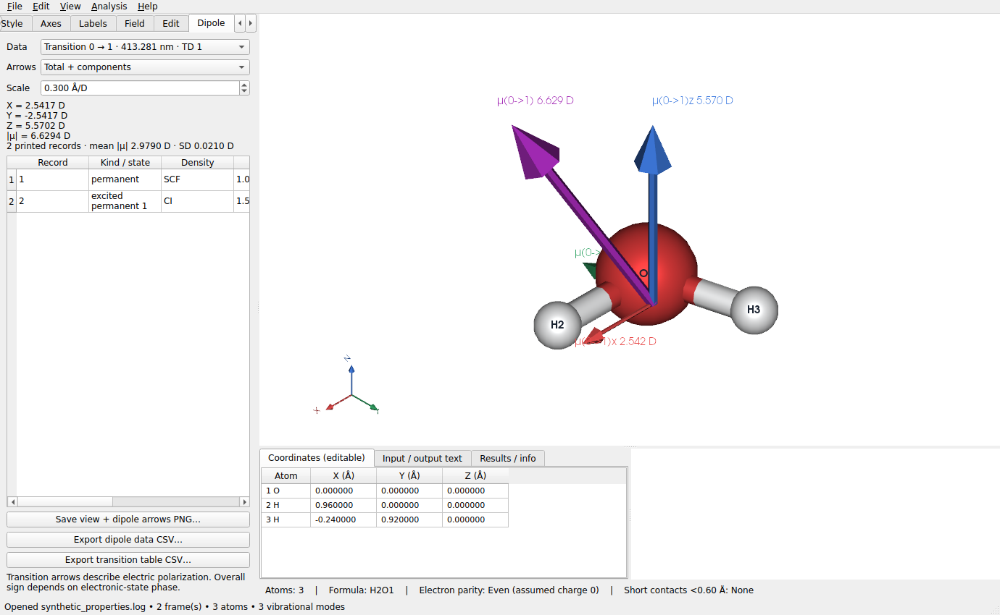
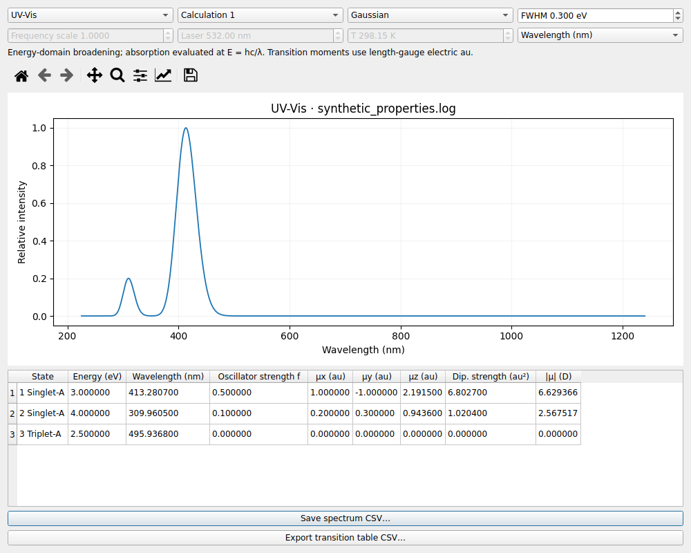
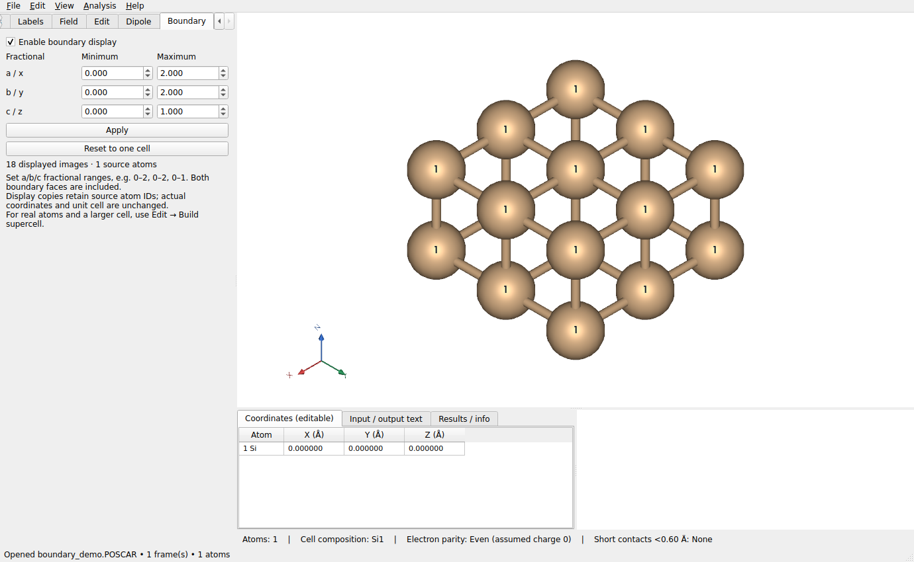

# v1.4 / v1.5 功能恢复（v1.7.0 历史记录）

本文记录 v1.7.0 恢复功能时的入口。从 v1.7.2 起，Boundary 改为完整晶胞复制，
不再采用下文的非整数分数切面；当前操作请见 [v1.7.2 显示更新](DISPLAY_UPDATES_v1.7.2_CN.md)。

原先的两个源码包未能恢复，因此在 v1.6.0 上重新实现以下功能，保留真实扩胞。

| 原版本 | 功能 | 当前入口与行为 |
|---|---|---|
| 1.4 | GIF 图像质量 | File → Export animation GIF：默认 2× 超采样、Lanczos 缩小、跨动画采样的共享调色板和可选抖色；默认较高分辨率 |
| 1.4 | 保存目录 | PNG、GIF、结构、能量图、光谱和属性 CSV 默认位于输入文件目录 |
| 1.4 | 坐标轴文字 | 角落 XYZ/abc 字母使用面向标记相机的文字，随视角变化保持正对镜头 |
| 1.4 | 能量单位 | 分子软件（Gaussian/ORCA 等）显示 kcal/mol；周期软件显示 eV，列表、信息和相对能量曲线一致 |
| 1.4 | IR/Raman | Analysis → IR / Raman spectrum；频率后显示打印强度/活性，支持 Gaussian/Lorentzian 展宽及频率缩放 |
| 1.4 | 普通偶极 | 左侧 Dipole：分量、模长、记录均值/标准差，以及总箭头、三分量箭头或四箭头 |
| 1.4 | 成键 | 去掉被两条较短键遮挡的近共线长自动键；保留三角环与手动添加键 |
| 1.4 | UV-Vis | Analysis → UV-Vis spectrum：从 Gaussian TDDFT 打印跃迁模拟相对吸收谱 |
| 1.4 | 复制粘贴 | 选择原子 → Ctrl+C → 切换文件 → Ctrl+V → 在画布单击落点；Esc 取消，Ctrl+Z 撤销 |
| 1.4 | 框选 | Atoms 页 Box select atoms 按钮或 Edit 同名菜单；拖矩形按原子中心选择，Ctrl/Shift 追加，Esc 退出 |
| 1.5 | 激发态/跃迁偶极 | Dipole → Data 可选择打印的激发态永久偶极及 0→n 跃迁电偶极；按钮导出箭头 PNG 与偶极 CSV |
| 1.5 | 元素组展开 | 单击、双击元素名称不展开；点击旁边的小三角展开/折叠；画布选择不会自动展开 |
| 1.5 | 跃迁表 | Dipole 页导出全部计算组；UV-Vis 页导出当前计算组的原始跃迁 CSV |
| 1.5 | Boundary | 左侧 Boundary：a/b/c 分数坐标范围，支持负值和非整数切面，重复显示晶胞、键和原子标签 |

## 偶极与导出

Dipole → Data 区分普通永久偶极、明确打印的激发态永久偶极和电跃迁偶极。
只有构型匹配时才提供箭头；刚性旋转同步转动向量，非刚性变化后不显示旧箭头。
跃迁箭头是长度规范电偶极，1 au 约等于 2.54174645 D；速度规范及磁偶极单独保留原始单位。
跃迁箭头表示极化方向，整体正负号依赖电子态相位，不等同于永久偶极或电荷转移方向。

三个按钮分别保存当前视图与箭头 PNG、全部偶极记录 CSV、全部跃迁表 CSV。
若 Arrows 为 Off，保存偶极 PNG 时临时显示总箭头，之后恢复 Off。
打印永久偶极的模长及由分量重算的模长分别保存。CSV 使用 UTF-8 BOM，便于 Windows Excel 打开。

跃迁 CSV 包含计算组、0→态编号、状态说明、激发能 eV、波长 nm、振子强度 f、
电偶极分量及模长（au/D）、打印偶极强度（au²）、长度/速度规范 f，以及速度/磁偶极原始分量。
附带按 `f = (2/3) ΔE(Hartree) |μ(au)|²` 计算的核对列。缺失值为空白，真实零值保留 0。
这些分量保持 Gaussian 打印坐标系；屏幕相机旋转不改写 CSV。

`mol1.log` 实际包含五个跃迁电偶极，而其永久偶极来自 **SCF Density**，不会被标作激发态永久偶极。
只有输出文件明确给出相应激发态密度时，才提供激发态永久偶极记录。

## 光谱与能量

光谱对话框可选择计算组、展宽线型和 FWHM。IR/Raman 支持频率缩放；Raman 可设置激光波长和温度，
由打印活性换算为相对 Stokes 权重。虚频不进入光谱曲线；缺少 Raman 活性时不凭空生成曲线。
UV-Vis 在能量域展宽，在波长模式下按 E=hc/λ 取值，不添加概率密度的 Jacobian。
所有光谱归一为相对强度，是打印线的展宽模拟，不是对实验数据进行参数拟合。

**Save spectrum CSV** 保存展宽后的采样曲线，**Export transition table CSV** 保存原始离散跃迁表。
振动动画中显示的偶极为参考构型的打印偶极，不是对振动瞬时构型重新计算的偶极。

内部能量始终采用 ASE 的 eV 约定，只在显示时换单位；Gaussian Hartree 不重复换算。
坐标编辑、删除、粘贴、扩胞等改变体系后，旧能量清空；整体刚性变换保持适用的原能量。

## Boundary 与真实扩胞

在 Boundary 页勾选 Enable，设置 a/b/c 最小/最大分数坐标并点击 Apply。
例如 a=0…2、b=0…2、c=0…1。范围沿实际晶格矢量，可用于斜晶胞。
非周期方向只截取，不重复；两端边界面都包含，因此显示副本数可多于独立原子数。

副本保留原原子的编号、颜色、透明度、显隐与标签；拾取副本对应原原子，PNG/GIF 使用同样的范围。
原子数、坐标导出和原晶胞不变；Boundary 不重复体数据网格。Reset 恢复单胞显示。
显示超过 50,000 个原子或范围过大时会提示；切换到不适用的帧时暂停显示并保留全局范围和启用设置。

**Edit → Build supercell** 则生成真实原子和更大的晶胞，可单独编辑新原子并导出新结构，保留 Ctrl+Z。
详细操作见 [扩胞说明](SUPERCELL_CN.md)。

## 示例与构建

`examples/synthetic_properties.log` 的频率、强度、跃迁与偶极全部是人工测试数据；
`examples/boundary_demo.POSCAR` 为人工简单立方例子。新截图只使用这些示例。
真实 `ts1.log` / `mol1.log` 不随源码分发。
Windows 更新程序需重新运行 `build_windows.bat`，旧 EXE 不会自动更新。
