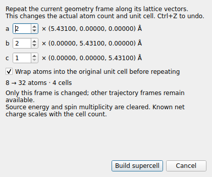
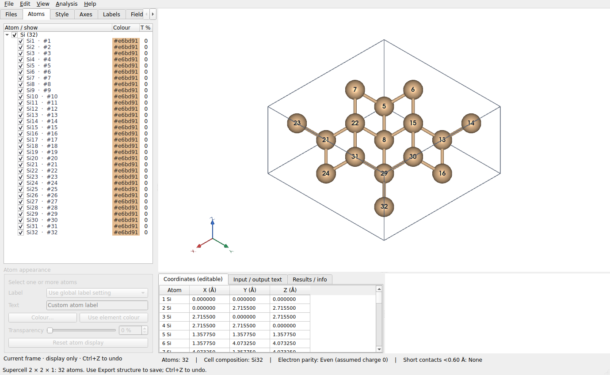

# 周期结构扩胞（v1.6.0）

扩胞功能在 v1.6.0 加入；当前 v1.7.1 还包含重新实现的 v1.4.0/v1.5.0 功能。
Boundary 只重复显示，扩胞则生成真实原子和新晶胞，两者可分别使用。

从 v1.7.1 起，**Ctrl+G** 选择跨晶胞的有限片段时，也会按需要自动建立真实超胞。
坐标表、Atoms 列表和原子编号同步更新，**Ctrl+I** 对扩胞后的全部原子反选；
**Ctrl+Z** 撤销自动扩胞。只在原晶胞内部选择片段时不扩胞、不增加撤销记录。
自动扩胞与下面的手动扩胞共用电荷、显示设置、成键、能量和体数据处理规则。

## 操作

1. 打开 POSCAR、CIF 等具有有效周期晶胞的结构，选择要扩胞的几何帧。
2. 点击 **Edit → Build supercell…**。
3. 分别设置 a、b、c 方向的正整数倍数，例如 **2 × 2 × 1**。
4. 检查对话框显示的新原子数，点击 **Build supercell**。
5. 使用 **File → Export structure…** 保存为 POSCAR、CIF、XYZ 或 GJF。

例如 `examples/Si_POSCAR` 含 8 个原子，2 × 2 × 1 扩胞后为 **32 个真实原子**，
晶格矢量 a、b 加倍，c 保持原长。坐标表、Atoms 列表、原子总数和导出的文件均采用新结构。
这不是显示副本；对新原子可分别选择、编辑颜色、透明度或坐标。

## 晶格与坐标

- 使用实际晶格矢量 a/b/c，不是屏幕 X/Y/Z；适用于斜晶胞。
- 新晶格为 `a′ = n_a a`、`b′ = n_b b`、`c′ = n_c c`。
- 原子顺序按平移晶胞排列，每个晶胞中保留原原子顺序；不在两端额外复制边界原子。
- 默认先将原子包裹进原晶胞的周期方向，再重复。取消 **Wrap atoms…** 可保留原输入的未包裹坐标。
- 非周期方向的倍数固定为 1；没有周期标志或晶胞无效时，扩胞入口不可用。
- 仅修改当前几何帧，其他轨迹帧保持原状。振动模式预览中不能扩胞，需先选择几何帧。
- 支持最多 50,000 个真实原子；超过时不能提交。

## 编辑与计算数据

显隐、颜色、透明度、自定义标签和原 POSCAR 分组信息复制到对应的新原子。
手动成键或断键按实际的周期平移路径映射，包含跨原晶胞边界的键。

扩胞后原输出能量不再适用于新体系，因此清空，不假定其为原能量的简单整数倍。
已知净电荷按重复晶胞数倍增；自旋多重度需要重新指定，不据旧值推测。

若文档带有体数据，扩胞会分离旧网格，避免把单胞网格当作新超胞的计算结果。
**Ctrl+Z** 恢复原原子、晶胞、选择、能量和体数据。

导出坐标后可用于后续计算；单原子的显示设置及手动键属于可视化设置，不写入 POSCAR/XYZ/CIF。
Windows 更新程序需重新运行 `build_windows.bat`。
