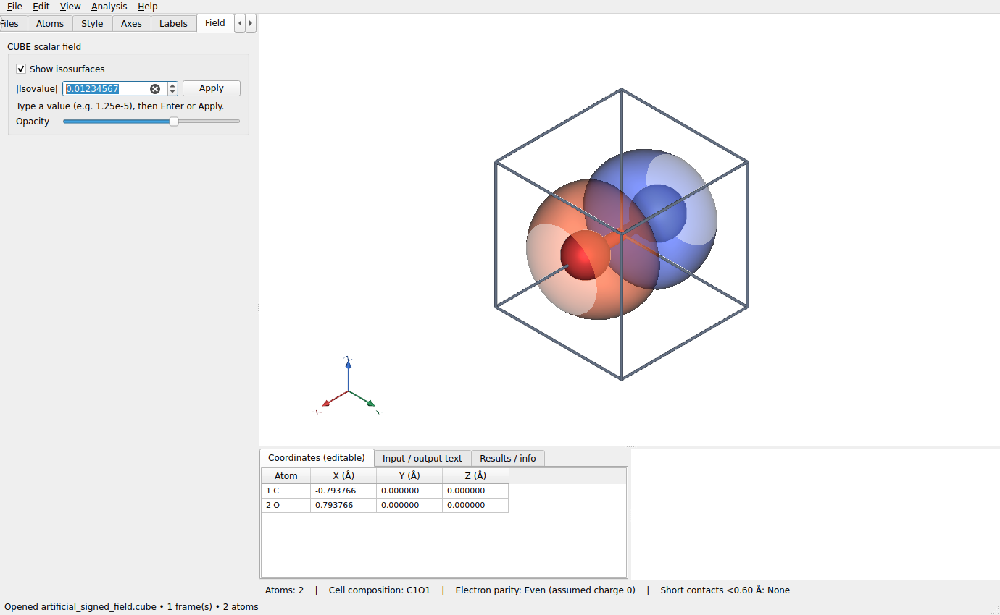

# LELE 1.1.1 验证记录

日期：2026-10-27

## 修复

原等值面输入框限制为 4 位小数，键入 `0.01234567` 实际只接受 `0.0123`；
输入过程中的值变化还会立即触发场景重建。

- 等值面输入框支持小数、科学计数法和粘贴，最多 12 位小数。
- 按 Enter、点击 Apply 或移开焦点后应用；输入中间状态不重建等值面。
- 上下箭头保留原来的 0.005 步长，支持范围为 1e-12 至 10000。
- 控件和渲染器使用相同的最小值，避免小于 1e-7 的输入被渲染器替换为旧下限。
- 程序、欢迎页、Python 包、启动提示与当前文档同步为 1.1.1。

## 结果

- 完整回归：151 项测试、64 个子测试通过，无失败、无跳过。
- 实际 Qt 键盘输入 `0.01234567`：输入中没有刷新，Enter 后只刷新一次，参数及两个
  vtkContourFilter 的阈值分别为精确的正、负输入值。
- 粘贴 `1.2345e-5`、点击 Apply、Up 键增加步长、Delete 编辑文字及无效的零值回退均通过。
- 验证 1.25e-9 的小阈值确实传给正、负等值面，没有被提高到旧的 1e-7 下限。
- 检查实际 Qt 控件和 VTK 离屏场景截图，确认输入内容、Apply、箭头及提示均可见。
- 实际构建 1.1.1 wheel，检查版本为 1.1.1、许可为 MIT，相关源码模块与包内内容一致。
- 欢迎页确认显示 Version 1.1.1，并更新截图。

当前验证环境为 Linux；Windows EXE 需要用本次源码重新运行 build_windows.bat。
