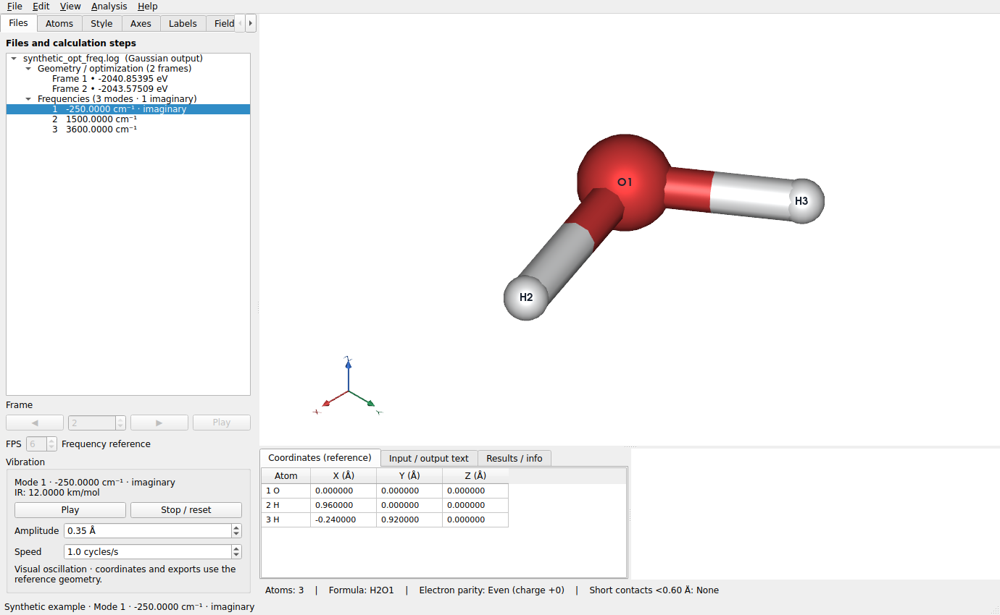

# LELE 1.2.0 验证记录

日期：2026-10-27

## 本版内容

Gaussian 读取器原先仅提取结构及 ASE 能量。本版额外读取谐振频率、IR 强度、约化质量、
力常数和笛卡尔位移，保留优化轨迹，并在 Files 树中分别显示结构和频率。
选择模式后播放振动，可暂停、复位、调整振幅和演示速度。

## 验证结果

- 完整回归：**175 项测试、64 个子测试通过**，无失败、无跳过。
- 用户提供的完整 Gaussian 优化加频率日志：读取 **134 个原子、43 个结构帧、396 个模式、
  1 个虚频**；396 个模式的位移均完整。
- 对该日志运行实际 Qt 界面与 VTK 离屏场景：树中分别有 43 个结构项和 396 个模式项。
  验证选择虚频后开始运动、暂停保持姿态、选择最后一个高频模式、停止恢复参考构型、
  返回优化帧，以及关闭窗口停止定时器。所有原始结构帧和频率参考坐标保持不变。
- 人工 Opt+Freq 示例：验证三列模式的频率、强度与 XYZ 位移一一对应，保留负频率；
  多个频率任务分别关联自己的参考构型，Standard/Input 坐标方向不混用。
- 覆盖 Fortran D 指数、单模式表、缺少可选强度、附加高精度表、低频摘要、
  截断位移表、缺失原子、元素不匹配、非有限位移、零向量、任务边界和缺少参考构型。
- Qt 交互覆盖文件树上下键切换、自动播放、暂停/复位、振幅、固定相机、原始坐标保护、
  坐标编辑保护、原子显示设置与撤销、多组频率/多文件切换，以及返回结构帧后恢复编辑。
- VTK 验证放大位移时仍绘制参考构型的共价键，避免自动换键；离开振动视图后恢复正常成键。
- 原有窗口先绘制再预加载、等值面精确输入、原子显示、轨迹、编辑与选择回归均通过。
- 实际构建 1.2.0 wheel，并检查包版本、MIT 许可及新增模块；欢迎页确认显示 Version 1.2.0。
- 检查实际 Qt + VTK 截图及人工示例振动预览。源码包只附带人工示例，未包含用户上传的计算日志。

当前检查环境为 Linux、Python 3.12、PySide6 6.12 和 VTK 9.7（EGL 离屏）。
Windows 原生交互与 EXE 仍需在 Windows 上验收；使用本次源码重新运行 `build_windows.bat`。

操作与读取范围见 [Gaussian 频率与振动动画说明](GAUSSIAN_VIBRATIONS_CN.md)。
