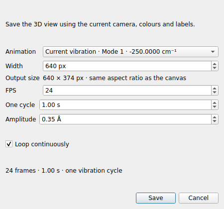

# LELE 1.3.0 验证记录

日期：2026-10-27

## 本版内容

新增 **File → Export animation GIF…**。可保存几何优化/普通轨迹，以及当前选中的振动模式。
提供分辨率、FPS、循环、帧范围、抽帧、往返播放、振幅与周期时长设置。
导出使用独立 VTK 画布，逐帧编码，支持进度、取消及完成后的播放状态恢复。

## 结果

- 完整回归：**192 项测试、64 个子测试通过**，无失败、无跳过。
- 从实际 File 菜单进入真实 Qt 导出对话框，设置后保存人工示例的单个振动模式：
  Pillow 读回为 **640 × 374、24 帧、总时长 1000 ms、无限循环**。
- 导出人工示例的优化轨迹：读回为 **640 × 374、2 帧**。
- 用户提供的完整 Gaussian 日志：实际界面打开后，导出 **43 帧几何优化轨迹**及
  **24 帧虚频周期**（均为 480 × 280），逐帧读回成功，原始坐标保持不变。
- 实际窗口在导出期间收到关闭请求：先取消，再关闭原生画布；已有目标文件保持完整，
  临时文件已清理，振动定时器已停止。
- 原生 VTK 回归验证帧范围和往返顺序、输出尺寸、纵向像素方向、固定相机及源坐标保护。
- 振动采样验证完整周期、正反向位移、归一化振幅，以及不重复最后一个起始姿态。
- GIF 解码验证每帧颜色表、重复输入帧的保留、循环/单次播放、FPS 取整后的总时长。
  短周期高帧率仍保留至少 20 ms 的单帧延时。
- 取消、渲染器异常、帧数不匹配和尺寸不一致均保留原有文件，并移除未完成文件。
- Qt 流程验证导出不改变主窗口振动相位、相机和原始坐标；完成和取消后恢复原来的播放。
- 首次绘制后自动预加载的回归通过，Pillow 编码模块也在首次绘制后导入。
- Windows 启动器检查 Pillow 版本；构建脚本先安装声明依赖，再打包程序。
- 实际构建 1.3.0 wheel，检查版本、MIT 许可、Pillow 依赖及新增导出模块。
- 欢迎页确认显示 Version 1.3.0，并更新截图。分发包仅附人工示例和预览，
  未包含用户上传的计算日志或对应的计算结构动画。

检查环境为 Linux、Python 3.12、PySide6 6.12、VTK 9.7（EGL 离屏）和 Pillow 12.3。
Windows 原生交互与 EXE 仍需在 Windows 上验收；使用本次完整源码重新运行 `build_windows.bat`。

使用方法见 [GIF 导出说明](GIF_EXPORT_CN.md)。编码使用 Pillow 文档中列出的
[GIF 插件接口](https://pillow.readthedocs.io/en/stable/reference/plugins.html#module-PIL.GifImagePlugin)，
按帧写出，避免将整段高分辨率轨迹同时保存在内存。
