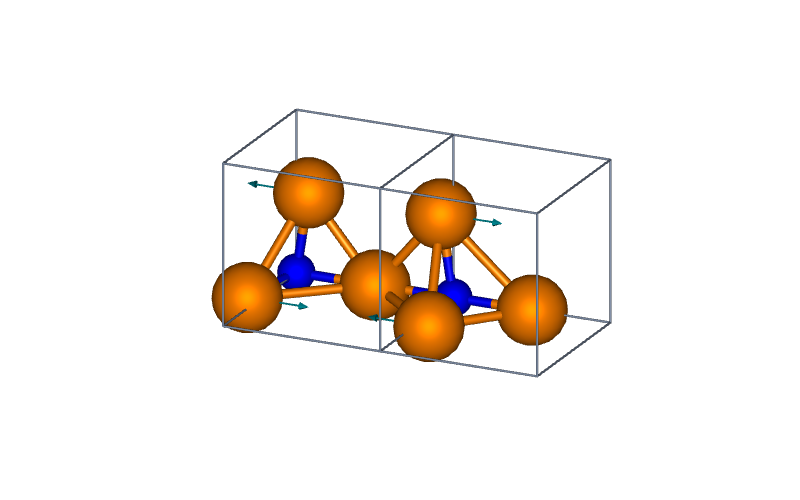

# LELE 2.10.0 validation — 2026-10-30

**707 tests and 78 subtests passed**, with no failures, errors or skips, in
**48.47 seconds**. This includes all four supplied QE files and the previously
supplied CP2K Molden example. The JUnit report records 785 cases because the
78 subtests are represented as individual cases there.

Environment: Python 3.12.14, ASE 3.29.0, NumPy 2.3.5, SciPy 1.17.0,
PySide6 6.12.0, VTK 9.7.1; Linux, Qt offscreen and native VTK EGL rendering.
No Windows executable was built or tested in this environment.

```bash
LELE_QE_EXAMPLE_DIR=/path/to/four/QE/files \
LELE_CP2K_MOLDEN_EXAMPLE=/path/to/COF2_O2_a_freq-VIBRATIONS-1.mol \
QT_QPA_PLATFORM=offscreen VTK_DEFAULT_OPENGL_WINDOW=vtkEGLRenderWindow \
python -m pytest tests -q --junitxml=docs/qa_v2.10.0/full_v2100.xml
```

[Full test report](qa_v2.10.0/full_v2100.xml).
The original private examples are not redistributed. Without their environment
variables, the corresponding two actual-file cases are skipped.

## Actual files

[Acceptance record](qa_v2.10.0/supplied_qe_acceptance.json) includes SHA256 hashes,
record counts, q-point order, source Rydberg energies and native rendering checks.

| File | Verified result |
| --- | --- |
| `01_vc-relax.in` | 4 atoms, N/Cu/Cu/Cu coordinate order, 3.81470618 Å cubic cell and parsed namelists |
| `job.out` | Five structure/SCF evaluation records, independently retained source Ry energies, variable cells and confirmed final convergence |
| `job.out03` | PHONON detection despite the suffix; 4 q points and 48 frequencies, no invented displacement data |
| `matdyn.modes` | Five q-point occurrences, including both Gamma entries; 60 modes, source negative frequencies and complex columns preserved |

The final PWSCF source energy is −659.95599528 Ry; final cubic lattice parameter
is 3.826675649 Šand volume is 56.0357202256568 ų. Internal eV/Bohr conversions
retain ASE's QE-reader unit convention, and source Ry values remain separately
available without reconstructing them from rounded converted values.

Explicit association to the PHONON reference makes all 60 supplied matdyn modes
animatable. The PHONON file's 48 frequency-only modes remain non-animatable.
The two distinct frequency sets are not merged or matched by nearest frequency.

## Regression coverage

The 21 new cases cover Angstrom/Bohr/crystal input units; input metadata and
project round trips; variable cells separated from coordinate cards; distinct
SCF evaluations on unchanged coordinates; incomplete trailing records; PHONON
stdout with and without geometry; frequency-only and incomplete displacement
records; repeated q points; reference atom-count and alat checks; complex-vector
participation; exact cyclic normalization; Bloch spatial/time phase including
complex polarization and atoms crossing cell faces; raw/bound project persistence;
actual GUI reference assignment and frequency actions; q-labeled CSV; and removal
of stale QE energy/force data on geometry edits with undo restoration.

Existing 1,003-frame QE regressions still match ASE's fixed/variable-cell
structures and energies exactly, retain final SCF distinctions and separate
concatenated jobs. Existing molecular-mode, project, Boundary, GIF, legend and
other-format tests remain in the full suite.

## Native rendering

```bash
VTK_DEFAULT_OPENGL_WINDOW=vtkEGLRenderWindow \
python tools/validate_qe_examples.py /path/to/four/QE/files
```

The production renderer displays the actual supplied non-Gamma q=(0.5,0,0),
mode 3 (53.358059 cm⁻¹), using two Boundary cells. Eight displayed atoms and
four nonzero polarization arrows are recorded. Source reference coordinates
are preserved. The GIF was reopened to verify eight frames at 480×320 pixels;
the PNG was visually inspected. Analytic tests independently check the Bloch
phase convention, rather than inferring it from the appearance of this image.



## Scope and source conventions

PW structure inputs use ASE espresso-in semantics; the supplied input and
coordinate-unit variations use ibrav=0. This validation does not assert support
for every QE executable or every nonzero-ibrav input. `.modes` is treated as
normalized Cartesian displacements; `.eig` is not silently interpreted as the
same representation. q vectors are Cartesian 2π/alat, with the scale supplied
explicitly when associating a reference. Missing structures, vectors, energies
and IR/Raman intensities remain missing.

Primary format references:

- [QE PW input description](https://www.quantum-espresso.org/Doc/INPUT_PW.html)
- [QE matdyn input/output description](https://www.quantum-espresso.org/Doc/INPUT_MATDYN.html)
- [QE 7.3.1 mode writer](https://github.com/QEF/q-e/blob/qe-7.3.1/PHonon/PH/write_eigenvectors.f90)
- [QE 7.3.1 matdyn implementation](https://github.com/QEF/q-e/blob/qe-7.3.1/PHonon/PH/matdyn.f90)

The reader preserves printed normalized vectors and their real/imaginary
components; it does not divide them by square-root masses a second time.
