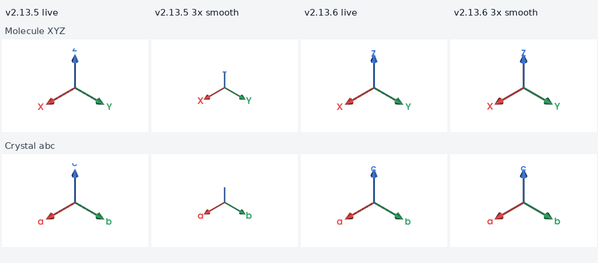

# LELE v2.13.6 坐标轴修复与复验

日期：2026-11-03。针对 `LELE_v2.13.5_acceptance_20261103(1).md` 的 A1、A2 修复，基线源码 SHA-256 为 `1ad208daa2ca8eb55375e4613e88e7829d19574f45913a8aa0e3af577e91fe76`。

**结论：两项报告问题均已修复。报告的 18 项图像断言全部通过。**

## 修复内容

### A1：3×/4× 平滑 PNG 截短左下角坐标轴

高清捕获使用独立的角落覆层快照，包括渲染器、文字对象和文字属性。方向标记的实时相机及视口更新不再干扰分块渲染；独立文字对象也避免导出污染原画布的字形缓存。保存或发生异常后均移除临时覆层并恢复现场状态。

保留 1×/2×/3×/4×、自定义宽度和平滑选项，默认仍为 3× 平滑；没有通过降低默认导出质量来绕开问题。

### A2：原画布 Z/c 字母被裁切

按实际字体的像素包围框，在角落视口内保留 3 px 边缘余量。相机旋转、字号变化和画布尺寸变化时重新安排字母位置；视口过小时适配字形尺寸。箭头几何保持原有定义，文字不参与坐标轴的三维边界计算。

## 复验结果

| 检查 | 结果 |
| --- | --- |
| 修改前，原报告图像断言 | 复现 **12 通过、6 失败** |
| 修改后，原报告图像断言 | **18 项全部通过**，原断言及 15% 范围容差保持不变 |
| 新增渲染回归 | **25 项全部通过**，已计入下方完整回归 |
| 完整回归 | **1019 项测试及 78 个子测试全部通过**，0 失败、0 错误、0 跳过；JUnit 合计 1097 |
| 历次独立复验 | **114 项全部通过**，0 跳过，包含长输出检查 |
| wheel 安装产物 | 构建、安装成功；离开源码目录，从安装产物运行两份结构及全部倍率/平滑组合，**18 项图像断言全部通过** |

新增用例包含 XYZ/abc 的 1× 至 4×、平滑开关共 16 个导出场景；另检查 8/15/32/72 四种字号、旋转及窗口缩放下的完整字形边界，以及导出异常时覆层与文字状态的恢复。

在安装产物中实测，将输出缩回 1022×620 画布尺寸后的坐标轴及文字范围如下：

| 场景 | 原画布 | 3× 平滑 | 4× 平滑 |
| --- | --- | --- | --- |
| 水分子 XYZ | 124×100 px | 121×101 px | 122×101 px |
| 硅晶体 abc | 124×98 px | 122×98 px | 122×98 px |

各导出组合的范围均接近原画布。每次保存后还逐像素比较原画布，全部保持一致。

原画布 Z 的可见字形高度从 **5 px 恢复到 11 px**，c 从 **5 px 恢复到 9 px**；与报告使用的向内移动字母对照分别相同，不再从视口上沿开始被截断。



## 证据与复现

证据位于 `qa_v2.13.6/`：

- `full_retest.xml`、`full_retest.log`：完整回归。
- `independent.xml`、`independent.log`：114 项独立复验。
- `new_regressions.xml`、`new_regressions.log`：新增 25 项渲染回归。
- `wheel_oracles.xml`、`wheel_oracles.log`：安装产物的 18 项原报告图像断言。
- `before/axis_probe.json`、`before/live_label_probe.json`：修复前测量。
- `after/axis/`、`after/labels/`：安装产物实测的图像、裁图和测量记录，JSON 中保留实际包路径及版本。
- `repro/`：沿用原报告的生产窗口探针和像素断言脚本。
- `axes_fix_comparison.png`：修复前后对照。

Linux EGL 环境下，在已安装当前源码或 wheel 的 Python 环境中，可从任意目录运行以下命令。将 SRC 替换为源码根目录、QA 替换为本证据目录、OUT 替换为新的输出目录：

```bash
export QT_QPA_PLATFORM=offscreen VTK_DEFAULT_OPENGL_WINDOW=vtkEGLRenderWindow EGL_PLATFORM=surfaceless
export OMP_NUM_THREADS=1 OPENBLAS_NUM_THREADS=1 LP_NUM_THREADS=2
python "$QA/repro/axis_probe.py" "$SRC/examples" "$OUT/axis"
python "$QA/repro/live_labels.py" "$SRC/examples" "$OUT/labels"
LELE_ACCEPT_EVIDENCE="$OUT" python -m pytest "$QA/repro/test_axis_fidelity.py" -q
```

完整回归的私有样例配置继续沿用 `VALIDATION_v2.13.2.md`；用户原始私有输入文件不重新分发。

环境为 Linux、Python 3.12、PySide6 6.12.0、VTK 9.7.1、Pillow 12.3.0，生产 Qt 窗口使用 EGL 离屏渲染。交付为源码包；Windows EXE 未构建或实机验证。
