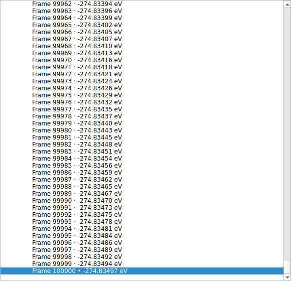

# LELE 2.5.0 validation — 2026-10-30

Validated on Linux with CPython 3.12.14, ASE 3.29.0, NumPy 2.3.5, SciPy 1.17.0,
PySide6 6.12.0 and VTK 9.7.1. Qt used offscreen/EGL. No Windows executable was
built or tested here.

## Functional regression

**605 tests and 78 subtests passed**, zero failures/skips, in 28.67 seconds.
The 22 new long-file tests cover imports above 750 frames for CP2K XYZ/stdout,
plain/extended XYZ, variable-cell XDATCAR, VASP OUTCAR, Gaussian/ORCA optimization,
xTB and SIESTA ANI; a 50,003-frame NEB reader case; packed VASP number columns;
UTF-16; incomplete tails; optional explicit API limits without a silent last-frame
fallback; load-scoped text caching without stale reopen results; lazy tree pages,
stage-specific navigation, energy-only selection and complete curves; edited
long-project and active-series GUI round trips; worker-thread parsing/main-thread
attachment; cancellation and ordered continuation without partial documents.

```bash
QT_QPA_PLATFORM=offscreen VTK_DEFAULT_OPENGL_WINDOW=vtkEGLRenderWindow \
python -m pytest tests -q --junitxml=docs/qa_v2.5.0/full_v250.xml
```

Report: [full_v250.xml](qa_v2.5.0/full_v250.xml).

## Complete scientific-value equivalence

All eight supplied files were loaded with 2.4.0 and 2.5.0. A canonical recursive
comparison of each entire Document (coordinates/cells, energy records and links,
source metadata, jobs/stages, forces/criteria, orbitals, spectra, transitions and
vibrations) gives identical hashes for every file. Counts:

| Source | Structures | Calculation records |
| --- | ---: | ---: |
| cp2k.inp | 1 | 1 structure-only record |
| cp2k.out | 1 | 135 |
| Phenylhydrazine-pos-1.xyz | 134 | 134 |
| Phenylhydrazine-1.restart | 1 | 1 structure-only record |
| cp2k.out_tddft | 2 | 2 |
| OUTCAR_opt | 20 | 20 |
| OUTCAR_freq | 25 | 25 |
| XDATCAR | 20 | 20 structure-only records |

This retains VASP E0-only behavior, CP2K's independent-file policy and the
200 printed TDDFPT transitions with component magnitudes, without fabricated
vectors or coefficients. Actual user coordinates and outputs are not bundled.
Report: [actual_file_equivalence.json](qa_v2.5.0/actual_file_equivalence.json).

## Parser performance

Synthetic, reproducible inputs; three complete loads per case, warm imports,
same runtime/machine and median wall seconds. Timings exclude GUI construction
and the post-load correctness digest. The old version is given an explicit
20,000-frame API limit to allow a complete baseline; 2.5.0 uses its unrestricted
default. Source text is not cached across loads. Counts and scientific digests
match exactly between versions. These are measured cases, not a universal
speed guarantee or Windows benchmark.

| Synthetic case | Data | 2.4.0 (s) | 2.5.0 (s) | Speedup |
| --- | --- | ---: | ---: | ---: |
| CP2K XYZ | 10,000 frames × 128 atoms; 37.65 MB | 3.744 | 1.149 | 3.26× |
| Plain XYZ | 10,000 frames × 128 atoms; 37.27 MB | 2.265 | 0.980 | 2.31× |
| XDATCAR | 10,000 frames × 128 atoms; 34.83 MB | 6.279 | 1.233 | 5.09× |
| CP2K stdout, mostly SCF rows | 4,000 energy records; 71.05 MB | 7.230 | 1.522 | 4.75× |
| CP2K stdout, coordinate tables | 4,000 frames × 16 atoms, two jobs; 2.83 MB | 0.492 | 0.378 | 1.30× |

The Files-tree benchmark for the same 4,000-frame/two-stage document includes
initial population and making the first frame available. Median of three runs:
**0.1539 s → 0.00329 s (46.7×)**. Initial widgets drop from 4,003 to 275. Peak RSS
for each complete standalone tree-benchmark process was 273,756 KiB and
153,460 KiB respectively; these are process peaks including imports/parsing,
not isolated tree allocations. Tree timings are separate from parser timings.

Raw reports: [baseline](qa_v2.5.0/baseline_loading_v240.json),
[current](qa_v2.5.0/loading_v250.json),
[comparison](qa_v2.5.0/performance_comparison.json),
[old tree](qa_v2.5.0/tree_v240.json), [new tree](qa_v2.5.0/tree_v250.json).

Reproduce the parser cases (generates roughly 184 MB of synthetic inputs):

```bash
python tools/benchmark_loading.py --generate /tmp/lele-bench \
  --repeat 3 --output /tmp/lele-loading.json
```

For the old source, add `--source /path/to/LELE-2.4.0 --legacy-limit 20000`.
Use the same input files/machine and compare the retained scientific digests.

## 100,000-frame GUI acceptance

A separate synthetic CP2K XYZ contains **100,000 frames with one atom per frame**
and 100,000 comment energies. It opens through the actual background-import path
and Qt event loop in the headless GUI harness. Parsing plus attachment takes
4.278 s; a 5 ms GUI timer fires 205 times during import. The last frame is selected
through the frame-number control, its coordinate is checked, and only 808 tree
widgets exist after visiting the first and last pages. The energy plot retains
100,000 points and CSV exports all 100,000 records with the correct final frame.
This is a responsiveness/integrity acceptance case; it does not estimate the
cost of 100,000 large structures or real-time 3D rendering on user hardware.

Report: [large_gui_acceptance.json](qa_v2.5.0/large_gui_acceptance.json).
The synthetic Files-tree preview was inspected:



## Practical scope

No fixed application frame-count cap is imposed. Structure data still resides
in memory; available RAM and atom count determine practical capacity. Tree pages
limit widget creation only and do not sample or discard frames. Binary/project
IO and generic third-party formats retain their existing data models. Large
scientific files (at least 4 MiB) parse in a background worker; `.lele` project
loading remains synchronous. Cancellation is cooperative at parsing checkpoints.
No new electronic-entropy correction or CP2K E0 inference was introduced.
