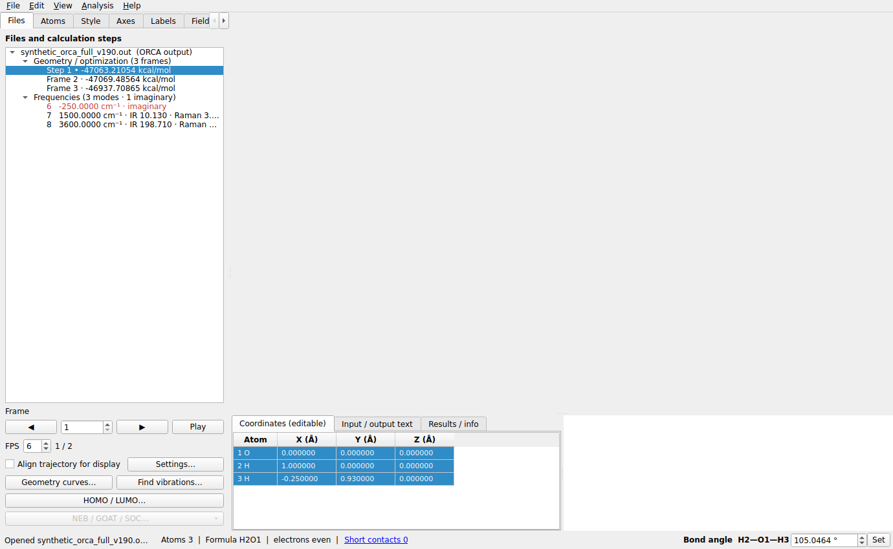
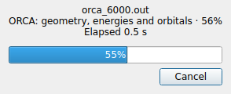

# LELE 2.6.0 validation — 2026-10-30

Environment: Linux, CPython 3.12.14, ASE 3.29.0, NumPy 2.3.5, SciPy 1.17.0,
PySide6 6.12.0, VTK 9.7.1. Qt controls and event loops use the offscreen platform.
Windows mouse responsiveness and a rebuilt Windows EXE have not been tested here.

## Regression

**646 tests and 78 subtests passed**, with zero failures/errors/skips, in
31.10 seconds. There are 41 new tests compared with 2.5.0.

The full suite covers the retained VASP E0-only policy, independent CP2K files,
uncapped frame imports, projects, periodic geometry, rendering and analysis.
The new cases cover rigid terminal-fragment distance/angle/dihedral edits,
selection order, exact target values, collinear angles, invalid targets,
ring/network rejection without mutation, periodic unwrapping/image shifts,
independent dashed links, GUI input/Enter, undo and stale energies, effective
cutoff changes with frozen/manual bonds and pair rules, and the bottom footer.

ORCA cases verify all frames/energies/dipoles, convergence values and reference
links, UTF-8/UTF-16 byte progress, bounded progress signal traffic, cancellation
during a property pass, background loading below 4 MiB, main-thread attachment,
Qt timer service during actual parsing, window closure, compound-job isolation,
and mixed background/synchronous imports draining their entire queue.

```bash
QT_QPA_PLATFORM=offscreen VTK_DEFAULT_OPENGL_WINDOW=vtkEGLRenderWindow \
python -m pytest tests -q --junitxml=docs/qa_v2.6.0/full_v260.xml
```

Full result: [JUnit report](qa_v2.6.0/full_v260.xml).

## Complete scientific-value equivalence

All eight supplied CP2K/VASP files produce identical complete-Document recursive
digests in 2.5.0 and 2.6.0. This includes all dataclass fields, symbols, coordinate
and cell arrays, original energy records and frame links, source line metadata,
jobs/stages, orbitals, transitions, spectra and vibrations. Source files:
cp2k.inp, cp2k.out, Phenylhydrazine-pos-1.xyz, Phenylhydrazine-1.restart,
cp2k.out_tddft, OUTCAR_opt, OUTCAR_freq and XDATCAR.

Report: [actual-file equivalence](qa_v2.6.0/actual_equivalence.json).
User calculation files are not bundled.

## ORCA parser performance

Each generated ORCA optimization contains 16 atoms per frame, 30 numeric SCF
rows per step, a printed final energy and permanent dipole at every step.
Three complete loads per version, warm parser imports, same machine/runtime;
median wall seconds exclude the post-load correctness digest and GUI creation.
No frame limit or subsampling is used. Complete-Document digests match between
versions for every case, including every dipole's reference geometry/energy.

| Frames / dipoles | Input size | 2.5.0 | 2.6.0 | Speedup |
| ---: | ---: | ---: | ---: | ---: |
| 1,500 | 2.36 MB | 1.309 s | 0.301 s | 4.35× |
| 6,000 | 9.43 MB | 5.523 s | 1.117 s | 4.94× |
| 12,000 | 18.86 MB | 12.809 s | 2.402 s | 5.33× |

These are reproducible synthetic cases, not a universal speed guarantee or a
benchmark of the user's problematic ORCA file (that file was not supplied).
Original numbers and complete digests:
[baseline](qa_v2.6.0/orca_baseline_v250.json),
[current](qa_v2.6.0/orca_loading_v260.json),
[comparison](qa_v2.6.0/orca_comparison.json).

```bash
python tools/benchmark_orca_loading.py --data /tmp/lele-orca --generate \
  --output /tmp/orca-current.json
# Same generated inputs, older source:
python tools/benchmark_orca_loading.py --data /tmp/lele-orca \
  --source /path/to/LELE-2.5.0 --output /tmp/orca-baseline.json
```

## GUI and layout acceptance

A separate headless Qt application opens the 6,000-frame/16-atom ORCA case
through the actual public background import path. It retains 6,000 dipoles,
reaches and checks frame 6,000, and creates only 393 tree widgets after visiting
the last frame. Parsing takes 1.553 s, followed by 0.303 s for main-thread view
attachment. A 5 ms GUI timer fires 173 times before attachment. The parser
reports source-reading, job, structure, frame-collection and property stages.
The progress dialog is captured while parsing. The maximum timer gap for the
whole import is 0.309 s, including view attachment; this does not claim that
every GUI operation or arbitrary-sized VTK scene is nonblocking.

The same run applies a water H–O–H target of 115° and verifies undo. At both
1380×850 and 1100×850, the numeric field and Set button fit inside the window;
the summary ends 2 px above the bottom edge. At 1380×850 with the same source
and selection, the initial canvas height increases **597 → 620 px**, and the
footer gap decreases **22 → 2 px**. Font/theme differences can change these
pixel values on Windows.

Report: [GUI acceptance](qa_v2.6.0/gui_acceptance.json),
[layout baseline](qa_v2.6.0/layout_baseline.json).
The controls were visually inspected at both window widths. The images below
use the headless canvas with a real VTK scene model and native rendering disabled.
A separate native QVTK/offscreen probe could not initialize OpenGL in this
environment; native Windows/OpenGL rendering is not validated by these images.





## Scope retained

There is no application frame-count cap. Parsed structures/results still occupy
RAM. Scientific-output parsing is cancellable at cooperative checkpoints; final
Qt/VTK attachment remains on the GUI thread. Small direct structure formats keep
the fast synchronous path, and `.lele` project loading remains synchronous.
The cutoff is a covalent-radius multiplier; explicit element-pair distances and
manual overrides retain their existing precedence. Edits do not infer new
energies or change the VASP/CP2K energy definitions.
