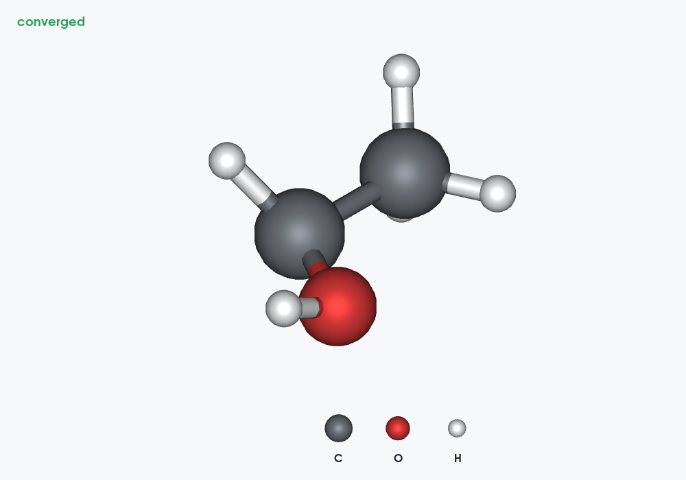

# LELE 2.7.0 validation — 2026-10-30

## Regression

**661 tests and 78 subtests passed**, with no failures, errors or skips, in 37.21 seconds.
All original 646 tests remain in the suite; 15 new cases cover this release.

Environment: Linux, Python 3.12.14, ASE 3.29.0, NumPy 2.3.5,
SciPy 1.17.0, PySide6 6.12.0, VTK 9.7.1, Pillow 12.3.0.
Qt uses the offscreen platform; native VTK capture uses EGL/software rendering.
A Windows EXE and the Windows desktop/window-manager behavior were not tested here.

```bash
QT_QPA_PLATFORM=offscreen VTK_DEFAULT_OPENGL_WINDOW=vtkEGLRenderWindow \
python -m pytest tests -q --junitxml=docs/qa_v2.7.0/full_v270.xml
```

Full results: [JUnit](qa_v2.7.0/full_v270.xml).

## Algorithms and complete numeric/record equivalence

The audit includes ORCA, Gaussian, CP2K stdout/XYZ, VASP OUTCAR/OSZICAR/XDATCAR,
xTB/g-xTB, SIESTA stdout/ANI, QE, NWChem and generic ASE imports.
The existing ORCA algorithm improvements are retained. Native output readers share
source text within one import and preserve all complete frames/records.

The benchmark compares complete 1,000- and 4,000-record files in 2.6.0 and 2.7.0.
The 16 main-format cases and four NWChem cases have matching complete-document digests.
The only fields excluded by the comparison are new frame convergence flags and
QE's newly added source line/job annotations. Coordinates, cells, all energies,
forces/criteria, orbitals, dipoles, spectra and existing associations remain in the digest.

Every case loads the entire file twice. The table reports median wall seconds,
excluding the post-load digest. Common readers are imported first; delayed imports
specific to a reader may still be included in its first repetition.
These synthetic cases use two atoms and deliberately exercise the relevant long-history
paths. They are reproducible examples, not universal speed guarantees.

| 4,000 records/modules | Loaded geometries | 2.6.0 seconds | 2.7.0 seconds | Speedup |
| --- | ---: | ---: | ---: | ---: |
| CP2K（每步 TD 表） | 4,000 | 0.8449 | 0.4243 | 1.99× |
| xTB（每步轨道快照） | 0 | 0.4314 | 0.1523 | 2.83× |
| Quantum ESPRESSO | 4,000 | 0.5625 | 0.0983 | 5.72× |
| VASP OUTCAR | 4,000 | 0.2646 | 0.2675 | 0.99× |
| SIESTA stdout | 4,000 | 0.1198 | 0.1138 | 1.05× |
| Gaussian | 4,000 | 0.5312 | 0.5077 | 1.05× |
| 普通 XYZ | 4,000 | 0.0844 | 0.0816 | 1.03× |
| XDATCAR | 4,000 | 0.1198 | 0.1165 | 1.03× |
| NWChem（每模块打印几何） | 4,000 | 0.4493 | 0.4381 | 1.03× |
| NWChem（连续无新几何的电子模块） | 2 | 41.2452 | 0.5018 | 82.19× |

The NWChem continuation case contains **4,000 electronic modules but only two
printed geometry snapshots**. It exercises the old cumulative-history fallback;
it must not be described as 4,000 independent geometry frames. Its final energies,
force summaries and two structures match the old reader exactly.

Raw reports: [main baseline](qa_v2.7.0/multistep_baseline.json),
[main current](qa_v2.7.0/multistep_current.json),
[main comparison](qa_v2.7.0/multistep_comparison.json),
[NWChem baseline](qa_v2.7.0/nwchem_baseline.json),
[NWChem current](qa_v2.7.0/nwchem_current.json),
[NWChem comparison](qa_v2.7.0/nwchem_comparison.json).

```bash
python tools/benchmark_multistep.py --data /tmp/lele-multistep --generate --output /tmp/new.json
python tools/benchmark_multistep.py --source /path/to/LELE-2.6.0 --data /tmp/lele-multistep --output /tmp/old.json
```

A separate xTB regression catches an old correctness issue: a subsequent ellipsis-decorated
CYCLE header could be consumed inside an orbital table without an HL-Gap footer.
The new parser retains all 2,003 cycles and their correct orbital-step associations.
That corrected malformed-boundary case is tested separately from equivalence benchmarks.

## Progress, cancellation and GUI lifetime

New tests exercise the real Qt event loop: a 0.7 s background calculation displays
an enabled delayed progress dialog, reports phase/elapsed time, runs off the GUI
thread and continues servicing a 10 ms timer. A quick task does not show a dialog.
A real Cancel-button click interrupts cooperative computation and propagates no
partial result; worker errors return to the GUI thread as the original exception.

Original tests continue to cover queued imports, cancellation without partial
documents, main-thread attachment, window close and ORCA timer service.
The older long-file test's busy QTest.qWait polling was replaced by an actual
QEventLoop: some PySide builds hold Python's GIL inside QTest.qWait, starving the
worker in a way the application's event loop does not.

Progress notifications suppress repeated identical/end-of-buffer values. Stage
counters are time-throttled. This avoids thousands of redundant completion events
and deliberate yields when a text buffer has read ahead to EOF.

Data calculations/project I/O use workers. Qt tables, Matplotlib canvas drawing
and VTK scene updates stay on the GUI thread with row/stage/algorithm checkpoints.
Single indivisible graphics/driver calls are not claimed to be interruptible.
Exports that cannot safely cancel while writing expose progress without a Cancel button.

## Optimization status and atom legend

Tests cover successful/unfinished ORCA, CP2K, VASP and QE records, NWChem final
success blocks, explicit job boundaries and a reprinted final QE geometry.
Existing xTB/Gaussian/ORCA tests retain the original calculation-step success logic.
Only mapped successful geometry frames receive the flag; energy-only/coordinate-only
records do not acquire an inferred status. Geometry edits clear it and undo restores it.

The legend regression checks visible-element uniqueness, order, per-atom custom color,
non-pickable unbonded samples, camera independence, disabling and unchanged source
coordinates/connectivity. Native VTK captures confirm that enabling it changes image
pixels and disabling it exactly restores the original capture without moving the
structure camera. A two-frame GIF with the legend renders and is decoded successfully.
The legend's setting also survives project serialization. Native illustrative output
was visually inspected:



The second welcome-page email is checked in the UI. Existing view/project tests
continue to cover isolated display settings between documents.

## CP2K vibrational files

[The release guide](FEATURES_v2.7.0_CN.md#cp2k-频率计算的输出文件) documents primary logs,
replica logs, optional Hessian/restart data and Molden `*-VIBRATIONS-*.mol` files,
with links to current official CP2K documentation. This release explains their
organization; it does not add CP2K Molden-mode import/animation.
