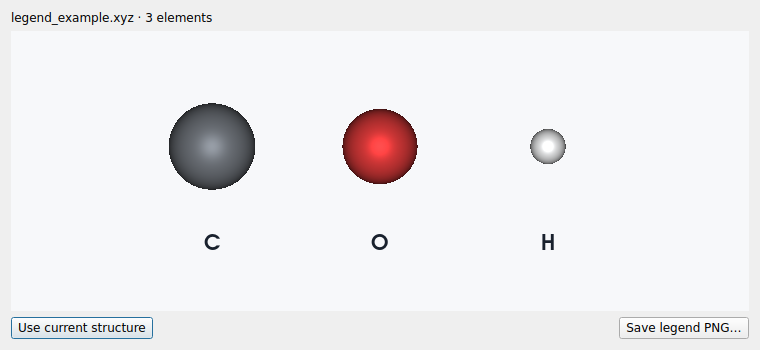
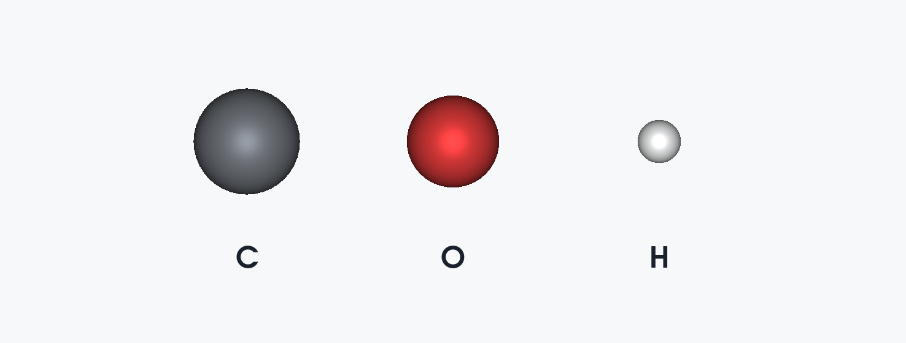

# LELE 2.8.0 validation — 2026-10-30

## Results

**673 tests and 78 subtests passed**, with zero failures, errors or skips, in **38.18 s**.
Environment: Linux, Python 3.12.14, ASE 3.29.0, NumPy 2.3.5,
PySide6 6.12.0, VTK 9.7.1. Qt uses its offscreen platform;
standalone VTK rendering uses EGL. A Windows EXE was not built or exercised here.

Relative to v2.7.0, 12 new cases cover Molden parsing and the separate legend window.
The three former overlay-specific tests now check independent sample scenes and
legacy project compatibility without recreating a main-canvas overlay.

```bash
LELE_CP2K_MOLDEN_EXAMPLE=/path/to/COF2_O2_a_freq-VIBRATIONS-1.mol \
QT_QPA_PLATFORM=offscreen VTK_DEFAULT_OPENGL_WINDOW=vtkEGLRenderWindow \
python -m pytest tests -q --junitxml=docs/qa_v2.8.0/full_v280.xml
```

[Full JUnit report](qa_v2.8.0/full_v280.xml). The supplied private calculation file
is not redistributed. Without that environment variable, the single optional
actual-file test is skipped; synthetic cases still exercise the reader.

## Supplied CP2K file

[Actual-file acceptance](qa_v2.8.0/supplied_molden_acceptance.json) records its filename,
SHA-256, atom/mode counts, frequencies and nonzero-vector atom indices.
The file contains 124 atoms and six modes at 239.777289, 252.259862, 312.216834,
318.175319, 324.214973 and 1548.774920 cm⁻¹. Every mode retains exactly zero rows
for the first 122 atoms; only O123/O124 move. All six modes can animate.

Checks include the Bohr→Å coordinate/vector conversion, unchanged frozen positions,
visual maximum-displacement amplitude, and native eight-frame GIF export of the
highest-frequency mode. The GIF is decoded again to verify frame count/dimensions.
No IR intensity, cell, energy, charge or periodicity is invented for this file.

## Parser and workflow regression

Synthetic tests cover content-based .mol/.molden/other-suffix detection, UTF-16,
ordinary MDL .mol compatibility, FR-COORD references, Atoms Angstrom fallback,
explicit Cell units without assumed PBC, negative frequencies, mode-number mapping,
partial trailing displacement data, source-unit INT values, cancellation, project
serialization, frequency controls and GIF availability. Existing Gaussian/ORCA/VASP
frequency and project workflows remain in the full suite.

Molden coordinates and displacements follow the original format specification;
CP2K's writer explicitly inserts zero rows for atoms outside its mobile-atom list.
The optional CP2K INT column is written in a.u./amu in its implementation, so the
new reader retains source units instead of using the default km/mol label.
Sources: [Molden format](https://www.theochem.ru.nl/molden/molden_format.html),
[CP2K writer](https://doxygen.cp2k.org/dc/dff/molden__utils_8F_source.html).

## Separate legend canvas

The actual production Qt canvas was opened, rendered, exported and closed on the
offscreen Qt platform. Its VTK scene renders offscreen, then Qt paints that image;
it does not embed another native OpenGL child window or share the structure camera.
An attempted native QVTK child widget could not initialize OpenGL in this environment;
that approach was replaced by the dedicated image canvas before final validation.

The automated production-canvas test verifies a nonempty rendered image, a PNG at
twice the canvas pixel dimensions, and cleanup. Another window test verifies the
menu action opens a distinct nonmodal canvas, exactly one sphere and one label per
visible element, correct source colors/hidden-atom handling, snapshot behavior,
explicit refresh, and unchanged main structure/camera/props. Legacy v2.7 project
flags round-trip without drawing any overlay in the main view.

Both final visual artifacts were inspected:





The images use a synthetic C/O/H sample, not the supplied molecular geometry.
