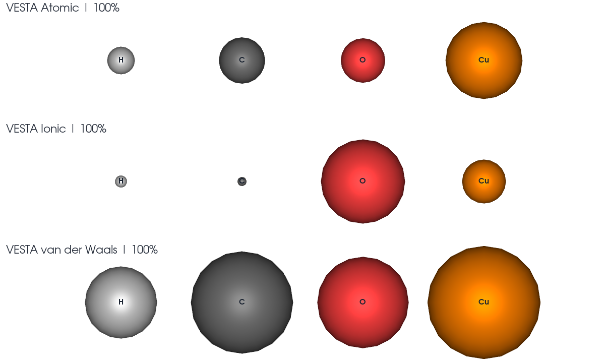

# LELE 2.9.0 validation — 2026-10-30

**686 tests and 78 subtests passed**, without failures, errors or skips, in
**39.30 seconds**. This includes the supplied 124-atom CP2K Molden example.
Environment: Linux, Python 3.12.14, ASE 3.29.0, PySide6 6.12.0, VTK 9.7.1.
Qt uses its offscreen platform and standalone VTK rendering uses EGL.
A Windows executable was not built or tested.

```bash
LELE_CP2K_MOLDEN_EXAMPLE=/path/to/COF2_O2_a_freq-VIBRATIONS-1.mol \
QT_QPA_PLATFORM=offscreen VTK_DEFAULT_OPENGL_WINDOW=vtkEGLRenderWindow \
python -m pytest tests -q --junitxml=docs/qa_v2.9.0/full_v290.xml
```

The private example is not redistributed. Without that environment variable,
one optional actual-file test is skipped. The final complete run used it.
See the [full JUnit report](qa_v2.9.0/full_v290.xml).

Thirteen new cases exercise ordinary-bond threshold boundaries and symmetry,
the separation of hydrogen-bond records, manual/rule precedence, frozen edited
graphs, periodic images and fragments, independent space-filling size controls,
all-frame model changes, document switching, project round trips and legacy
project connectivity. Existing geometry editing, animation, PNG/GIF, standalone
legend, periodic-cell and scientific import tests remain in the full suite.

The [reference acceptance record](qa_v2.9.0/reference_acceptance.json) lists
source-file hashes, table coverage, representative distances and the radii/colors
actually passed into the production renderer and legend sampling. Data cover
105 elements and 5,559 ordinary pair limits, 106 compatibility colors, and
97 VESTA radius rows including D/XX. No original upstream binary or configuration
file is included. The pinned extraction layouts and numeric facts are
reproducible with the bundled extractor.

This is LELE integration validation. The complete Chemcraft GUI pair table has
not been compared row by row, and the palette is Chemcraft's GaussView-style
compatibility preset rather than an independently verified native Gaussian RGB
export. See [source scope](display_reference_data.md).

The production renderer was rendered at three VESTA radius settings, at the
same camera scale and 100% size, with labels and the default compatibility
colors. The output was visually inspected, including the small ionic carbon
radius and the larger van der Waals spheres.

```bash
VTK_DEFAULT_OPENGL_WINDOW=vtkEGLRenderWindow python tools/render_reference_preview.py
```


