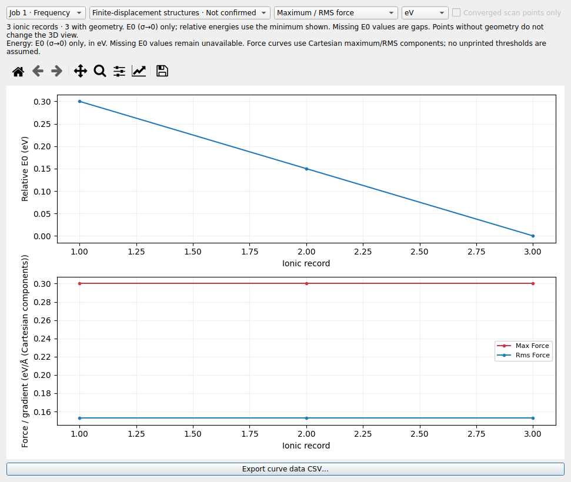

# LELE v2.3.1：VASP 只使用 E0

VASP 的能量统一采用电子展宽外推到 σ→0 的 **E0**：

| 文件 | 取值字段 |
| --- | --- |
| OSZICAR | 离子步汇总行的 `E0=` |
| OUTCAR | 离子步汇总中的 `energy(sigma->0)` |
| XDATCAR | 不提供能量，继续作为纯结构轨迹读取 |

E0 的定义参见 [VASP 官方 OSZICAR 文档](https://vasp.at/wiki/OSZICAR)。

## 显示与导出

- 文件树中的能量、Results / info、计算总览、频率参考结构和能量曲线统一使用 E0。
- 删除曲线中选择其他 VASP 能量类型的下拉框；纵轴显示 Relative E0。
- 曲线 CSV 的唯一能量列为 `energy_E0_eV`，仍保留离子步、结构帧、最大/RMS 力和源行号。
- 不再用 TOTEN/F 或 energy without entropy 填补缺失的 E0。缺失值在 CSV 中为空，
  在能量曲线上断线。该帧的结构和已有力数据仍可浏览。
- 文件只有其他能量、没有 E0 和结构时，保留结果说明页，注明没有 E0，不生成能量曲线或虚拟结构。

原始输出文本和解析时的源字段保留，用于追溯；它们不作为显示或能量导出的替代来源。
以前清除结构能量的编辑操作仍然生效，不从历史 E0 字段重新恢复当前结构的能量。

## 旧项目

打开已有 `.lele` 项目时，其 VASP 离子步、结构帧、当前/缓存频率参考结构和计算汇总
也使用同一策略。旧项目此前回退到其他能量、但没有 E0 的位置改为无可用能量。
振动任务的汇总继续对应其频率参考结构，避免误用最后一个有限位移结构的能量。

## 验证记录 — 2026-10-30

Linux / CPython 3.12.14，ASE 3.29.0、NumPy 2.3.5、PySide6 6.12.0、VTK 9.7.1，
Qt offscreen 与 EGL。未在本环境构建或运行 Windows EXE。

新增 9 项回归，覆盖 OSZICAR 优化/MD 的 E0 缺失、D/E 科学计数法、部分步缺失导致的
曲线断线和 CSV 留空、无 E0 文件的结果页、编辑后能量保持清除，以及旧项目的回退能量
和频率参考结构恢复。原 VASP 用例已改为检查只显示和导出 E0。

完整回归：**551 项测试和 78 项子测试全部通过**，零失败、零跳过。

```bash
QT_QPA_PLATFORM=offscreen VTK_DEFAULT_OPENGL_WINDOW=vtkEGLRenderWindow \
python -m pytest tests -q --junitxml=docs/qa_v2.3.1/full_v231.xml
```

报告：[full_v231.xml](qa_v2.3.1/full_v231.xml)。

实际输入 `OUTCAR_opt`、`OUTCAR_freq` 的逐帧 E0 与独立 ASE OUTCAR 读取结果对照，
`XDATCAR` 保持纯结构；同时检查实际能量曲线/CSV 和项目往返保存。详见
[actual_E0_v231.json](qa_v2.3.1/actual_E0_v231.json)。实际用户坐标不打包。

合成例子的曲线界面如下，已检查标题、E0 标识、按钮和绘图布局：



保留 v2.3.0 的元素对规则、多面体定量分析、项目保存以及此前其他功能。
使用 Windows EXE 时需重新运行 `build_windows.bat` 构建。
