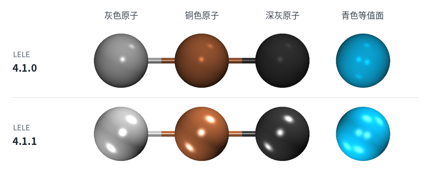

# LELE 4.1.1 高光验证

Style → Lighting 选择 Glossy。Highlight brightness 在 0 时关闭镜面反射，50 使用校准亮度，100 使用该材质的最高亮度。Highlight size 调节反光的宽窄。两个滑杆可分别保存在显示预设与 .lele 项目中。View → Lighting 可单独开关 Front、Upper right、Rear upper left 和 Lower left。默认开启前方、右上和左下三盏灯。

图中两行使用相同的结构、原子颜色、球半径、正交相机、白色背景、等值面和 80% 图层不透明度。原子质心与投影比例相同。图像由两版 LELE 分别渲染，仅裁去空白并加上行列标签。用户提供的 VMD 截图用于校准。

## 像素测量

在第二张参考图第一排选取七个无遮挡的灰球，球半径约 22 像素。统计距球心 0.78 倍半径以内的像素以排除轮廓、背景与键。用红、绿、蓝三个通道都达到 240/255 来判断近白高光。三处光斑在参考图中的近白像素合计占该区域的 9.9% 至 11.1%，七球平均约 10.4%。测试灰球的本色为 #ADADAD，铜色球为 #A05A34，深灰球为 #333333。

| 测量项 | 4.1.0 画布 | 4.1.1 画布 | 4.1.0 高清 PNG | 4.1.1 高清 PNG |
| --- | ---: | ---: | ---: | ---: |
| 灰球近白像素比例 | 0.27% | 10.34% | 0.27% | 10.56% |
| 灰球内部灰度中位数 | 129 | 165 | 129 | 165 |
| 铜色球内部蓝通道峰值 | 78 | 255 | 78 | 255 |
| 深灰球内部灰度峰值 | 76 | 255 | 76 | 255 |
| 半透明青色等值面内部红通道峰值 | 10 | 142 | 10 | 142 |

铜色球镜面中心的三个颜色通道均达到 255，有色原子的漫反射仍使用指定的 RGB。透射和背景会影响半透明等值面的实际像素亮度。ESP 色图继续使用原数据和查色表。

## 回归

在 Linux 下运行完整测试目录，2,420 项测试与 78 项子测试通过，0 项失败。14 项因缺少私有样例或可选依赖跳过。测试覆盖两个滑杆的独立作用、不同材质、原子颜色、映射场、半透明等值面、框选隐藏后的高清导出、保存项目以及旧项目中自定义灯位的保留。校准使用 Mesa llvmpipe 和 VTK OpenGL。独立安装包内 wheel 后，测试场景的画布和高清 PNG 均与源码运行结果逐像素一致。Windows 桌面未实机验证。[完整回归记录](regression.xml)
