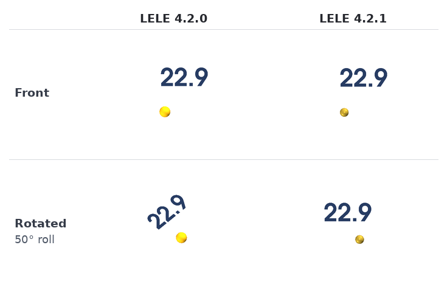

# LELE 4.2.1 验证

## 极值点与旧项目

用 v4.2.0 安装包将 `extrema_points.dat` 的五个极值保存到项目，在其中修改一个标签的位置、字号、粗体和颜色，并给另一个标签设置三维旋转。用独立安装的 v4.2.1 打开此项目，逐项核对了原始坐标、数值、标签位置和样式，另存后再次打开也能复现。

用两版程序分别导出正视和旋转后的 1440 × 1000 高清 PNG。在新版的两张图上，逐个核对了金色像素的落点和五个数值 **29.7、22.9、19.9、0.5、−46.7** 的文字像素。极值球半径由 0.10 Å 减至 0.08 Å，材质基色为 #D4AF37。下图截取其中的 22.9，左右使用相同的相机与字号。第二行的相机转过 32° 方位角和 18° 仰角，再绕视线滚转 50°。

在正交与透视相机下分别测试了旋转、滚转和替换相机。对齐变换后的标签锚点与文件坐标的预期投影一致，字框的两边始终平行于屏幕水平和垂直方向，画布上的选框和点击区域随同更新。旋转后拖动标签、撤销，以及普通三维自由文本的独立朝向也已验证。

另用两帧轨迹导出 GIF，在 50° 滚转和轨迹对齐同时生效的情况下核对了两帧的极值点位置与标签轮廓。

## 欢迎页

分别用鼠标单击和键盘回车激活欢迎页的 **LELE Manual**，核对传给系统浏览器的地址均为 <https://sjzhang0905.dpdns.org/lele/manual/>。

## 回归结果

Linux、Python 3.12、Qt 离屏界面与 VTK OpenGL 环境下，2,438 项测试和 78 项子测试通过。14 项因缺少外部样例或可选依赖而跳过。Windows 桌面尚未实机验证。[完整回归记录](regression.xml)
